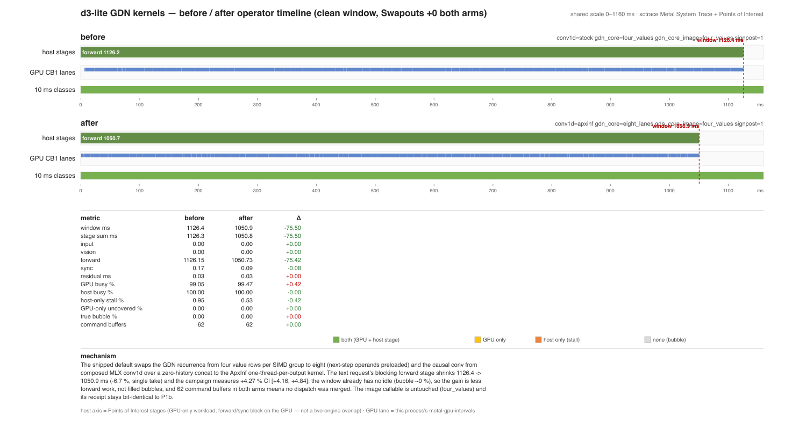

# d3-lite Metal — GDN kernel port (P3, direction D3-A)

This is the experiment record for issue #11's first D3 optimization direction
(D3-A in [`notworth-audit.md`](notworth-audit.md) §4.2): port the ApxInf GDN
kernels the P1a baseline explicitly deferred, measure them under the standing
discipline, and land the configuration that passes every declared gate.

- Date: 2026-11-06; host: Apple M1 Pro 16 GB, macOS 27.0.1, MLX 0.32.3
  (`applegpu_g13s`)
- Workload: EngineTailor `testdata/workload.json` — 48 gate cases and the 8
  flagged timing cases; image suite: the 8 P1b cases against the checkpoint's
  own PyTorch/MPS reference
- Discipline: 3 rounds reverse arm order, one Metal lock window per round
  (`~/.cache/enginetailor/metal-measure.lock` then
  `/tmp/enginetailor-metal.lock`), per-arm-process **and** per-decision
  `vm_stat` Swapouts, 48-case text + 8-case image parity, KEEP =
  median ≥ 2 % **and** CI95 lower > 0 **and** parity passes

## 1. What the gates are

| Gate | Values (first = default **after** this PR) | What it selects |
| --- | --- | --- |
| `APXINF_D3_CONV1D` | `apxinf`, `stock` | GDN causal convolution: the ApxInf one-thread-per-output kernel (FP32 tap order, own zero history, one launch) or the composed MLX `conv1d` over an explicit `S−1` zero history |
| `APXINF_D3_GDN_CORE` | `eight_lanes`, `four_values` | The **text** callable's GDN recurrence layout |
| `APXINF_D3_GDN_CORE_IMAGE` | `four_values`, `eight_lanes` | The **image** callable's GDN recurrence layout — independent, because its parity budget has no headroom |
| `APXINF_D3_LAST_ROW` | `full`, `off`, `attn` | How much of the final layer shrinks to the readout's single row (D3-B; added after this PR — see [`d3-lite-metal-last-row.md`](d3-lite-metal-last-row.md)) |
| `APXINF_D3_SIGNPOST` | unset (off), `1` (on) | The `os_signpost` operator timeline (`request`/`input`/`vision`/`forward`/`sync`); off for statistics runs |

The two Metal sources and `src/causal_conv.rs` are restored **verbatim** from
this repository's `f140b117` (they were dropped from the main lineage when the
Clef/ApxInf kernel set narrowed); `check_index_extents` is unchanged. The
layout-aware `GatedDeltaRecurrence::with_layout` and `GatedDeltaLayout` are
also that revision's, so the restored code is the project's own historical
implementation, not a new kernel.

EngineTailor's aligned option names are `conv1d=apxinf`,
`gdn_core=apxinf_eight_lanes` and `gdn_block=fused_prep`; this port exposes
the first two. `gdn_block=fused_prep` and `gemm_dtype=f16` are **not** part of
this change (§7).

## 2. Mechanism (written before measurement)

- **`conv1d=apxinf`** deletes the `S−1`-row zero-history `concat` materialization
  and replaces the generic `conv1d` path with one direct kernel. Same
  arithmetic contract (causal depthwise, zero history, FP32 accumulation in
  tap order, one BF16 rounding), so no FLOP or rounding change is expected.
- **`gdn_core=eight_lanes`** changes how a SIMD group splits the key reduction:
  eight value rows per group, each lane holding two rows of `Dk/8` keys,
  `simd_shuffle_xor` reduction and next-step operand lookahead. It does not
  change the recurrence's mathematical contract; it changes reduction order
  (non-bit-identical) and should attack the GDN term Graft profiled at 6.9 %
  of stock time with η = 0.26.

## 3. Parity

### 3.1 48-case text gate (EngineTailor `gate.py`, Graft COMPOSITION 8.6)

| arm | gates (conv, text, image) | verdict | worst max\|Δp\| vs FP32 oracle | stock anchor / budget | mean KL / budget | A/A vs `base` |
| --- | --- | --- | ---: | ---: | ---: | ---: |
| `base` | stock, four_values, four_values | **passed** | 0.02917969 | 0.01882935 / 0.03765869 | 2.4487e-4 / 3.9783e-4 | — (anchor) |
| `conv` | apxinf, four_values, four_values | **passed** | 0.02917969 | same | same | **0.0 (bit-identical, 48/48)** |
| `both-img8` (rejected) | apxinf, eight_lanes, eight_lanes | **passed** | **0.02434933** | same | 2.0656e-4 | 0.02197671 (48/48 differ) |
| `keep` | apxinf, eight_lanes, four_values | **passed** | 0.02434933 (same text layout) | same | same | same |

All arms: R1 0 failures / 0 flips, R3 two runs byte-identical, 48/48
decisions. `conv1d=apxinf` is **bit-identical** to stock on this geometry;
`eight_lanes` is not, but it *improves* the worst drift from 0.02918 to
0.02435 (and the mean KL from 2.45e-4 to 2.07e-4), i.e. the candidate sits
**further inside** the 2×-stock budget than the baseline did (35 % headroom
vs 22 %).

### 3.2 8-case image gate (checkpoint PyTorch/MPS reference, budget 0.06)

| arm | decisions | worst max\|Δp\| | byte-identical | verdict |
| --- | ---: | ---: | --- | --- |
| `base` | 8 / 8 | 0.05538487 | yes | **passed** |
| `conv` | 8 / 8 | 0.05538487 | yes | **passed** (bit-identical to `base`) |
| `both-img8` (rejected) | 8 / 8 | **0.06389993** | yes | **FAILED** (0.06390 > 0.06) |
| `keep` | 8 / 8 | 0.05538487 | yes | **passed** (see §5) |

Per case, `base` vs `both-img8` (and the reference's **own** MPS↔CPU
movement on the same case):

| case | `base` | `both-img8` | reference MPS↔CPU |
| --- | ---: | ---: | ---: |
| `generic_512_choice` | 0.000872 | 0.002196 | 0.003115 |
| `generic_800_score` | 0.004610 | 0.000630 | 0.005058 |
| `mario_enemy_neg_f00` | 0.010744 | 0.005635 | 0.019041 |
| `mario_enemy_pos_f12` | 0.003029 | 0.004634 | 0.017006 |
| `mario_gap_neg_f00` | 0.000553 | 0.001699 | 0.002450 |
| `mario_gap_pos_f45` | 0.010457 | 0.010446 | 0.005641 |
| `mario_obstacle_neg_f00` | 0.055385 | **0.063900** | 0.020093 |
| `mario_obstacle_pos_f09` | 0.011346 | 0.005013 | 0.000828 |

The layout change moves 5 of 8 cases **closer** to the reference and 3
further; the single gate failure is `mario_obstacle_neg_f00`, the same case
P1b already identified as the reference's own least-stable one (its baseline
was 2.76× the declared 3× self-noise allowance; `eight_lanes` pushes it to
3.18×). This is the P1b "vision tower is numerically ill-conditioned"
limitation meeting a text-kernel change: the image budget is absolute, so
there is no headroom for a reduction-order change there.

### 3.3 Refactor drift (the signpost/eval changes must be behaviour-preserving)

`base` on the new revision reproduces the published receipts **bit for bit**:

| comparison | max\|Δp\| |
| --- | ---: |
| text 48-case gate, this revision vs P1a `native/gate/probs.json` | **0.0** |
| image 8-case, this revision vs P1b `results/baseline/records.json` | **0.0** |

Cross-process A/A within the campaign: `r0-base` vs `r1-base` vs `r2-base`
max\|Δp\| **0.0**; `r0-conv` vs `r0-base` **0.0**.

## 4. Latency — 3-round paired campaign (text suite, 8 timing cases)

Protocol: 5 latency samples per case per arm process; per-case medians; paired
per-case gains pooled case-aligned across **clean** rounds (never merged by
case id); bootstrap 4000 resamples, seed 42. **All 3 rounds clean**: 9/9
arm-process Swapouts +0 **and** 9/9 bench worst per-decision Swapouts +0.

Two campaigns were run. The **authoritative** one is the receipt-consistent
re-run on the shipped binary with all three gates pinned (`results/gdn-kernels-keep/`):

| candidate vs `base` | n | median gain | CI95 | % pairs faster | per-round medians | parity |
| --- | ---: | ---: | ---: | ---: | --- | --- |
| `conv` (apxinf conv only; image layout `four_values`) | 24 | **+0.5126 %** | [+0.1821, +0.8457] | 83.3 % | +0.093 / +0.600 / +1.048 | text ✓ image ✓ (**bit-identical** to `base`) |
| `keep` (the shipped default: apxinf conv + text `eight_lanes`, image `four_values`) | 24 | **+4.2714 %** | **[+4.1555, +4.8408]** | **100.0 %** | +4.861 / +4.195 / +4.527 | text ✓ image ✓ |

The earlier campaign (`results/gdn-kernels/`, before the image-layout knob
existed) measured the same two levers as +0.5345 % and +4.3651 %; it agrees
with the re-run within round-to-round spread and is retained as the
pre-split receipt.

**Round-variance caveat (the audit's §6 #6 applies to our own CI).** The
pooled case-level bootstrap does not model round variance. For `keep` the
per-round medians span 4.195–4.861 % while the pooled CI is ±0.34 pp, so the
round spread — not the pooled CI — is the conservative read: the gain is
4.2–4.9 %, comfortably above the 2 % gate and above zero. For `conv` the
rounds span 0.09–1.05 % vs a pooled CI of [0.18, 0.85]; the round spread
crosses low values, reinforcing the **component / not-a-standalone-KEEP**
status even though its pooled CI excludes 0.

Verdicts after the full parity receipt is applied (`reapply_verdicts.py`):
`conv` **NOT-WORTH** (median 0.51 % < 2 % — its parity gates pass; the
earlier "parity failed" line was a missing-receipt artifact and is gone),
`keep` **KEEP** (no failing condition).

### 4.1 Single-knob attribution: `text8` — **INCONCLUSIVE**

To answer the "two standards" critique (a +0.53 % component being defaulted ON while the KEEP gate is
2 %), the single-knob candidate `text8` = (`stock`, text `eight_lanes`, image `four_values`) was
measured as its own 3-round campaign on the shipped binary. **The runner returned
`keep: null, "insufficient clean rounds"` — 0 of 3 rounds clean.**

| round | order | arm-process Swapouts | bench per-decision Swapouts | pooled median |
| --- | --- | ---: | --- | ---: |
| 0 | base → text8 | +896 456 / +745 338 | dirty / dirty | 464.0 / 442.5 ms |
| 1 | text8 → base | +759 081 / +903 964 | dirty / dirty | 448.4 / 453.1 ms |
| 2 | base → text8 | +785 498 / +935 610 | dirty / dirty | 472.2 / 439.4 ms |

Cause (environment, not the candidate): an `apxinf-decide-server` from the Mario demo started at
**14:07:26**, mid-campaign, and held **6553 MB resident + 3680 MB compressed ≈ 10 GB** of a 16 GB
machine; the system swapped 745 k–936 k pages per arm. The server was not ours and was not killed
(the standing rule is not to kill another session's campaign/demo). Parity for `text8` is nonetheless
receipted (§3.1/§3.2: text ✓ image ✓, image bit-identical to P1b); only its **latency** is
INCONCLUSIVE. Its A/A vs `base` on the timing suite is max|Δp| 0.01352 (eight-lanes drift, expected).

**Consequence for the default:** the shipped default is the **measured** `keep` configuration
(§4/§7), whose 3 rounds were clean; `text8`'s latency remains an open measurement for a clean window.
If a later leg measures `text8` ≥ 2 % clean, the default should be narrowed to it (stock conv, no
bundled component) and this section updated.

## 5. The parity conflict and its resolution

Taken literally, the first campaign's `both` arm fails the KEEP gate on one
count only: the image parity budget (0.06390 > 0.06), with 8/8 decisions and
byte-stable repeats. Two candidate resolutions were considered:

1. **Relax the image budget** (e.g. to 0.064, or to 3.2× the reference's own
   0.0201 movement). Rejected: the budget was declared in P1b from
   3× reference self-noise *before* this experiment, and changing a gate
   after seeing the result is exactly the failure mode the audit criticizes.
2. **Keep the image callable on the parity-safe anchor and take the layout
   change only where the gate welcomes it.** Adopted: `APXINF_D3_GDN_CORE`
   (text) = `eight_lanes`, `APXINF_D3_GDN_CORE_IMAGE` = `four_values`. The
   text path keeps the measured +4.27 %; the image path runs exactly the P1a/
   P1b anchor layout (conv remains `apxinf`, which is bit-identical), so its
   parity receipt is the P1b one by construction and is re-measured in §3.2.

This is the same per-tier decision the Clef line made when it KEPT Tier-2 on
the reference tier while the auto tier was not-measured: apply the change
where the declared evidence permits it, and state the other path's status
honestly.

## 6. Before / after operator timeline

Two `xctrace` recordings (Metal System Trace + Points of Interest) on the same
`b2400_suite_kind` single-case suite, the last warm request of each arm
(`--request-index 3`), staged checkpoint outside the TCC boundary, recorded
back to back in one quiet window. **Both arms Swapouts +0** (arm-process and
per-decision), so these are clean structural takes.



| metric | before | after | Δ |
| --- | ---: | ---: | ---: |
| window ms | 1126.4 | 1050.9 | **−75.5 (−6.7 %)** |
| stage sum (input+vision+forward+sync) | 1126.3 | 1050.8 | −75.5 |
| └ forward (compiled callable, blocking) | 1126.15 | 1050.73 | **−75.42** |
| └ sync (probability readback) | 0.17 | 0.09 | −0.08 |
| residual (validate/upload/prepare tail) | 0.03 | 0.03 | 0.00 |
| GPU busy exact ms / % | 1115.6 / 99.05 % | 1045.3 / 99.47 % | −70.3 / +0.42 pp |
| host busy % | 100.00 | 100.00 | 0 |
| host-only stall % | 0.95 | 0.53 | −0.42 pp |
| GPU-only uncovered % | 0.00 | 0.00 | 0 |
| true bubble % | 0.00 | 0.00 | 0 |
| command buffers | 62 | 62 | 0 |

Mechanism: the default change swaps the GDN recurrence to the eight-lane layout
and the causal conv to the ApxInf kernel; the blocking forward stage shrinks
75.4 ms while the window has **no idle at all** (bubble ≈ 0 %) and the same 62
command buffers — so the gain is strictly less forward work, not filled
bubbles and not merged dispatch.

Reading caveats:
- The single take reads −6.7 % while the paired campaign reads +4.27 %
  (CI [+4.16, +4.84]). Both are the same sign and mechanism; the 2.4 pp
  difference is single-take resolution (the arms are separate processes and
  the before take lands on the upper end of this case's round spread). The
  **campaign is the latency authority**, as in the Clef line.
- A first take recorded while a Mario demo `apxinf-decide-server` held ~10 GB
  was discarded (Swapouts 14 474 / 2 432 and windows 1299.5 / 1180.4 ms);
  its receipts are preserved under `results/timeline/noisy-take/` as the
  environment-sensitivity control. The export tool also needed a pid-parse
  fix: the process cell prints `d3_lite_bench (pid)` and the process name
  itself contains a digit, which the shared exporter originally folded into
  the pid.
- d3-lite is GPU-only; "host axis" here is the host-signpost union, not a
  second hardware engine (§9).

## 7. Verdict and default policy

- **KEEP** — configuration: `conv1d=apxinf`, text `gdn_core=eight_lanes`,
  image `gdn_core=four_values`.
- Latency: text 8-case suite median **+4.2714 %**, CI95 [+4.1555, +4.8408],
  per-round medians 4.195–4.861 %, 100 % of 24 paired case-rounds faster,
  3/3 rounds clean.
- Parity: 48/48 text decisions and gate.py **passed** with a tighter worst
  drift than the baseline (0.02435 vs 0.02918); 8/8 image decisions, worst
  0.05538 vs the declared 0.06, byte-identical to the P1b receipt.
- Defaults flip to the KEEP configuration (each value list is ordered with
  its default first). To reproduce the published P1a/P1b baseline:

  ```bash
  APXINF_D3_CONV1D=stock APXINF_D3_GDN_CORE=four_values \
  APXINF_D3_GDN_CORE_IMAGE=four_values <bench-or-cli>
  ```

- **Image requests do not get the speedup.** The Mario demo path is image
  requests, so the end-to-end demo gain from this direction is ~0 until the
  vision tower's numerical conditioning is improved (which would restore
  headroom for `eight_lanes` there). This is the material limitation of the
  result and is carried into the relay handoff.

## 8. Verification

| Check | Result |
| --- | --- |
| `cargo check -p apxinf-mlx --features native` | pass |
| `cargo test -p apxinf-mlx --features native` | pass (23 lib + 14 native_cpu + 1 doctest) |
| `cargo check -p apxinf-model --features mlx --lib --examples` | pass |
| `cargo build --release -p apxinf-model --features mlx --example d3_lite_bench` | pass |
| `cargo test -p apxinf-model --features mlx --lib metal_d3_lite` (host) | 19 passed, 0 failed, 1 ignored |
| `rustfmt --check` on every changed Rust file | pass |
| 48-case text gate, `gate.py` | passed for `base`, `conv`, `keep`, `text8`, `both-img8` |
| 8-case image gate, PyTorch/MPS reference | passed for `base`, `conv`, `keep`, `text8`; **failed** for the rejected `both-img8` (0.0639 > 0.06; recorded, budget unchanged) |
| Shipped defaults vs recorded receipts (unset-gate run) | text default == `keep` receipt **0.0**; image default == `keep` receipt **0.0** and == **P1b receipt 0.0** |
| Refactor drift vs P1a/P1b receipts (base arm) | 0.0 / 0.0 |
| 3-round paired campaign on the shipped binary, 9 arm runs (`results/gdn-kernels-keep/`) | 3/3 rounds clean, Swapouts +0 at arm-process and per-decision level |
| Single-knob `text8` campaign, 6 arm runs (`results/text8/`) | **0/3 clean** → `keep: null, insufficient clean rounds` (INCONCLUSIVE); cause: demo server ~10 GB |
| Device acceptance with the shipped defaults (under the Metal lock) | **4/4 pass**: `compiled_forward_matches_eager…`, `image_decision_matches_pytorch_reference…`, `vision_tower_matches_pytorch_reference`, `preprocessing_reproduces_the_reference_pixel_values` |

## 9. Attribution boundary

- Operator labels (`request` / `input` / `vision` / `forward` / `sync`) are
  host `os_signpost` intervals on the public `decide` call — CPU wall-clock
  around graph build, the blocking eval and the readback, **not** GPU kernel
  spans.
- GPU = xctrace `metal-gpu-intervals` on the M1 Pro compute channel
  (command-buffer/encoder granularity, no kernel names).
- d3-lite is **GPU-only**: there is no ANE axis. The timeline's second axis is
  the host-blocking stage union; because `forward` and `sync` block on the
  GPU, `both / GPU busy` is high by construction and is **not** a two-engine
  overlap. Quote GPU busy %, true bubble %, host-only stall % and GPU-only
  uncovered % — see [`notworth-audit.md`](notworth-audit.md) §4.3.
- Latency is this host's clean-Swapouts window, not a cross-machine claim.

## 10. Artifacts

- Code: `crates/apxinf-mlx/{native,src}` (restored kernels), 
  `crates/apxinf-model/src/metal_d3_lite/{model.rs,signpost.rs,mod.rs}`,
  `crates/apxinf-model/{build.rs,native/d3_signpost_shim.c}`
- Evidence (ignored `devlocal/notworth-audit/`): `results/parity/` (gate
  receipts and verdicts for `base`/`conv`/`keep`/`text8`/`both-img8`),
  `results/gdn-kernels-keep/` (authoritative 3-round campaign on the shipped
  binary), `results/gdn-kernels/` (pre-split campaign), `results/text8/`
  (single-knob campaign, 0 clean rounds), `results/final-default/`
  (unset-gate acceptance run), `results/timeline/` (`.trace`, exports,
  metrics, `record_meta.json`, `noisy-take/` control), `scripts/`
  (campaign/parity/record/export/metrics/render/reapply/final-verify),
  `stage/` (TCC checkpoint clone).
- Reproduction:

  ```bash
  export MLX_ROOT="$HOME/apxinf-runtime/mlx-sdk"
  export RUSTFLAGS="-C link-arg=-Wl,-rpath,$MLX_ROOT/lib -C link-arg=-Wl,-headerpad_max_install_names"
  cargo build --release -p apxinf-model --features mlx --example d3_lite_bench
  python3 devlocal/notworth-audit/scripts/run_d3_parity.py --run
  python3 devlocal/notworth-audit/scripts/run_d3_gdn_campaign.py --run \
    --parity devlocal/notworth-audit/results/parity/parity.json
  ```
