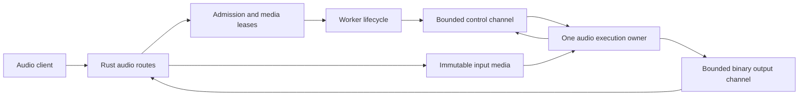

# ApxInf audio serving proposal

Date: 2026-10-25. Status: design proposal, without an implementation or approved runtime profile.
This proposal extends local serving to automatic speech recognition and text-to-speech.
The [community research](audio-community-research-20261025.md) records external observations separately from these design choices.
The existing [contract](contracts-v0.1.md) retains authority.
This proposal does not activate new wire fields or change the text profile.

## Scope and decisions

The first audio release targets completed recordings and complete text inputs on Apple Silicon.
It uses one configured resident audio model and one active operation.
The operator selects either an ASR deployment or a TTS deployment.
These modes do not imply simultaneous ASR, text generation, and TTS residency.

The design retains Rust for ingress, admission, deadlines, public transport, and process supervision.
A separate worker owns audio preprocessing and model execution.
The adapter calls approved dependency APIs.
Authors write the adapter, validators, tests, and fixtures by hand.

The first deployment keeps provider pipelines within one worker process.
It does not create separate processes for each encoder, generator, decoder, and vocoder.
Later measurements can justify stage separation or pipelining.
The deployment manifest identifies every internal model component, including a separate codec or vocoder.

## Current constraints

The current [gateway](../../crates/apxinf-serving/src/gateway.rs) exposes only the declared text APIs and service observations.
The current [supervisor](../../crates/apxinf-serving/src/supervisor.rs) combines lifecycle handling with text preparation and text output parsing.
The [worker](../../python/apxinf/apxinf/serving/text_worker.py) uses a pinned MLX-LM text runtime.
Its prepared input, output events, usage, and stop boundaries count text tokens.

Audio requires its own payload and event variants.
Waveform samples must not appear as token IDs or text deltas.
Audio output must bypass tool parsing and text stop matching.
The 1 MiB text JSONL limit remains unchanged.

The [implementation plan](implementation-plan.md) lists a general device arbiter as proposed work.
The current service has no implemented global arbiter for independent resident models.
Two independently budgeted supervisors cannot establish safe combined device capacity.

## Terms

| Term | Meaning |
| --- | --- |
| ASR | Automatic speech recognition that converts input audio to text. |
| TTS | Text-to-speech generation that converts input text to audio. |
| PCM | Pulse-code modulation with an explicit numeric sample format. |
| PCM frame | One sample for every channel at one position in time. |
| audio chunk | A contiguous interval of PCM frames with one fixed format. |
| completed recording | Audio whose entire input is available before inference starts. |
| native audio streaming | The model produces playable audio before it completes synthesis of the whole input. |
| segmented synthesis | Independent synthesis of successive text segments. |
| partial transcript | A replaceable hypothesis for an identified input interval. |
| final transcript segment | A transcript segment that the service will not revise. |
| media lease | Accounted ownership of uploaded, prepared, or buffered audio bytes. |
| TTFA | Time from request ingress to the first playable audio available at the stated observation point. |
| RTF | Processing elapsed time divided by the corresponding audio duration. |

A model's final transcript segment does not imply request completion or resource settlement.
Native audio streaming does not imply incremental text input or persistent acoustic state.
An open network connection does not imply a persistent model session.

## Architecture

This diagram describes ownership and transport, not implemented module names.
Control and binary readers handle bytes without mutating model state.
Only the execution owner loads models, creates device objects, advances inference, and completes device cleanup.
The worker keeps model-specific preprocessing, codec, and vocoder scheduling behind one adapter.

Common lifecycle code owns identities, public deadlines, cancellation, process state, reservations, and settlement.
Operation adapters own input validation after preparation, output validation, operation usage, and completion conditions.
The text adapter retains templates, token accounting, stop matching, and tool parsing.
The audio adapters retain sample ranges, transcript revisions, and audio formats.

## Public API sequence

The proposed compatibility scope is explicit and smaller than the full upstream audio APIs.
The implementation must publish a parameter matrix before it exposes a route.
Unknown fields produce validation errors.
Known but unsupported capabilities produce `unsupported_feature` before execution.

| Route | First proposed behavior | Later extension |
| --- | --- | --- |
| `POST /v1/audio/transcriptions` | One completed WAV upload, final JSON transcript, explicit model and language policy. | File-result streaming and supported timestamps. |
| `POST /v1/audio/speech` | Complete text input, explicit model and voice, completed WAV output. | Native PCM streaming and a checked SSE profile. |
| `GET /v1/models` | Model discovery with task capability information in a documented extension. | Multiple configured tasks after shared admission exists. |
| `GET /readyz` | Selected model, task, revisions, pressure, and declared audio limits. | Separate task readiness after multi-model admission exists. |
| `WS /v1/realtime` | Unavailable in the first audio release. | A separately versioned transcription session subset. |

The first transcription profile accepts PCM16 little-endian WAV, mono, at 16 kHz.
It rejects compressed containers, unsupported rates, and unsupported channel layouts.
This narrow profile avoids an initial general media decoder dependency.
Later decoding and resampling require explicit preprocessing identities and their own quality checks.

The first speech profile accepts `model`, `input`, `voice`, and `response_format="wav"`.
An omitted format uses the documented WAV default for this local profile.
That default differs from upstream services that default to MP3.
Other fields require an explicit capability entry before acceptance.
The initial profile uses speed `1.0`.
Reference audio, voice uploads, instructions, and voice design require later profiles.

The streaming extension uses `response_format="pcm"` with a declared `stream_format`.
Raw audio and SSE are separate response modes.
The exact SSE event schema and error mapping require a compatibility fixture set before release.
The service must not claim full OpenAI compatibility from route names alone.

## Input and output interfaces

These are candidate data shapes, not current Rust or Python types.
Stage A0 must promote the selected shapes into the canonical contract.
It must define exact integer ranges, optional fields, errors, and resource effects there.
The contract, handwritten types, validators, and original fixtures must change together.

| Proposed shape | Required information | Owner |
| --- | --- | --- |
| `AudioCapabilities` | Task, input modes, output modes, formats, languages, voices, limits, and cancellation boundary. | Immutable worker capability revision. |
| `AudioManifest` | Model artifacts, runtime, provider, precision, preprocessing, text frontend, voice assets, codec, and vocoder identities. | Supervisor verification and worker readiness. |
| `AsrInput` | Owned media handle, actual format, frame count, content digest, and language policy. | Gateway media owner, then worker lease. |
| `TtsInput` | Exact input text, approved voice identity, language policy, and output format. | Request adapter and execution owner. |
| `AudioChunk` | Execution key, event sequence, payload length, PCM format, first frame, and frame count. | Worker producer and checked binary receiver. |
| `TranscriptSegment` | Segment identity, revision, replacement text, input frame interval, and finality. | ASR adapter. |
| `AudioUsage` | Input frames, output frames, bytes, and operation-specific optional token measurements. | Checked worker measurements. |

Every attempt retains `(worker_epoch, request_id, attempt)` and its selected model and capability revisions.
Audio event sequences and frame ranges must be contiguous within their declared scope.
A partial replaces the previous hypothesis for the same segment.
A final segment is immutable.
Frame positions refer to the declared audio timeline, not text tokens.

Resampling requires separate source and model frame counts with a recorded mapping.
VAD requires original timeline offsets even when it removes silence from model input.
Timestamp support and speaker diarization remain separate capabilities.
The service must not derive word timestamps from coarse segment boundaries.

The first ASR adapter emits one final result and does not expose partial hypotheses.
The later streaming adapter must declare either append-only stable deltas or replaceable segment revisions.
A public append-only endpoint must not append an unstable replacement as new text.

## Local media transport

The proposal adds a distinct, explicitly negotiated audio protocol.
The existing `apxinf-worker/2.0` text profile retains its wire behavior.
The new protocol identifier, handshake, and frame schema remain Stage A0 decisions.

The initial ASR upload becomes an immutable, service-owned local file.
The gateway accounts for incoming bytes before accepting the body.
It publishes the handle only after bounded parsing and format checks finish.
Clients cannot supply arbitrary local paths or remote audio URLs.

A media handle binds content identity, exact size, actual format, request ownership, and cleanup conditions.
The worker opens only handles that the supervisor grants through the private service namespace.
The protocol must prevent handle reuse, path traversal, and replacement after validation.
Cleanup waits for worker release or observed process reaping.

Streaming output uses a private framed local binary channel, separate from control JSONL.
The supervisor creates and passes the connected endpoint to the worker.
The negotiated frame binds payload bytes to an execution key, event sequence, format, and frame interval.
The receiver checks declared length before allocation and reads exactly that length within a deadline.
Invalid framing fences the worker channel.

The initial implementation can use a Unix socket pair with separate receive tasks.
It must specify the fixed header, bounded metadata, endianness, and truncated-frame behavior in Stage A0.
Raw PCM does not pass through JSONL or text output parsers.
An external SSE mode can encode checked chunks as base64 without changing the internal binary protocol.

Control delivery and terminal delivery retain reserved capacity.
A full audio data queue must not block cancellation, terminal validation, or resource release messages.
Cross-channel arrival order is not authoritative.
Success waits for all declared output frames and the matching settlement record.

The terminal record states the final event boundary and generated frame count.
Valid in-flight data can arrive after the control terminal within the declared boundary and receive deadline.
The binary receiver retains bounded reorder capacity until that deadline.
The receiver rejects missing, duplicate, late, or conflicting frames.
Late means beyond the declared boundary, after the receive deadline, or from an ended epoch.

EOF without a valid terminal record is a failure.
No data channel is reusable after its epoch ends.

Completed WAV output transfers from worker ownership to an accounted gateway media lease before worker settlement completes.
The gateway keeps that lease until sending completes or the connection closes.
Worker settlement does not wait for client playback or release the gateway's retained media quota.

## Backpressure and lifecycle

Every request has separate generated, gateway-accepted, and network-written frame positions.
Network-written audio does not prove client playback.
Cancellation suppresses future public output at a checked frame boundary.
Already transmitted samples remain observable and cannot be withdrawn.

Buffer limits count bytes, frames, and buffered duration.
Chunk counts alone do not bound memory or playback delay.
The service cancels a slow consumer within a fixed send deadline.
The worker checks cancellation at its declared encoder, generation, or vocoder boundary.

A provider callback or iterator does not establish a bounded cancellation interval.
Acceptance tests must measure the longest uninterruptible step.
If graceful cleanup cannot finish within its declared grace, the supervisor stops and reaps the worker.
Uncertain resources remain reserved until reaping succeeds.

Public expiry, worker terminal, device completion, media cleanup, and resource settlement remain separate events.
Each logical request records one public terminal outcome.
A terminal control record does not return memory by itself.
Published partial audio disables transparent replay of that request.

After streaming headers, raw PCM cannot carry a structured JSON error.
The gateway aborts an invalid raw response and never treats its EOF as checked success.
Clients that require a terminal success marker use the checked event-stream profile.
The service documents raw PCM's weaker completion evidence.

Signals remain active during loading, execution, and replacement loading.
Shutdown waits for active settlement and worker reaping.
The existing 20-second HTTP drain limit starts after worker reaping.
New upload and output tasks must also have deadlines and owned cleanup.

## Capacity and scheduling

The first profile uses one operation at a time and a bounded FIFO queue.
Queued media has a separate ingress lease before model execution admission.
Resident models, active work, and pending reclaim share the same physical device budget.
Filesystem quota, host buffers, and device reservations remain distinct accounting dimensions.

| Accounted component | Examples |
| --- | --- |
| Resident runtime | Weights, tokenizer or text frontend, audio codec, vocoder, and allocator reserve. |
| Prepared input | Uploaded bytes, normalized PCM, features, and model-specific encoder input. |
| Active execution | Encoder workspace, decoder state, audio tokens, vocoder overlap, and temporary tensors. |
| Output ownership | PCM chunks, event encoding, network buffers, and completed WAV storage. |
| Pending reclaim | Outstanding device work, retained media handles, and unconfirmed worker exit. |

ASR admission uses duration, frames, frontend shape, and measured runtime capacity.
TTS admission uses text limits, model token limits where available, and an explicit audio output ceiling.
Text length alone does not bound generated audio duration.

The adapter must enforce output ceilings during generation and before large allocations.
Truncating a completed waveform does not establish bounded generation memory.
The provider must expose a checked stopping boundary or a proven allocation bound for the selected input domain.
The existing text context formula cannot substitute for either estimate.

Before simultaneous text and audio residency, one shared owner must grant device reservations and compute permits.
Priority may favor live ASR and TTS playback only at tested safe execution boundaries.
A long text prefill cannot become preemptible through a priority queue alone.
Fairness and starvation limits require mixed-workload tests before activation.

## Candidate limits for the first profile

This proposal uses the following candidate guardrails for review and boundary tests.
They are not measured memory limits, latency guarantees, or approved deployment defaults.
Stage A0 must freeze the chosen values before implementation.
Stage A1 must show that the selected model fits within them.

| Item | Candidate bound |
| --- | --- |
| ASR input | PCM16 WAV, mono, 16000 frames per second, at most 30 seconds. |
| Encoded upload | At most 2 MiB, including bounded WAV metadata. |
| TTS input | At most 4096 Unicode scalar values and 16 KiB of UTF-8 text. |
| TTS output | At most 60 seconds and 8 MiB of PCM, whichever limit occurs first. |
| PCM chunk | At most 64 KiB, aligned to whole PCM frames. |
| In-flight output | At most 512 KiB per active request, including encoding expansion where applicable. |
| Ingress and queue | At most two uploads in progress and four waiting requests. |
| Aggregate media quota | At most 32 MiB across ingress, queued, active, and completed media awaiting release. |
| Upload timeout | At most 15 seconds, within the original request deadline. |
| Queue timeout | At most 5 seconds, within the original request deadline. |
| Request deadline | At most 120 seconds from ingress, including upload and preparation. |
| Output send timeout | At most 5 seconds for a stalled client. |

The selected TTS capability declares the actual output rate and channel count.
The adapter does not silently resample to fit a fixed public rate.
The first model should support mono PCM output through an approved conversion path.
Chunk cadence targets need separate measurement and must fit the byte and duration bounds.

Missing content length does not bypass the actual byte counter.
WAV metadata and payload lengths require consistency checks before inference.
Allocation checks use checked arithmetic for frames, channels, widths, and feature dimensions.
Later compressed formats require incremental decoded-size limits before large allocations.

## Dependency candidates

This proposal approves no dependency and installs none.
The [research record](audio-community-research-20261025.md#依赖和运行设置差异) identifies current version differences.
The text runtime environment retains its existing pins.

| Candidate | Role | Approval evidence |
| --- | --- | --- |
| MLX Audio at a fixed revision | Public ASR and TTS model APIs on Apple Silicon. | Exact environment, model APIs, global setting effects, quality, cleanup, and memory checks. |
| Standard WAV parser or a small maintained audio dependency | Bounded PCM16 WAV input and completed output. | Parser limits, malformed inputs, channel and frame arithmetic, and explicit dependency ownership. |
| whisper.cpp at a fixed revision | Alternative native ASR worker or independent comparison. | Model conversion identity, backend selection, process integration, and quality checks. |
| sherpa-onnx at a fixed revision | Later online ASR or CPU audio worker. | Provider and model coverage, online state, callback ownership, and cancellation checks. |
| faster-whisper at a fixed revision | Later CPU or CUDA ASR adapter. | Supported device execution, lazy iteration ownership, model identity, and lifetime tests. |

Initial model candidates are a fixed Whisper-family ASR bundle and Kokoro with a fixed preset voice.
They provide bounded first integrations for final transcription and completed speech output.
Qwen3-ASR is a candidate for Chinese speech evaluation.
Qwen3-TTS CustomVoice is a candidate for native streamed output with a preset voice.
Base voice-cloning models require a separate reference-audio profile.

Each model needs its own checked public API and capability mapping.
Kokoro segment iteration must not automatically claim native audio streaming.
No candidate carries an approved memory or speed claim for this Mac.
Model and voice selection must remain explicit after qualification.

The audio worker uses a separately pinned environment.
Its manifest records preprocessing assets and transitive runtime components that affect results.
The selected call path must respect the approved memory policy.
Reject a path that requires an unapproved wired-limit change or pressure bypass.
Do not patch dependency internals to hide those effects.

## Measurements and acceptance

| Area | Required observation |
| --- | --- |
| ASR quality | WER or CER under a fixed normalization policy, per language and recording condition. |
| ASR latency | Upload, queue, preprocessing, first stable text, final transcript, and settlement intervals. |
| TTS quality | Intelligibility, pronunciation, voice consistency, clipping, silence, and chunk-boundary continuity. |
| TTS latency | Model load, TTFA, chunk intervals, total generation, playback underruns, and settlement. |
| Throughput | RTF with a stated timing boundary, audio duration, concurrency, and request count. |
| Resources | Process memory, allocator observations, output buffering, pressure, and cleanup evidence. |
| Cancellation | Request-to-stop and request-to-resource-release intervals at declared execution boundaries. |

Server TTFA ends when playable PCM reaches the checked gateway output.
Client TTFA ends when the client receives enough valid frames to play.
Client playback start and end require client observations.
Missing output does not become a zero-latency sample.

Full-run RTF uses the full processing interval and full audio duration.
Playback continuity also requires bounded chunk gaps and sufficient early audio.
An aggregate RTF below one does not prove continuous realtime playback.
Quality thresholds and latency targets remain unset until baseline measurements support them.

The original fixture corpus must include these cases:

- Wrong protocol, stale epoch, duplicate events, and unknown capability fields.
- Invalid WAV metadata, unsupported format, arithmetic overflow, and oversized upload.
- Quota exhaustion before upload, after preparation, and while requests wait.
- Truncated binary headers, length mismatch, frame gaps, and format changes during output.
- Binary output arriving before metadata, missing output after terminal, and data-channel EOF.
- Cancellation during upload, preprocessing, encoder work, synthesis, and vocoding.
- A full output queue with reserved control and terminal delivery.
- Slow clients, disconnects, deadlines, and absent or duplicate settlement.
- Loading cancellation, shutdown during active work, rotation, and process reaping failure.
- Empty transcripts, all-silence audio, zero audio output, and output duration exhaustion.
- Partial transcript replacement, final segment immutability, and timestamp timeline preservation in later profiles.
- Repeated requests without retained voice state or cross-request audio leakage.

Rust and Python must consume the same original valid and invalid cases.
CPU workers prove lifecycle and transport behavior without claiming speech quality.
Hardware tests must use fixed model, runtime, voice, preprocessing, and execution identities.
Pressure blocks, early termination, missing diagnostics, and unreached shapes remain visible.

## Delivery stages

Each stage ends with a working vertical slice and its own evidence.
No stage marks the unfinished text P1 gate complete.
Text batching, persistent sessions, and cache reuse retain their existing gates.

| Stage | Deliverable | Exit condition |
| --- | --- | --- |
| A0 | Canonical audio contract, protocol, limits, dependency decision, and original fixture definitions. | Rust and Python field parity, exact ownership, release conditions, and reviewed failure cases. |
| A1a | Completed-file ASR through one audio worker. | Real WAV upload, final transcript, deadline, cancellation, reaping, and fixed-profile quality baseline. |
| A1b | Completed-input TTS with completed WAV output. | Fixed voice, valid WAV, bounded output, cleanup, and fixed-profile quality baseline. |
| A2 | Native TTS PCM streaming and a checked event-stream profile. | First audio before full synthesis, contiguous frames, quality continuity, slow-client cancellation, and terminal integrity. |
| A3a | Microphone transcription with explicit input commits. | Input credits, turn isolation, buffer bounds, partial revisions, finality, expiry, and interruption tests. |
| A3b | Shared text and audio device admission. | One physical budget, tested compute handoff, mixed-workload latency, fairness, and pressure recovery. |
| A4 | ASR to LLM to TTS orchestration. | Versioned turn ownership, barge-in, stale-output suppression, client playback observations, and quality gates. |

A1a and A1b use separate deployment modes until A3b passes.
A3a can retain one resident ASR model.
Automatic VAD follows explicit commit semantics and requires its own identity and endpoint policy.
Incremental TTS text input follows A2 and requires an explicit segmentation or continuation capability.

## Realtime extension boundary

The later session protocol needs session, turn, and output-generation identities.
It needs input sequence numbers, frame offsets, available input credit, and explicit end-of-input.
It also needs maximum buffered duration, maximum session duration, idle expiry, and output send deadlines.
VAD commits, explicit commits, and buffer reset must have distinct semantics.

Barge-in creates a new output generation and cancels the previous generation's future output.
The gateway suppresses stale chunks using their turn and generation identities.
The client must also discard or stop playback of already buffered stale audio.
The server cannot retract audio that the client already played.

These audio sessions are not text exact-append sessions.
Native speech-to-speech and a cascaded ASR-to-LLM-to-TTS pipeline require separate capabilities.
The initial proposal does not claim either full duplex operation or complete Realtime API compatibility.

## Proposed code ownership

These paths describe later maintained implementation, not files created by this proposal.
The actual implementation should create only the modules needed by the active stage.

| Proposed path | Responsibility |
| --- | --- |
| `crates/apxinf-serving/src/audio/contracts.rs` | Audio types and operation-specific checks from the canonical contract. |
| `crates/apxinf-serving/src/audio/gateway.rs` | Upload parsing, speech responses, and public capability checks. |
| `crates/apxinf-serving/src/audio/media.rs` | Immutable media handles, quotas, and release ownership. |
| `crates/apxinf-serving/src/audio/transport.rs` | Bounded binary framing and channel validation. |
| `python/apxinf/apxinf/serving/audio_contracts.py` | Matching handwritten Python types and validators. |
| `python/apxinf/apxinf/serving/audio_worker.py` | One execution owner and approved provider calls. |
| `tests/fixtures/serving/audio/` | Original cross-language conformance cases. |
| `benchmarks/serving/audio/` | Maintained audio quality, latency, and lifecycle checks. |

Shared process and deadline helpers should emerge from proven common behavior.
The implementation must preserve existing shutdown, rotation, diagnostics, and fault-delivery regression tests.
It must not duplicate the text supervisor wholesale or require a general pipeline framework before A1.

This proposal follows ASD-STE100 Issue 9 structural principles for English.
Structural checks do not establish full dictionary compliance or certification.
