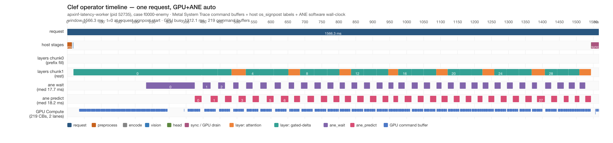

# Clef ANE 基线归因（auto GPU+ANE，Tier-1 前缀命中）

Issue #17 的第一步：用与既有 Clef timeline 相同的 `os_signpost` + Metal System
Trace recorder，把 auto(GPU+ANE) 的稳态单请求窗口拆开。本文只有测量与归因，
**没有改模型代码、没有翻任何 gate、不作 latency KEEP 结论**。

- 测量机：Apple M1 Pro 16 GB，macOS 27.0.1 (26A434)，MLX arch `applegpu_g13s`
- 组合：`APXINF_MODEL_VARIANT=auto`（GPU composition + 每层 MLP 的 5632 列在 ANE）
- recorder：Metal System Trace + Points of Interest，与
  [TIMELINE-OPERATOR.md](TIMELINE-OPERATOR.md) / [EAGER-EVAL.md](EAGER-EVAL.md)
  同一套导出与四分类脚本
- 录制：2-case job；request index 1 导出，request index 0 只作 warm/A-A
- 时间线图：

## 1. 为什么单 case 录制不是 1.49 s 基线

42-case 的 1.43–1.49 s 是 **Tier-1 system prefix 命中后的稳态窗口**：首个请求把
system/chat prefix 填进 `self.prefix_cache`，之后同 prompt 前缀的新图直接跳过
chunk0 的 32 层。单 case `--launch` 录到的是冷 fill：

- 既有 take：`f0000-enemy` 3453.2 ms / 5038.3 ms / 5000.3 ms；
- 本线早先的 launch 录制：chunk0 fill + chunk1，64 个 layer 区间。

所以本文用两案 job：

| 顺序 | case | 作用 |
| --- | --- | --- |
| 0 | `f0000-enemy` | warm：填 Tier-1 prefix、编译/加载 ANE cache、跑一次完整 vision+backbone |
| 1 | `f0009-gap` | **measured**：不同 image，Tier-1 hit，chunk0 跳过，只剩 chunk1 |

导出窗口的 layer 消息全部是 `cached=1`，`chunk0_fill=0`、
`chunk1_rest=32`，确认是稳态结构。layer 的 `tokens=286` 是 chunk1 token 数；
该 case 落在 42-case suite 的 299/303/323-token 档（prefix_end 后的 rest）。

## 2. 录制纪律与干净度

### 2.1 锁与环境

按 issue #16/#17 的顺序先取外锁 `/tmp/enginetailor-metal.lock`，再取
`~/.cache/enginetailor/metal-measure.lock`；ANE idle probe 通过
（ANECompilerService 0 %，两把锁 free，2 s Swapouts 0）。磁盘 free ≥ 44 GiB。
42-case 只做统计，本录制只 trace 2 请求。

环境（`xctrace --env` 与 worker 相同）：

```text
APXINF_MODEL_VARIANT=auto
APXINF_COREML_CACHE=/tmp/clef-ane-cache-signpost-timeline
APXINF_CLEF_FUSION=0
APXINF_CLEF_PREP_CACHE=0
APXINF_CLEF_PREFIX_CACHE=1
APXINF_CLEF_PREFIX_CACHE_TIER2=1
APXINF_CLEF_SIGNPOST=1
APXINF_CLEF_ANE_TRACE=1
```

### 2.2 A/A 与 Swapouts

- **A/A**：同一 job、同一二进制，signposts off（warm arm）vs signposts on
  （trace arm）：决策逐案相同，`max|Δp| = 0.0`。
- **Swapouts**：整个 lock 窗口 `+30976` 页，**发生在模型 load**（5.8 GB checkpoint
  + 2.06 GiB Core ML weight payload）。为区分 load 与 request，录制期间用外部
  monitor 在 worker 每次 flush `records.jsonl` 时快照 `vm_stat`：
  - monitor 看到 `ready`、`request0`、`request1`、`done` 共 4 行；
  - measured request 的前后快照相隔 **1573.2 ms**（与 trace window 1566.3 ms
    同量级）；
  - **request window：Swapouts = 0，Swapins = +252**。

因此：**request-only 窗口干净**；绝对时延仍受本机桌面负载
（WindowServer / Ventura 占用 GPU）影响，只作结构证据，不作 KEEP 样本。

### 2.3 xctrace 命令与导出

```bash
xctrace record --template "Metal System Trace" --instrument "Points of Interest" \
  --output .../baseline-attribution.trace --no-prompt \
  --env ... --launch -- target/release/apxinf-latency-worker <2-case-job>

python3 devlocal/signpost-operator-timeline/scripts/export_tables.py \
  --trace .../baseline-attribution.trace --out .../trace/export --request-index 1
python3 devlocal/matmul-fusion/scripts/timeline_metrics.py \
  --export .../trace/export --out .../trace/export/metrics.json --case f0009-gap
```

`clipped_intervals=0`，无 over-scoped guard；窗口账目残差 2.99 ms。

## 3. 窗口与 stage sums

导出 request index 1，窗口 **1566.324 ms**（request signpost 到 end）。

| stage | host ms | % window | 说明 |
| --- | ---: | ---: | --- |
| preprocess + encode | 14.34 | 0.92 | PNG decode/resize/patchify + tokenize |
| vision + head | 1.34 | 0.09 | host 建图标签；GPU 工作在标签之后/并发 |
| **layer host** | **1525.06** | **97.37** | 32 个 backbone layer 区间之和 |
| ├ `ane_wait` | 689.85 | 44.04 | `to_bytes_ready` 等 pack（GPU/ANE overlap 窗） |
| ├ `ane_predict` | 581.07 | 37.10 | Core ML predict（ANE 轴） |
| └ layer graph residual | 254.14 | 16.23 | layer host − wait − predict（host 建图/其它） |
| sync | 22.60 | 1.44 | `to_f32_vec` 末端 drain |
| residual | 2.99 | 0.19 | stage+layer 与 window 的账目残差 |
| **window** | **1566.32** | **100** | |

关键读数：**ANE wait/predict 两个软件窗口合计 1270.91 ms，占窗口 81.14 %；
layer host 几乎等于这两段 + host 建图。**

## 4. 四分类：GPU / ANE / overlap / bubble

`engine_active` = 落在 `ane_wait` 或 `ane_predict` host signpost 内；
`gpu_active` = 本进程 `metal-gpu-intervals` 的并集。exact partition：

| class | ms | % window | 含义 |
| --- | ---: | ---: | --- |
| **both** | **1104.08** | **70.49** | GPU 与 ANE 调用窗同时 active |
| gpu_only | 208.03 | 13.28 | GPU busy，ANE host 窗 idle |
| engine_only | 166.84 | 10.65 | ANE host 窗 busy，本进程无 GPU CB |
| none | 87.38 | 5.58 | 两引擎都 idle（真 bubble） |
| total | 1566.32 | 100 | |

派生指标：

| 指标 | 值 |
| --- | ---: |
| GPU busy %（both+gpu_only） | **83.77 %**（1312.11 ms） |
| ANE busy %（both+engine_only，软件轴） | **81.14 %**（1270.91 ms） |
| overlap % of GPU busy（both / GPU busy） | **84.15 %** |
| overlap % of busy union（both / union） | **74.65 %** |
| busy union % | 94.42 % |
| **非重叠并集（window − both）** | **462.25 ms = 29.51 %** |
| 真 bubble %（none / window） | **5.58 %** |

### 4.1 对成本模型 0.67 s 的实测结论

**结论：0.67 s 串行估计偏高，未被实测支持。**

- 按“非重叠并集”定义（`gpu_only + engine_only + none`）：**0.462 s**
  （29.51 %），成本模型 0.67 s 高估 **0.208 s（+45 %）**；
- 若把“串行”只定义为 GPU idle 的 ANE 段（`engine_only + none`）：
  **0.254 s（16.23 %）**；
- 若只看 GPU 独占段：**0.208 s（13.28 %）**；
- 最大单段是 **GPU-only 0.208 s**，不是 ANE-only。

这把优化目标从“整体重排 0.67 s”收敛到两段具体工作：
1. **layer0 之前/内部的 GPU-only 段**（见 §6）；
2. **ANE wait/predict 与 GPU 的剩余非重叠**（`engine_only + none`）。

### 4.2 真 bubble 的位置

10 等分窗口的 `none` ms：

| 0–10 % | 10–20 | 20–30 | 30–40 | 40–50 | 50–60 | 60–70 | 70–80 | 80–90 | 90–100 |
| ---: | ---: | ---: | ---: | ---: | ---: | ---: | ---: | ---: | ---: |
| 35.3 | 0.3 | 4.5 | 13.2 | 5.8 | 3.9 | 2.8 | 1.8 | 4.7 | 15.1 |

- 开头 **34.8 ms**（0–34.8）：preprocess → encode → vision host 串行，
  第一个 ANE wait 之前两引擎都没事干；
- 结尾 **12.5 ms**（1543.2–1555.7）：`head` host + `sync` 末端；
- 中间最长 gap 约 **4.9 ms**，没有大段真气泡。

## 5. ANE program：dispatch、weight upload、copy bytes

| 项 | 值 | 口径 |
| --- | ---: | --- |
| Core ML programs loaded | **32** | 每层一个 column-split program；匹配 `weight.bin` 中 `[5632,4096,1,1]` 的 32 个 `.mlmodelc` |
| 总 dispatch 次数 / 请求 | **32** | `ane_predict` signpost 数；每个 program **1 次**（326-token 级单 tile） |
| 单次 wait / predict host-blocking median | 17.73 / 18.20 ms | signpost duration median |
| **weight payload @ load** | **2,216,152,544 B = 2.064 GiB** | 32 个 compiled `weight.bin` 总和（median 66.05 MiB/program） |
| weight upload / request | **0 B** | 代码路径 load 一次，resident；ANE weight 预算约 2.4 GB，2.064 GiB 未触发 churn |
| **host copy / request（ANE hand-off）** | **268,500,992 B = 256.06 MiB** | geometry 推导，非硬件计数器 |

copy bytes 分解（每 `[4096,512]` f16 tile）：

- GPU→host packed input：4,194,304 B × 32 = 128 MiB；
- ANE→host `y`：4,194,304 B × 32 = 128 MiB；
- ANE→host `gate_scale` + `up_scale`：2,048 B × 32 = 64 KiB；
- 合计 **268,500,992 B**；每 tile 8,390,656 B。

`APXINF_CLEF_ANE_TRACE` 的 signposts-off warm arm 显示 measured request 的
layer0 service gap **4.9 ms**，per-predict `predict_ms` median **18.0 ms**。
xctrace 的 target stderr 不会回传到 host log，因此 traced take 的
ANE_TRACE 行未取到；**timeline 的权威数字以 os_signpost signposts 为准**，
ANE_TRACE 只补充 dispatch/gap 证据。固定 dispatch 开销与真实 ANE 计算
在当前软件轴下不可分；若 direction 6 要定量，需要 Core ML async/batch 或
临时 per-call 计时。

### 5.1 layer0 的 GPU-only 来源（vision hand-off）

layer0 区间 377.7 ms（其它层 median 36.4 ms），拆开：

| 子段 | host ms | 本进程 GPU busy ms | 读法 |
| --- | ---: | ---: | --- |
| layer0 start → first `ane_wait` | **214.05** | **196.55** | **vision tower / splice 的 GPU 执行**（host vision 标签只有 1.0 ms，GPU 工作被 lazy 排到之后） |
| `ane_wait` | 143.45 | 83.83 | 等 pack，GPU 仍在跑 |
| `ane_predict` | 20.11 | 15.84 | ANE predict |

这解释了 §4 的 **GPU-only 208 ms**：几乎全部集中在 layer0 的 pre-ANE 段。
它不是“host 建图慢”，而是 **vision GPU 工作挤在第一个 ANE 交接之前/期间**。
这也说明 [vision_ane.rs](../../crates/apxinf-model/src/metal_clef/vision_ane.rs)
现有的 row-split skeleton 对本 workload **不起作用**：它的 `SPLIT_FLOOR_ROWS=1024`，
而 Mario 单 crop 只有 432/480/600 patch rows，`window_rows=0`。

## 6. 六个 ANE 方向的重新排序

基于本文 + 既有 column-balance / prefix-cache 结果，按本机可测收益排序：

| rank | 方向 | 本文测到的钩子 | 预期收益 | falsifier / 限制 |
| ---: | --- | --- | --- | --- |
| 1 | **层间/块间流水**（direction 3） | 非重叠并集 462.25 ms；engine_only 166.84 + none 87.38 | **0.20–0.35 s** | Core ML `predict` 同步 + MLX 单 stream；若 chunk k+1 的 ANE 无法与 chunk k 的 GPU 同时在飞，收益归零 |
| 2 | **视觉塔整塔上 ANE**（direction 4） | layer0 pre-ANE GPU 196.55 ms；GPU-only 208.03 ms | **0.10–0.20 s** | 现有 skeleton 对 480 行 no-op；整塔 fp16 weight ≈ 0.50 GiB，叠加 language 2.064 GiB = **约 2.56 GiB（≈2.75 GB），超过文档记录的 ~2.4 GB ANE weight 预算**，必须 int8/palettize 或放弃常驻 |
| 3 | **跨请求流水**（direction 5） | 单请求窗口已占 1.57 s；一次决策 3 crop 独立 | **0.3–0.5 s/decision** | 需要 async Core ML 或多请求并行；同步 `MLModel.predict` 在单 host 线程上会串行 |
| 4 | **降低 ANE 调度开销**（direction 6） | 32 programs，32 dispatch，host-blocking median ~18 ms | **0.05–0.15 s**（仅当 fixed overhead 占大头） | 2.064/2.4 GiB weight budget 几乎用满；合并大 program 可能触发 reload。falsifier：合并后单请求总 ANE host 时间不降 |
| 5 | **operator 级整 MLP 切 ANE**（direction 1） | 当前 ANE 列 5632 vs GPU 列 6656；既有 deeper/shallower split 均负 | **预计 ≤0 或负** | 当前 balance 点 GPU ∝ 320×6656、ANE ∝ 512×5632；整 ANE 会把 ANE 列工作放大约 2.2×。falsifier：实测 ANE 每列 INT8 吞吐 > GPU 每列 2.2× 且 parity 可过 |
| 6 | **ANE 侧 int8/int4 palette**（direction 2） | language ANE share **已是 per-row INT8 + FP16 scales**，`weight.bin` 不是 fp16 展开 | **对本组合 <2 %**；对 GPU share 或其它模型另算 | 若指“把已 int8 的 ANE 权重再降 bit”，需重新量化 + parity；falsifier：weight 流量下降但 ANE compute 不降 |

**排序依据**：direction 3 直接对准实测 462 ms 非重叠；direction 4 对准最大单段
GPU-only；direction 5 是 per-decision 口径的唯一结构性大项。direction 1/2
在本机已有强负证据或已实现，不应作为下一根据“最高价值”标签直接开 campaign。

## 7. Roofline 与剩余空间

### 7.1 FLOPs 与有效吞吐（粗略）

- MLP 每层 3 个 GEMM：`3 × 4096 × 12288` 参数；323 token × 32 层：
  **3.12 TFLOP**（`2 × params × tokens × layers`）。
- 若把 3.12 TFLOP 全摊到窗口：1.566 s → **2.0 TFLOPS**；1.0 s 目标
  仅 MLP 就需要 **≥3.12 TFLOPS**，尚未计 attention/GDN/vision/head。
- 视觉塔按 0.456 B 参数、单 crop ~480 patch rows 估 ~0.11–0.44 TFLOP，
  与 layer0 GPU-only 段的观察一致；attention/GDN/head 为其余 FLOPs。

### 7.2 峰值假设与边界

- **GPU fp16 peak：5.2 TFLOPS**（M1 Pro 16-core GPU 的 Apple marketing 口径；
  实际 kernel 利用率更低，本机 desktop 争用明显）；
- **ANE INT8 peak：11 TOPS**（16-core Neural Engine marketing 口径；本机禁用
  Core AI instrument，无硬件计数器，**effective ANE 吞吐未测**）；
- **内存带宽：200 GB/s**；权重 resident，per-request activation/weight
  traffic 不是主约束，主要是 256 MiB hand-off copy + 固定 predict 延迟。

### 7.3 能否到 ≤1.0 s

本棒**未达标**（窗口 1.566 s）。理想化地把实测非重叠并集 0.462 s 全部藏掉，
窗口下界约 **1.10 s**，仍差 ~0.10 s；这 0.10 s 需要
（a）vision/attention 有效吞吐提升，或
（b）减少工作（prefix/Tier-2/cache），或
（c）让 ANE INT8 真正接近其峰值。

**当前瓶颈不是 host 图构建，也不是 weight bandwidth，而是：**
1. layer0 前的 vision GPU 段（~196 ms GPU-only）；
2. ANE wait/predict 与 GPU 的残余非重叠（~254 ms GPU-idle）；
3. 末端 sync + 开头 host 串行（~47 ms 真 bubble）。

## 8. 归因边界

与 [TIMELINE-OPERATOR.md](TIMELINE-OPERATOR.md) §5 相同：

1. **GPU** = 硬件 command buffer/encoder 区间（Metal System Trace），本机不给
   kernel 名；GPU busy 只能读到 CB 粒度。
2. **算子标签** = host `os_signpost`（`request/preprocess/encode/vision/layer/
   head/ane_wait/ane_predict/sync`），是入队序/阻塞点，不是 GPU kernel span；
   vision/host 标签只有 1 ms，但其 GPU 工作落在后续 CB 上。
3. **ANE** = 软件轴 wall-clock（`ane_wait`/`ane_predict` host 阻塞）；Core AI /
   Neural Engine hardware instrument 在本机禁用（dyld hang / GB 级 ktrace），
   ANE busy% 是**调用窗占比，不是硬件利用率**。
4. **overlap/bubble** = host 窗口与 GPU CB 求交的结构性读数；绝对 ms 受
   WindowServer/Ventura desktop 负载影响，不可外推。
5. vision/head 的 GPU 工作未被独立 signpost 圈定；本文用 layer0 pre-ANE 段
   作结构性代理，**不声称等于整个 vision tower FLOPs**。

## 9. 产物与复现

**本 PR 维护产物**：

- `docs/mario-opt/ANE-ATTRIBUTION.md`（本文）
- `docs/mario-opt/timeline-ane-attribution.png`（同一 recorder 的双轴 timeline）

**中间产物**（`devlocal/`，gitignored；路径相对录制所在 worktree，本次为
`signpost-timeline-candidates-27c7fa7b6590`；本 PR 不 vendor 这些文件）：

```text
devlocal/clef-ane-attribution/results/baseline-attribution/
  baseline-attribution.trace
  record_meta.json
  timeline.svg / timeline.png
  warm/{job.json,records.jsonl,worker-stderr.log}
  trace/{job.json,records.jsonl,export/{signposts,gpu,metrics,...}}
devlocal/clef-ane-attribution/scripts/record_attribution.py
devlocal/matmul-fusion/scripts/{record_before_after,timeline_metrics}.py
devlocal/signpost-operator-timeline/scripts/{make_1case_job,export_tables}.py
```

复现（在录制 worktree `signpost-timeline-candidates-27c7fa7b6590` 中；录制前
需 TCC-外暂存 checkpoint/image、GPU 安静窗口；本次 warm 未编译，Core ML cache
命中，load ~22 s）：

```bash
export MLX_ROOT="$HOME/apxinf-runtime/mlx-sdk"
export RUSTFLAGS="-C link-arg=-Wl,-rpath,$MLX_ROOT/lib -C link-arg=-Wl,-headerpad_max_install_names"
# 先取两把 Metal 锁，再构建
cargo build --release --features mlx,coreml --bin apxinf-latency-worker
python3 devlocal/clef-ane-attribution/scripts/record_attribution.py --run
python3 devlocal/signpost-operator-timeline/scripts/make_timeline_svg.py \
  --export devlocal/clef-ane-attribution/results/baseline-attribution/trace/export \
  --out devlocal/clef-ane-attribution/results/baseline-attribution/timeline.svg
rsvg-convert -o docs/mario-opt/timeline-ane-attribution.png \
  devlocal/clef-ane-attribution/results/baseline-attribution/timeline.svg
```

**交付结论**：归因完成；四个请求级快照给出干净 request window
（Swapouts=0），timeline 可复现。下一步按 §6 排序做单项 A/B，第一项建议
**层间/块间流水**，falsifier 见表；在拿到 before/after 双轴 timeline + parity
之前不宣称 ≤1.0 s。
