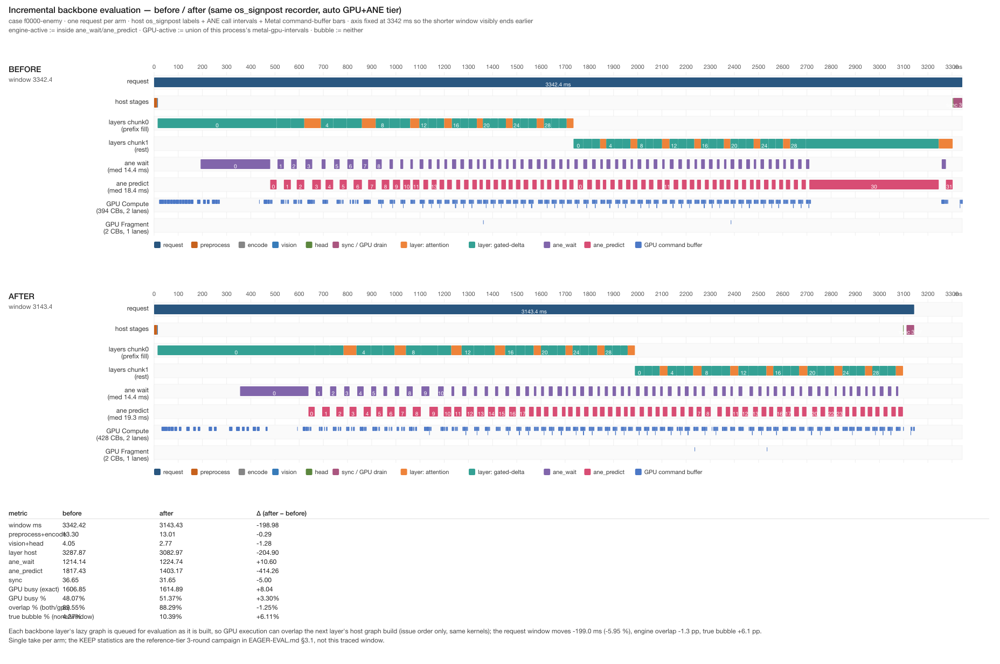

# 增量求值（host 建图 ∥ GPU 执行）

自主选向的第三个候选（`APXINF_CLEF_EAGER_EVAL`）。授权与纪律同
[ANE-COLUMN-BALANCE.md](ANE-COLUMN-BALANCE.md) / PR #5 评论
`2339b251199581ad2c8cbd97ef35a60f`。

- 测量机：Apple M1 Pro 16 GB，macOS 27.0.1
- KEEP 门跑在 **reference tier**（Swapouts 干净、vs-MLX parity 可过、
  42 案 id 对得上，parity 与 latency 同一轮出）
- gate：`APXINF_CLEF_EAGER_EVAL`（`0/1`/unset，默认 OFF）

## 1. 方向与机制预期

证据（既有记录，无需新录制）：

- **reference tier 的整个 forward 是 lazy 的**：chrome 记录显示每请求
  ~230 ms 的 host 图构建（layer/chunk/head）先跑完、GPU 全程空闲，
  然后最终阻塞读 `to_f32_vec` 才一次性执行全部 GPU 工作（fill 请求
  的 `logits_sync` = 2506 ms，Tier-2 命中请求 = 1136 ms）——**两段串行**；
- 取反例：auto tier 靠 ANE 交接强制增量执行，同几何请求只要
  ~1429 ms vs reference ~2224 ms —— 增量执行本身就是收益来源；
- 逐层尺度：reference 每层 host 建图 ~4.7 ms（44 层 ≈ 230 ms 内）、
  每层 GPU 执行 ~31 ms（chunk1 总 ~1 s）→ 建图完全可以藏进上一层的
  执行。

**机制预期（测量前写下）**：不删 FLOPs、不换 kernel、不改数值——只把
每层建好的 lazy 图**提前** `async_eval`，让 GPU 执行和下一层的 host
建图重叠。预期删除的是"host 建图 + GPU 执行"两段和里的重叠部分，
即每层 ~4.7 ms × 32 层 ≈ **150 ms**：命中窗 150/1140 ≈ **13 %**、
full 窗 230/2745 ≈ **8 %**。值得做，因为它是目前**唯一既可 KEEP 门
测量（reference 干净）又量级 >2 %** 的结构；auto 已由 ANE 交接增量
执行，预期同向但幅度小，用 before/after 录制取证。

## 2. 实现

`crates/apxinf-model/src/metal_clef/model.rs`（单文件，+64/−1）：

- `eager_eval_flag`（unset 跟 `EAGER_EVAL_DEFAULT_ON=false`，精确
  `0/1`，其它报错）+ `Network::eager_eval`，`Network::new` 读一次；
- `backbone_forward` 每层 `h = h1.add(&m)` 后
  `if self.eager_eval { self.stream.async_eval(&[h])?; }`，末层 norm
  后同样一次（drain 掉最后一层，让 head 建图有活干）；
- `logits_with_vision` 建完 head 后对 `logits` 同样一次（head 的 GPU
  执行藏进 caller 的 softmax 链建图与读回准备）。

全部是 `async_eval`（非阻塞派发），不引入 host 等待；图与最终读回
要评估的**完全相同**，只是 issue 时刻提前。

单测（1 个）：gate 拼写校验 + 默认相对性（unset 跟 const；`0` 恒关、
`1` 恒开、`true/yes` 报错）。

## 3. 测量

### 3.1 42-case paired campaign（reference，3 轮）

**3 轮全部干净**（6/6 臂次 Swapouts +0；墙钟 base 98.0/97.9/97.8 s、
eager 97.9/97.9/97.6 s）：

| | |
| --- | --- |
| median 增益（126 对） | **+0.115 %** |
| bootstrap CI95 | **[−0.038 %, +0.264 %]**（含 0） |
| 更快案例占比 | 54.0 %（掷硬币） |
| 逐轮 median | +0.171 / −0.022 / +0.261 % |
| **A/A vs base** | 42/42 决策相同，max\|Δp\| = **0.0 → bit_equal** ✓ |
| **parity vs 冻结 MLX** | base **与 eager 均为** 42/42、max\|Δp\| = **0.032783 → PASS** ✓ |

质量满分（位级一致、parity 与基线完全相同），但 **latency 无收益**：
median 0.115 % < 2 %，CI 含 0 → **NOT-WORTH**。

### 3.2 为什么机制没兑现（chrome 诊断，同案 fill）

对比同案（`f0000-enemy` fill、reference tier）的两份 chrome 记录
（基线 = repeat run 的 cache-off 请求 0；eager = `/tmp/eager-chrome-diag.json`）：

| | layer span 合计（host 建图） | logits_sync | 末层→sync 间隙 | request |
| --- | --- | --- | --- | --- |
| eager=0 | **238.4 ms** | **2506.4 ms** | 0.4 ms | 2745.2 ms |
| eager=1 | **2226.6 ms** | **141.8 ms** | 323.4 ms | 2691.8 ms |
| Δ | **+1988.2 ms** | **−2364.7 ms** | +323.0 ms | **−53.4 ms** |

`async_eval` 确实把 GPU 工作**提前**了（sync 从 2.5 s 塌到 0.14 s），
但 **layer span 按每层 +45 ms 暴涨——正好等于该层的 GPU 执行时长**：
即 GPU 执行落进了 host span，**host 建图与 GPU 执行仍然串行**，
"提前派发藏进建图"没有发生；净 request 只省 53 ms（1.9 %，来自
head/读回的少量重叠），42 案配对中位数只有 +0.115 %。

归因到"具体是 `mx::async_eval` 调用本身阻塞，还是下一层对 `h` 的
消费 op 在等这次异步求值"**本记录不裁定**——两种读法都与 span 归属
一致；裁定需要在派发点前后加临时计时（产品码改动，本 ticket 不做）。
可执行的结论不变：**在此 MLX 构建上，对本线程正在构造的 lazy 图做
per-layer `async_eval` 拿不到重叠**；跨流又受 `Array` 单流约束
（`inputs` 检查 `same(stream)`）不可行。这是 NOT-WORTH 的机制层理由。

### 3.3 本轮其余方向的筛选结论（按新规 <2% / parity 风险高 / 不可 KEEP 则跳过）

eager eval 是本轮第三个 NOT-WORTH；按"不要空转、自行选下一个"再筛一遍
timeline 支持的方向，**全部因下述硬约束不启动 campaign**：

| 候选 | 硬约束 |
| --- | --- |
| auto 尾部 `sync` 真气泡（113 ms，稳态窗 5–10 %） | KEEP 只能在 auto 跑，而 auto 被两条门同时卡死：42 案 campaign 结构性 Swapouts 污染（本轮列拆分 5/6 臂次 ≠0），且 auto **基线自身** vs-MLX max\|Δp\| = 0.0404 > 0.035（[ANE-COLUMN-BALANCE.md](ANE-COLUMN-BALANCE.md) §4）——auto 上无一条能过的 KEEP 门。归属（host 建图 vs 桌面 GPU 争用）也未定因 |
| chunk0-at-load（把 1947 ms prefix 填充挪进 load） | 只改首请求；42 案 median 增益 = 0（1/42），过不了 median 门。除非自创"首请求 latency"新指标——不在批准协议内 |
| preprocess 加速（12.7 ms） | 上界 12.7/1429 ≈ 0.9 %（auto 稳态）、0.57 %（reference），<2 %；且换 resize/量化路径会改像素 → 高 parity 风险（vs 冻结 MLX 必然漂移） |
| vision tower / head kernel 重写 | 新 kernel + reduction 顺序变化 → parity 风险高、跨模块，超出本轮本地改动授权 |
| ANE TILE / 异步 Core ML API | 重编全部 program + Core ML API 改造，scope 大、parity 未知 |

**结论**：本机、本协议下，可 KEEP 的候选池已干（与 HANDOVER 关闭列表里
~8 个负结果同构）。继续"为试而试"违反 <2%/高风险直接跳过的规则，
所以本轮自主循环在此收口，不再烧 campaign。值得跟进的三件事：
(1) 给 campaign runner 加 xctrace 开销基线，或解决 auto swap 污染，
使 auto 能进 KEEP 门；(2) 在派发点加临时计时裁定 async_eval 阻塞归属；
(3) traffic preflight（候选 B）等真实子集复用流量出现后再启动。

## 4. before/after 时间线

两次录制都 TCC-暂存（见 [TIMELINE-OPERATOR.md](TIMELINE-OPERATOR.md) §2.2 的
多案 job 规则），exported request = 第 2 案（`f0000-enemy-v1`，两臂同题同图）。
图：。

| 指标 | before | after | Δ |
| --- | --- | --- | --- |
| window ms | 3342.4 | 3143.4 | −199.0 (−5.95 %) |
| preprocess+encode | 13.3 | 13.0 | −0.3 |
| vision+head | 4.0 | 2.8 | −1.2 |
| layer host | 3287.9 | 3083.0 | −204.9 |
| └ chunk0 fill | 1719.9 | 1974.0 | +254.1 |
| └ chunk1 rest | 1568.0 | 1109.0 | −459.0 |
| ane_wait | 1214.1 | 1224.7 | +10.6 |
| ane_predict | 1817.4 | 1403.2 | **−414.2** |
| sync | 36.7 | 31.7 | −5.0 |
| GPU busy (exact) | 1606.8 | 1614.9 | +8.1 |
| GPU busy % | 48.07 | 51.37 | **+3.30 pp** |
| engine overlap % (both/GPU) | 89.55 | 88.29 | −1.26 pp |
| 真气泡 bubble % (none/window) | 4.27 | 10.39 | **+6.12 pp** |

exact 四分类 ms（both/gpu-only/engine-only/none）：
before **1438.9 / 168.0 / 1592.7 / 142.9**；after **1425.9 / 189.0 / 1202.0 / 326.5**。
10 ms 桶计数（before 335 桶 / after 315 桶）：
before 212 / 19 / 100 / 4；after 222 / 26 / 53 / 14。
账目残差 0.54 / 13.04 ms ✓；encode **0.6 / 0.5 ms**，`clipped=0`。
两臂 request 2 都跑了 chunk0 fill + chunk1（Tier-2 在首趟未命中，
与 repeat campaign 的 rep0 结构一致），所以是**同结构可比**窗口。

**这些是单次录制的结构性读数，不是 latency 结论**：−199 ms (−5.95 %)
落在单 take 噪声带内（同机同案历史窗口在 3453→5038 ms 间摆动），
权威 latency 是 §3.1 reference-tier 42 案配对（+0.115 %，CI 含 0）。
auto tier 未做 KEEP 统计（swap 污染 + 其 vs-MLX 基线 0.0404 已超门），
因此 **GPU busy ↑3.30 pp、bubble ↑6.12 pp 只作结构观察**——若 bubble
增长为真，auto 上的 eager eval 反而不利；本轮不据此翻默认值。

## 5. 归因边界

与 [TIMELINE-OPERATOR.md](TIMELINE-OPERATOR.md) §5 相同：GPU = 硬件
command buffer 级、算子标签 = host os_signpost、ANE = 软件轴
wall-clock；overlap/bubble 是 host 窗口求交，不是硬件计数器。

## 6. 产物与复现

维护产物：本文 + `timeline-eager-before-after.png`。实现代码按 NOT-WORTH
**不进主线**（`model.rs` 与合并基线一致）；要复现派发改动见 campaign 期间
的 working-tree diff（6 行：`eager_eval_flag` + `Network.eager_eval` +
`backbone_forward`/`logits_with_vision` 各两处 `async_eval`）。

中间产物（`devlocal/matmul-fusion/`，gitignored）：
`results/eager-eval-42/summary.json`、`results/smoke-eager_eval-{0,1}/`、
`results/fusion-{before,after}.trace`、`results/timeline-eager/`、
`logs/`、`scripts/`。

```bash
export MLX_ROOT="$HOME/apxinf-runtime/mlx-sdk"
export RUSTFLAGS="-C link-arg=-Wl,-rpath,$MLX_ROOT/lib -C link-arg=-Wl,-headerpad_max_install_names"
cargo build --release --features mlx,coreml --bin apxinf-latency-worker
python3 devlocal/matmul-fusion/scripts/smoke_column_depth.py \
  --env-key APXINF_CLEF_EAGER_EVAL --columns 1 --variant reference --run
python3 devlocal/matmul-fusion/scripts/run_column_campaign.py --run \
  --env-key APXINF_CLEF_EAGER_EVAL --arms base=0 --arms eager=1 \
  --rounds 3 --measured 1 --variant reference --suite 42 \
  --run-root eager-eval-42
python3 devlocal/matmul-fusion/scripts/record_column_before_after.py --run \
  --env-key APXINF_CLEF_EAGER_EVAL --arms before=0 --arms after=1 \
  --job-suite devlocal/matmul-fusion/suites/prep-cache-repeat.json \
  --run-dir devlocal/matmul-fusion/results/timeline-eager
python3 devlocal/matmul-fusion/scripts/render_before_after.py \
  --run-dir devlocal/matmul-fusion/results/timeline-eager \
  --final docs/mario-opt/timeline-eager-before-after.png \
  --title "Incremental backbone evaluation — before / after (same os_signpost recorder, auto GPU+ANE tier)" \
  --mechanism-head "Each backbone layer's lazy graph is queued for evaluation as it is built, so GPU execution overlaps the next layer's host graph build (issue order only, same kernels); " \
  --caveat "Reference-tier KEEP numbers; this auto-tier recording is the structural before/after the delivery rule asks for."
```
