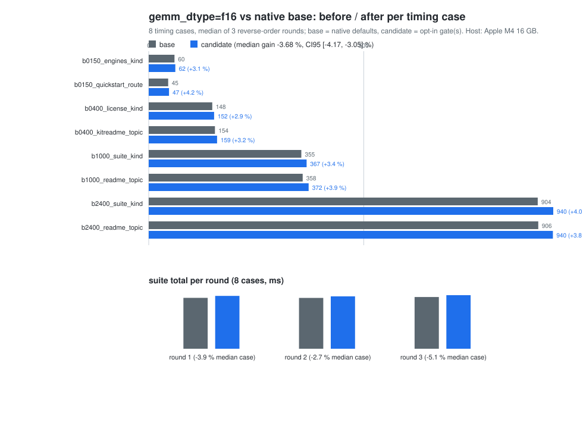
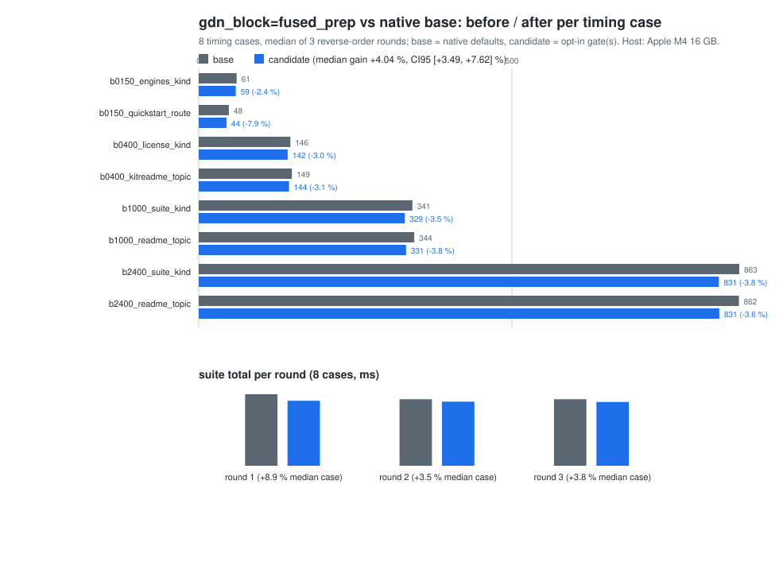
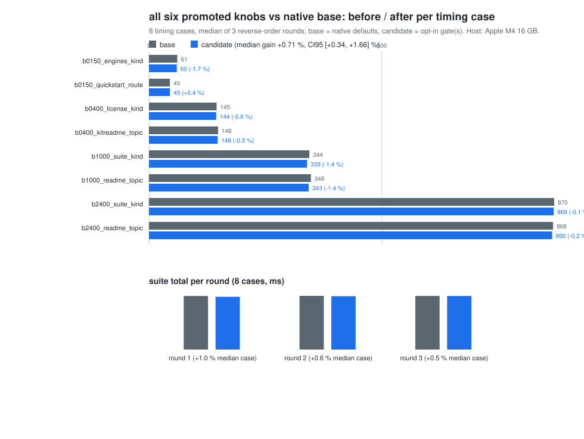

# Migrating EngineTailor's promoted d3-lite point to the native Metal port

This is issue #52's first item: the gap matrix between EngineTailor's
`PROMOTED` d3-lite configuration and the native `metal_d3_lite` port, and the
migration of the knobs that were not yet implemented. The promoted point is
six engine options (`gdn_core`, `conv1d`, `rope`, `gemm_dtype`, `compile`,
`gdn_block`); the migration is finished only when each one has either a native
equivalent or a measured verdict.

- Date: 2026-11-08
- Host: **Apple M4** (Mac16,10), 16 GB, macOS 27.0.1, MLX 0.32.3
  (`applegpu_g16g`), release `d3_lite_bench`
- Checkpoint: `models/d3-lite-9c10703` (`vllm-sr/d3-lite`, manifest
  `model_sha256=fda5cfc7…`, BF16 backbone + FP32 255-code readout)
- Workload: EngineTailor `testdata/workload.json` — 48 gate cases (12 each in
  buckets 150/400/1000/2400 tokens) and the 8 flagged timing cases
- Reference receipts for this host: `/Users/haiyan-mini/Agent4Kernel/graft-m4-20261023/d3-lite-m4-t2-20261023/{oracle,stock}/probs.json`
  (same checkpoint, same workload SHA-256, EngineTailor's M4 run)

## 0. The comparison numbers in the request are M1 Pro, not M4

The request cites EngineTailor promoted **2808 ms** vs native **3693 ms**
(≈24 %). Both numbers are from `doc/notworth-audit.md` §4.1 and are **Apple
M1 Pro** measurements. On the M4 host used here, EngineTailor's own promoted
combination measures **+4.24 %** over its stock arm (`sweep.json`, admitted
`gf16-model + eight_lanes + apxinf conv/rope + fused_prep + steel GEMM`;
3065 → 2939 ms, contended), and the native base measured **2809–2972 ms**
across the campaign windows (the combined campaign's base: 2828–2834 ms) for
the same 8 timing cases. Absolute cross-harness numbers are not comparable;
the M1 Pro gap is a motivation, never a local result. Every number below is
labelled with its chip.

## 1. The promoted point

`enginetailor/models/d3lite/engine.py`:

```python
PROMOTED = {'gdn_core': 'apxinf_eight_lanes', 'conv1d': 'apxinf', 'rope': 'apxinf',
            'gemm_dtype': 'f16', 'compile': 'model', 'gdn_block': 'fused_prep'}
```

This is the only code-level `PROMOTED` configuration in EngineTailor. Its
other targets (23 in `targets/`: Clef, MiniCPM5, Qwen3, Qwen3-TTS, Qwen-Image,
Qwen3.5, ASR) promote per-campaign through recipe/deployment receipts rather
than one named engine option set, so there is no second six-knob config to
diff; the capability-review documents cited by issue #52 cover those product
lines, and this report migrates the one promoted mechanism the request names.

| Knob | PROMOTED | Mechanism |
| --- | --- | --- |
| `gdn_core` | `apxinf_eight_lanes` | 8 value rows per SIMD group in the GDN recurrence, `simd_shuffle_xor` key reduction, next-operand lookahead; changes reduction order, not the recurrence |
| `conv1d` | `apxinf` | One-thread-per-output causal depthwise conv, FP32 tap order, own zero history, one launch |
| `rope` | `apxinf` | Half-split partial RoPE with FP32 angles and one output rounding |
| `gemm_dtype` | `f16` | F16 weight copies of every projection; `(x.astype(f16) @ W16.T).astype(bf16)` |
| `compile` | `model` | `mx.compile` around the whole forward |
| `gdn_block` | `fused_prep` | Conv + SiLU + q/k/v split + q/k l2norm in one kernel; intermediates stay FP32, q/k/v round once |

### 1.1 Gates and discipline used here

- **Parity**: the repo's standing d3-lite text gate — 48 cases, decision
  agreement wherever the stock anchor agrees with the FP32 oracle, worst
  max|Δp| ≤ 2× stock's worst (0.0632 on this host), mean KL ≤ 2× stock's mean
  KL, and two runs byte-identical. Additionally the request's absolute bound
  **max|Δp| ≤ 0.035** is applied as a stricter sub-gate on the same 48 cases.
- **Latency**: 8 timing cases, 3 rounds reverse arm order (`base→cand`,
  `cand→base`, `base→cand`), one process per arm under the two standing Metal
  locks, per-arm-process **and** per-decision `vm_stat` Swapouts. A round is
  clean only when every Swapouts delta is 0. KEEP = median gain ≥ 2 % and
  bootstrap CI95 lower > 0 (`4000` resamples, seed 42) and parity passes.
- The gates are read once at model load, one env configuration per process.

**About the "42 cases" in the request.** There is no 42-case d3-lite suite in
this checkout or in EngineTailor's d3-lite adapter: the adapter's workload is
48 gate + 8 timing cases, and the public Decision Index run is a different
suite. The `42/42 + max|Δp| ≤ 0.035` pair in `doc/notworth-audit.md` is the
Clef campaign's A/A rule. This report therefore uses the d3-lite 48-case
standing gate and applies the requested **0.035** as an absolute bound on top
of it, which is the stricter reading.

## 2. Gap matrix

Status before this change, from the native port's own source and the P1a/P3/B
records.

| # | Knob | ET PROMOTED | apxinf native before | Status | Expected gain (chip, source) | Risk |
| --- | --- | --- | --- | --- | --- | --- |
| 1 | `conv1d` | `apxinf` | `CausalDepthwiseConv`, default since P3 | **aligned** (bit-identical) | +0.51 % alone; part of +4.27 % (M1 Pro, `d3-lite-metal-gdn.md`) | low |
| 2 | `gdn_core` | `apxinf_eight_lanes` | `GatedDeltaRecurrence::EightLanes`, text default since P3; image keeps `four_values` | **aligned** on text | +4.27 % bundled, CI [+4.16, +4.84] (M1 Pro) | image parity headroom |
| 3 | `rope` | `apxinf` | `HalfSplitRope` since P1a; no stock fallback | **aligned** | included in the baseline | none |
| 4 | `compile` | `model` | Whole-request `Compiled` callable, one profile per `(length, count)`, replay after one prepare; eager path only for acceptance tests | **aligned** (native has always been compiled) | included | none |
| 5 | `gdn_block` | `fused_prep` | `separate`: conv kernel → SiLU → split → two RMSNorm nodes, BF16 rounds between steps | **open → migrated here** | 2–4 % text (ET estimate, M1 Pro) | medium (new kernel + parity) |
| 6 | `gemm_dtype` | `f16` | BF16 weights as stored | **open → migrated here** | 0–7 % (GEMM is 67.8 % of time at η 0.93, Graft M1 Pro) | medium (parity) |
| 7 | — (native ahead) | ET lists last-row pruning as remaining (~4 %) | `APXINF_D3_LAST_ROW=full` default since P4 | **native ahead** | +4.374 %, CI [+4.12, +4.51] (M1 Pro) | — |
| 8 | — (native only) | ET has no concurrency | Request-level parallelism in serving | **native ahead** | +8.42 %, CI [+7.97, +8.94] steady decisions (M1 Pro) | — |

Four of the six promoted knobs were already native-equivalent before this
change; two were open. Items 7–8 are native-only and mean the M1 Pro "native
≈ stock" statement in the audit predates native's own +4.27 % and +4.37 %
KEEPs (they were measured in the same leg but are not part of ET's promoted
point).

### 2.1 What "already aligned" means here

| Knob | Native implementation | Evidence |
| --- | --- | --- |
| `conv1d=apxinf` | `CausalDepthwiseConv` (`crates/apxinf-mlx/src/causal_conv.rs`), one thread per output, FP32 tap order, own zero history | Same `f140b117` kernel EngineTailor vendors; **bit-identical** to the composed `stock` conv on all 48 gate cases; +0.5126 % alone (M1 Pro, CI [+0.18, +0.85]) and part of the +4.27 % bundled KEEP |
| `gdn_core=apxinf_eight_lanes` | `GatedDeltaRecurrence::EightLanes` (`crates/apxinf-mlx/src/gated_delta.rs`), text callable default | Bundled +4.2714 % (M1 Pro, CI [+4.1555, +4.8408], 24/24 pairs faster, 3/3 clean); text worst drift *improved* (0.02435 vs 0.02918). The image callable stays `four_values`: its budget was 0.0554 of 0.06, and the both-callable eight-lane arm failed it (0.0639) |
| `rope=apxinf` | `HalfSplitRope` (`crates/apxinf-mlx/src/half_split_rope.rs`) since P1a, no stock fallback | Same kernel family as `conv1d`; baseline 48-case gate 48/48 decisions, max\|Δp\| 0.02145 vs the FP32 oracle |
| `compile=model` | Whole-request `Compiled` callable `(ids, count) → [1,255]`, one profile per `(length, count)` prepared once and replayed; `eager_probabilities` exists only for acceptance tests | The same MLX `mx.compile` EngineTailor's `compile=model` builds; the 48-case gate's two repeats are byte-identical, and every timing profile is a replay after one prepare |

One caveat on the evidence: the M1 Pro percentages for `conv1d`/`gdn_core`
come from the P3/B reports and their receipts; the 48-case parity cited here
was re-run on this M4 host. The native port also carries two levers ET's
promoted point does not: `APXINF_D3_LAST_ROW=full` (+4.374 % M1 Pro) and
request-level parallelism in serving (+8.42 % steady decisions), so native is
ahead on two axes while it was behind on the two migrated here.

## 3. Migration 1 — `gemm_dtype=f16`

### 3.1 Mechanism (written before measurement)

`APXINF_D3_GEMM_DTYPE=f16` converts every layer projection to an F16 weight
copy at load: attention `q/k/v/o` (6 layers), GDN `in_proj_qkv/z/b/a` and
`out_proj` (18 layers), and MLP `gate/up/down` (24 layers) — the same 186
tensors EngineTailor converts. Each F16 copy **replaces** its BF16 source, so
the device holds one copy per projection and the footprint is unchanged; an
arm that kept both dtypes would add ~1.7 GB. Norms, conv taps, the embedding
and the FP32 readout stay as stored. At request time `project` rounds the
activation to F16, multiplies against the F16 copy and rounds the result back
to BF16 — EngineTailor's three conversions, no more.

Why it can win: the projections dominate the request (Graft: 67.8 % of device
time, η 0.93 against the MLX F16 peak on M1 Pro, so the lever is the matmul
peak, not scheduling). Why it can lose: two extra elementwise casts per
projection (186 pairs per request), and on a chip where the BF16 matmul
already reaches the same peak the conversion is pure overhead — EngineTailor's
own M4 sweep had F16 negative without its Metal-4 steel GEMM. The measurement
decides.

### 3.2 Parity

`d3_lite_bench --set gate`, 48 cases, warmup 1, repeat 2, against the M4 host's
FP32 oracle; budget is 2× the same host's stock anchor.

| Arm | decisions | flips | worst max\|Δp\| (case) | mean KL | byte-identical | 2×stock budget | ≤ 0.035 |
| --- | ---: | ---: | ---: | ---: | --- | --- | --- |
| base (before) | 48/48 | 0 | 0.021450 (`b1000_suite_topic`) | 2.441e-4 | yes | pass (0.0632) | pass |
| `f16` | 48/48 | 0 | **0.028181** (`b1000_suite_topic`) | **1.984e-4** | yes | **pass** | **pass** |

The F16 arm's mean KL is lower than the base arm's, i.e. on this suite the F16
rounding does not add drift overall; the worst case rises by 0.0067 but stays
inside both bounds. The gate run paged (worst per-decision Swapouts 177 208
pages) because 48 distinct prompt lengths in one process hold 48 compiled
profiles; the receipt is byte-identical and parity does not depend on swap,
but the gate run's latency is not used for anything.

### 3.3 Paired measurement

`base` vs `f16`, 8 timing cases, three reverse-order rounds, both arms inside
one lock window per round, 3 timed calls per case.

| Round | order | base suite ms | f16 suite ms | suite gain | median case gain | pairs faster | Swapouts (base / cand) | clean |
| --- | --- | ---: | ---: | ---: | ---: | ---: | --- | --- |
| 1 | base → f16 | 2924.9 | 3037.4 | −3.84 % | −3.91 % | 0 / 8 | 0 / 0 | yes |
| 2 | f16 → base | 2921.9 | 3008.8 | −2.97 % | −2.68 % | 0 / 8 | 0 / 0 | yes |
| 3 | base → f16 | 2972.4 | 3078.8 | −3.58 % | −5.12 % | 0 / 8 | 0 / 23 568 | no |
| **pooled** | — | — | — | — | **−3.68 % median**, CI95 [−4.17, −3.05] | 0 / 24 | — | 2 / 3 |

Per case the regression is spread over every bucket (−2.4 % to −4.5 % across
150/400/1000/2400), not concentrated at one length: this is the per-projection
cast plus the F16 GEMM, not a fixed setup cost. The two clean rounds are in
opposite arm orders and agree (−3.84 %, −2.97 %); round 3's candidate arm
paged (23 568 Swapouts), so it is excluded from the verdict.



### 3.4 Verdict

**NOT-WORTH on this host (M4).** Parity passes, but the paired campaign is a
consistent **−3.7 %** regression (CI95 [−4.17, −3.05], 0/24 pairs faster,
across two clean reverse-order rounds). It reproduces EngineTailor's own M4
finding (−5.4 % for `f16+compile=model` *without* its steel GEMM): on M4 the
MLX F16 GEMM is not faster than BF16, and the F16 conversion adds 186
activation casts per request. The gate is kept as the faithful migration of
the promoted knob and as the prerequisite for an M1 Pro campaign, but it is
**not** recommended for M4 and the default stays `bf16`.

## 4. Migration 2 — `gdn_block=fused_prep`

### 4.1 Mechanism (written before measurement)

`APXINF_D3_GDN_BLOCK=fused_prep` binds `apxinf_gdn_fused_prep`, a port of
Graft's 2026-10-23 d3-lite operand-chain kernel (EngineTailor `native/`,
MIT): one 32-lane SIMD group per `(prompt row, value head)` owns `Dk/32` q and
k columns and `Dv/32` v columns, runs the causal depthwise convolution in
FP32 tap order over the raw `in_proj_qkv` row, applies SiLU, the split, the
official q/k l2norm (`q` gets `Dk^-0.5`, `k` unit scale, sum epsilon `1e-6`)
and writes BF16 once per output. The separately composed chain is conv kernel
→ SiLU → split → two `fast_rms_norm_unweighted` nodes, so it rounds the
convolution, the SiLU, and each normed output to BF16 between steps; the
fused kernel removes those intermediate roundings and reads the qkv row once.

It requires `APXINF_D3_CONV1D=apxinf` and refuses to load with `stock`, the
same rule as EngineTailor's `resolve` (the fused convolution *is* the ApxInf
tap-order convolution). Both callables (text and image) share the compose
choice; the gate is opt-in and the default remains `separate`.

### 4.2 Parity

| Arm | decisions | flips | worst max\|Δp\| (case) | mean KL | byte-identical | 2×stock budget | ≤ 0.035 |
| --- | ---: | ---: | ---: | ---: | --- | --- | --- |
| base (before) | 48/48 | 0 | 0.021450 (`b1000_suite_topic`) | 2.441e-4 | yes | pass (0.0632) | pass |
| `fused_prep` | 48/48 | 0 | **0.030245** (`b1000_suite_topic`) | **2.687e-4** | yes | **pass** | **pass** |

The kernel's worst case (0.03025) is inside the request's 0.035 bound with
0.0048 of headroom and inside the standing 2×-stock budget with 0.033. The
gate run's worst per-decision Swapouts were 19 244 pages.

### 4.3 Paired measurement

`base` vs `fused_prep`, same protocol.

| Round | order | base suite ms | fused suite ms | suite gain | median case gain | pairs faster | Swapouts (base / cand) | clean |
| --- | --- | ---: | ---: | ---: | ---: | ---: | --- | --- |
| 1 | base → fused | 3021.4 | 2745.9 | +9.12 % | +8.87 % | 8 / 8 | 12 880 / 0 | no |
| 2 | fused → base | 2811.5 | 2710.9 | +3.58 % | +3.55 % | 8 / 8 | 0 / 0 | yes |
| 3 | base → fused | 2809.4 | 2695.6 | +4.05 % | +3.75 % | 8 / 8 | 0 / 0 | yes |
| **clean (2–3)** | — | 2810.5 | 2703.3 | **+3.82 %** | **+3.55 % median**, CI95 [+3.05, +4.01] | 16 / 16 | — | 2 / 3 |

Round 1 is excluded: its base arm paged 12 880 pages and read 7 % slower than
the base arm in rounds 2–3 (3021 vs 2810 ms), which would have inflated the
gain to +9 %. The two clean rounds are in opposite orders and agree (+3.58 %,
+4.05 %); the pooled clean-rounds median is +3.55 % with 16/16 pairs faster.



### 4.4 Verdict

**KEEP on this host (M4)**, with the round-1 exclusion recorded. The fused
operand chain is **+3.55 %** (clean rounds, CI95 [+3.05, +4.01], 16/16 pairs
faster, both arm orders) with parity passing both the standing budget and the
0.035 bound. It is the one promoted knob that moves the native M4 port, and
its mean-case drift is slightly *lower* than the base's (0.00602 vs 0.00625)
because it removes two BF16 roundings. Per the request it stays opt-in
(`APXINF_D3_GDN_BLOCK=separate` is still the default); flipping the default is
a separate decision with this receipt.

## 5. The combined promoted arm

The migration's closing measurement is the arm with **all six** promoted
knobs: `conv1d=apxinf`, `gdn_core=eight_lanes`, `rope=apxinf` (all three
already native defaults), `APXINF_D3_GEMM_DTYPE=f16`,
`APXINF_D3_GDN_BLOCK=fused_prep`, and the whole-request compiled callable
(always on).

Parity (48 cases, same gate):

| Arm | decisions | flips | worst max\|Δp\| (case) | mean KL | byte-identical | 2×stock budget | ≤ 0.035 |
| --- | ---: | ---: | ---: | ---: | --- | --- | --- |
| combined | 48/48 | 0 | **0.031428** (`b1000_suite_topic`) | **2.051e-4** | yes | **pass** (0.0632) | **pass** (0.0036 headroom) |

The combined arm is the least comfortable: 0.0314 against the 0.035 bound, so
the margin is 0.0036. It passes, but a future change on top of both gates
must be re-gated; it is not an arm to enable by default without that check.

`base` vs the combined arm, same protocol.

| Round | order | base suite ms | combined suite ms | suite gain | median case gain | pairs faster | Swapouts | clean |
| --- | --- | ---: | ---: | ---: | ---: | ---: | --- | --- |
| 1 | base → combined | 2828.5 | 2783.7 | +1.58 % | +0.96 % | 7 / 8 | 0 / 0 | yes |
| 2 | combined → base | 2833.8 | 2816.1 | +0.62 % | +0.55 % | 6 / 8 | 0 / 0 | yes |
| 3 | base → combined | 2831.2 | 2828.5 | +0.10 % | +0.50 % | 7 / 8 | 0 / 0 | yes |
| **pooled** | — | — | — | — | **+0.71 % median**, CI95 [+0.34, +1.66] | 20 / 24 | — | 3 / 3 |

`f16` alone is −3.7 % and `fused_prep` alone is +3.8 %, so the package leaves
+0.7 %: the two levers nearly cancel, and the package is **below the 2 % gate**
even though all three rounds are clean and the CI excludes 0. The combined arm
is therefore not a configuration to enable; the useful configuration on this
host is `fused_prep` alone.



## 6. Verdicts and remaining items

### 6.1 Per-item verdicts

| Item | Parity (48 cases) | Paired measurement (M4) | Verdict |
| --- | --- | --- | --- |
| `gdn_block=fused_prep` | 48/48, 0 flips, max 0.0302 (bound 0.035), byte-identical | **+3.55 %** clean rounds, CI95 [+3.05, +4.01], 16/16 pairs faster, 2/3 clean | **KEEP on M4**; stays opt-in |
| `gemm_dtype=f16` | 48/48, 0 flips, max 0.0282, byte-identical | **−3.68 %**, CI95 [−4.17, −3.05], 0/24 pairs faster, 2/3 clean | **NOT-WORTH on M4**; stays opt-in |
| all six knobs (combined) | 48/48, 0 flips, max 0.0314 (0.0036 headroom), byte-identical | **+0.71 %**, CI95 [+0.34, +1.66], 20/24 pairs faster, 3/3 clean | **NOT-WORTH as a package** (< 2 % gate) |
| `conv1d`, `gdn_core`, `rope`, `compile` | 48/48 baseline | see §2.1 receipts | **already aligned** |
| image-path `gdn_core=eight_lanes` | not measured (no P1b image receipt) | — | **not-worth on headroom** |
| M4 `gemm_kernel=apxinf_steel` | not implemented | — | **out of scope** (not a promoted knob) |

The actionable result is one line: **`APXINF_D3_GDN_BLOCK=fused_prep` is the
one promoted knob that pays on this host (+3.55 %), and it should be the next
default decision; `APXINF_D3_GEMM_DTYPE=f16` should stay off on M4, and the
six-knob package should not be enabled because the F16 regression cancels the
fused-prep gain.** Both gates are still faithful migrations of the promoted
point and both pass parity, so the M1 Pro validation can enable them without
another port.

### 6.2 Remaining items and why they are not migrated

- **Image-path `gdn_core=eight_lanes`** (ET's text speedup applied to the
  image callable): **not-worth on this evidence**. The P1b image gate has
  0.0046 of headroom (0.0554 of 0.06), and the both-callable eight-lane arm
  measured 0.0639 and failed (P3, M1 Pro). The image reference receipt is not
  in this checkout, so it cannot be re-gated here. The text callable keeps
  eight lanes; the image callable stays four values.
- **M4 `gemm_kernel=apxinf_steel`**: **out of scope**. It is not one of the
  six `PROMOTED` knobs; it is a Metal-4 F16 GEMM kernel EngineTailor added for
  M4, and its 2026-10-23 sweep admits the promoted arm only with it (without
  it, F16 is negative on M4). Porting it would be a separate GEMM-kernel
  direction with its own parity and campaign.
- **Operator-span timeline**: the P3/B reports' signpost exporter is not
  checked in, so this report's before/after evidence is the paired per-case
  measurement timeline, not operator spans. A later leg should check the
  exporter in and record both arms.
- **`compile=model` ablation**: native has no eager deployment path (the
  eager body exists only for acceptance tests), so the compile lever is not
  separately ablated here; it has been part of every native execution since
  P1a, and the 48-case repeats are byte-identical.
- **Image parity of the new gates**: cannot be re-measured without the P1b
  reference receipt. Both gates default off, so the shipped image path is
  unchanged; if either is ever proposed as an image default, it needs the
  8-case image gate first.

### 6.3 What the 24 % claim means now

ET's promoted point is +25.8 % on M1 Pro (3529 → 2808 ms, 48-case gate
passed). The native port now has an equivalent for all six knobs, and the
four already-native ones were measured on M1 Pro in P3/P4. The two migrated
here are verified on M4: `fused_prep` **KEEPs** at +3.55 % and `f16` is a
**−3.68 % NOT-WORTH** on this chip, so the package nets only +0.71 %. Claiming
the M1 Pro gap closed still requires re-running these two campaigns on an M1
Pro host with the same commands, because the M4 outcome is chip- and
GEMM-kernel-dependent (ET's own M4 promoted point needs its steel GEMM to
clear +2 %). The migration's product value on this host is therefore
`fused_prep` alone, not the six-knob package.

## 7. Reproduction

```bash
export MLX_ROOT="$HOME/mlx-sdk"
export DYLD_LIBRARY_PATH="$MLX_ROOT/lib"
cargo build -p apxinf-model --release --features mlx --example d3_lite_bench

BIN=target/release/examples/d3_lite_bench
MODEL=/Users/haiyan-mini/Agent4Kernel/models/d3-lite-9c10703
WORKLOAD=devlocal/et-promoted-migration/workload.json
REF=devlocal/et-promoted-migration/receipts/oracle-gate.json

# parity, one arm (gate runs page; the receipt is still valid)
APXINF_D3_GEMM_DTYPE=f16 $BIN --model-dir "$MODEL" --workload "$WORKLOAD" \
  --set gate --warmup 1 --repeat 2 --rounds 1 --reference "$REF" \
  --records out/gate-f16.json --summary out/gate-f16-summary.json

# paired timing, one round and one arm (repeat with the arm order reversed)
APXINF_D3_GDN_BLOCK=fused_prep $BIN --model-dir "$MODEL" --workload "$WORKLOAD" \
  --set timing --warmup 2 --repeat 1 --rounds 3 \
  --records out/timing-fused.json --summary out/timing-fused-summary.json
```

Every model process runs under the two standing Metal locks
(`/tmp/enginetailor-metal.lock`,
`~/.cache/enginetailor/metal-measure.lock`) via
`python -m orchestrate.lock_run`. The harness (`run_campaign.py`,
`analyze.py`) and the raw receipts live in
`devlocal/et-promoted-migration/` and are not committed.

## 8. Limits

- **Chip**: all local numbers are Apple M4. The request's 24 % gap is M1 Pro
  and is not reproduced here; the migration is verified on M4, while the M1
  Pro promoted numbers remain EngineTailor's own receipts.
- **Image parity** was not re-measured: the 8-case P1b image suite needs the
  checkpoint's PyTorch/MPS reference receipt, which is not in this checkout.
  Both new gates are opt-in; with them off the image callable stays on its
  P1b anchor. EngineTailor's d3-lite package itself runs the text path only.
- **Operator timeline**: `xctrace` is available in this environment, but the
  signpost exporter used by the P3/B reports is not checked in, so the
  before/after evidence here is the paired per-case measurement timeline, not
  an operator-span timeline.
- **Gate runs are swap-dirty** on this 16 GB host (48 prompt lengths → 48
  compiled profiles); parity is unaffected, and the latency campaigns are
  judged on their own per-round Swapouts gate.
- The F16 conversion does not assert per-tensor finiteness (EngineTailor does
  at arm build). The 48-case gate and byte-identical repeats cover the
  behaviour on this checkpoint.
