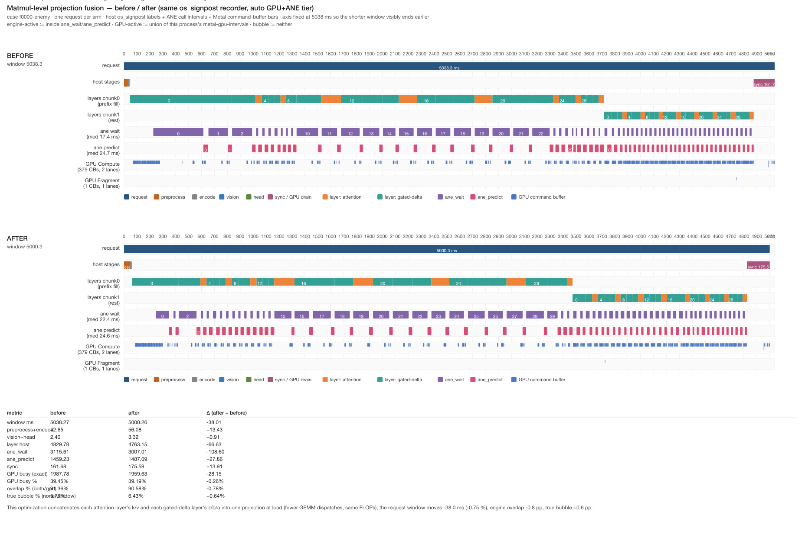

# 算子级 matmul 融合（A1 attention k/v · A2 GDN z/b/a）

候选 A 的实施与测量记录。批准来源：PR #5 评论
（`08b361d14d3991650dcf71bb41dff0ac`，“批准候选 A，按你提交的计划实施”），
配套交付规则见同一 PR 线程的 `21739d87057888c34e3b583d786cd80c`
（每个优化 PR 必须附同一 signpost recorder 的 before/after 时间线）。

- 测量机：Apple M1 Pro 16 GB，macOS 27.0.1，MLX arch `applegpu_g13s`
- gate：`APXINF_CLEF_FUSE_KV`（A1）/ `APXINF_CLEF_FUSE_GDN`（A2），精确 `1` 开启，默认关闭
- 时间线图：

## 1. 实现

改动集中在 `crates/apxinf-model/src/metal_clef/model.rs` 一个模块
（gate 读取、拼接、两条融合分支、单测）。`concat_q4` 沿**输出轴**拼接
affine-Q4（`weight [N, K/8]` + 每输出行的 `scales/biases [N, K/64]`），
可选补零行，并在 load 时 `stream.eval` 一次——不 eval 的话拼接会在每个
请求重新入队，反而多三个 kernel。原权重在 load 时释放进空槽
（沿用 `moved_mlp` 的做法），所以融合路径除 A2 在 GPU 组合下的补行外
**不增加设备内存**。

gate 在 `Network::new` 读一次：A/A 与 campaign 的两臂跑在不同进程里，
同进程内 gate 不变。

### A1：attention k/v 拼接

`Attention` 的 `k` 槽换成 `concat(k, v)`（`v` 置空）；`attention()` 里
一次 `single_projection(x, k)` 得到 `[1, T, 2048]`，按行切出 k/v 两半。
组合分流由既有 helper 完成：

- reference 组合（`gpu = None`）→ 一次 `qmm`（`quantized_matmul`）；
- GPU 组合 → 一次 `Q4TransposeDecode` + 一次 `F16Gemm`（M4 neuron 分支
  同理走 `MppF16Gemm`）。

输出维 k=v=1024，均为 64 的倍数，64 列 scale 块边界与拼接前逐行一致。

### A2：GDN z/b/a 合并

`GatedDelta` 的 `z` 槽换成 `concat(z, b, a)`（`b`/`a` 置空；实际几何
z=4096 行、b=a=32 行，**不是**候选文档里写的“1 列”）：

- **reference 组合**：三者原本都走 `qmm` → 一次 `qmm` over
  `[4160, 4096]`，切出 z/b/a（b/a 切片再 `contiguous()`，喂给编译版
  `_compute_g_beta`——其 traced graph 假定输入行打包）。
- **GPU 组合**：z 走 wn2 split GEMM、b/a 走 MLX `qmm`，无法在不改
  其中一个 kernel 的前提下合成一个 GEMM。实现按候选计划的本意做
  **完整合并**：load 时把 concat 补零到 4224 行（split GEMM 要求
  `N % 128 == 0`，两半各 2112），request 时两半各一次
  `Q4TransposeDecode` + `split.low/high` 一次 GEMM，再切 z/b/a。
  代价：z 的 decode/GEMM 比不合并时多 ~1.5 % / ~3.1 % 的补行列；
  收益：b/a 从两个独立 MLX qmm 变成搭车两列，省两次 dispatch。
  **这条路径只由下面的 before/after 录制做结构性取证，未经 latency
  campaign 统计。**

## 2. parity 性质（关键，与批准时的假设不同）

批准消息里有两个技术假设，实测**都不成立**，因此 A1 与 A2 都必须走
完整 parity 门，且**不得声称 bit 一致**：

1. **“A1 预期 bit 一致”——不成立。** `quantized_matmul` 对**相同输入**
   是确定的（同 shape 两次调用 0 字节差异；Tier-2 的跨进程 A/A 也
   印证了 reference 组合的这一性质），但 **shape 变化会改变 GEMM tiling
   与 FP32 累加顺序**。设备单测（T=17, K=4096, N=1024，Clef 几何）：

   | 比较 | 不同元素 | max\|Δ\| | 缓冲最大值 |
   | --- | --- | --- | --- |
   | A1 k：fused `[..,2048]` 前 1024 列 vs separate | 11880/17408 (68 %) | 3.125e-2 | 3.016 |
   | A1 v：后 1024 列 vs separate | 11160/17408 (64 %) | 4.688e-2 | 3.719 |
   | A1 rms_norm（strided slice → reshape） | 11116/17408 (64 %) | 3.125e-2 | 1.953 |
   | A2 z vs separate | 26100/69632 (38 %) | 1.562e-2 | 3.031 |
   | A2 b vs separate | 343/544 (63 %) | 3.125e-2 | 3.047 |
   | A2 a vs separate | 362/544 (67 %) | 2.344e-2 | 2.891 |

   即差异在 **1–2 个 BF16 间距**量级（max|Δ| / 缓冲最大值 ≈ 0.5–1.5 %），
   近零元素上的相对误差无意义。这不是 wiring 错误（wiring 错误会是
   O(缓冲最大值)），但也不是 bit 相等。

2. **“A2 改变 scale 分组”——不成立。** 该 checkpoint 的 Q4 scales/biases
   是**每输出行**一组（`[out, in/64]`），沿输出轴拼接不共享、也不改变
   任何 64 列分组。A2 的数值差异来自 GEMM tiling（N 变了），GPU 组合下
   另有 b/a 从 MLX qmm 换成自定义 FP16 GEMM 的 kernel 变化。

结论：parity gate 是**必须**的，而不是可选的保险。权威判据是
42 案决策 + max|Δp| ≤ 0.035 vs 冻结 MLX，不是逐位比较。

## 3. 测量

### 3.1 协议

reference（GPU-only）tier 先行，按批准要求：

- 42 案 `separate-proto14` 套件，`measured=1`，无 warmup 阶段
  （A/A 配对设计下两臂各自进程冷启动的首请求增益在配对里抵消；
  不做 warmup 把每臂从 ~190 s 压到 ~98 s）
- 3 轮；2 臂偶数轮正序、奇数轮**反序**（字面反序配对）
- 每轮一个锁窗口：`~/.cache/enginetailor/metal-measure.lock` →
  `/tmp/enginetailor-metal.lock`，两臂串行在窗口内
- 每臂 `vm_stat` 前后；**Swapouts ≠ 0 的轮次不进 KEEP 池**
- 配对逐案增益按 case 对齐、跨干净轮**累积**（不按 case 合并）
- KEEP = median ≥ 2 % **且** bootstrap CI95 下界 > 0 **且** parity 门通过

脚本：`devlocal/matmul-fusion/scripts/run_fusion_campaign.py`。

### 3.2 结果

**void take**：第一次 campaign 跑的是**早于融合代码的 worker 二进制**
（runner 验证了协议本身：3 轮全部 Swapouts +0、正/反序生效；但两臂
都未执行融合，42 案 payload 逐位相同，0.217 % 是臂间噪声）。已改名
`results/keep-combined-void-stale-binary/` 留作 runner 记录，**不作为
本优化的证据**。教训：campaign 前必须核对 `target/release` 二进制
mtime ≥ 改动源码（runner 未自动校验）。

**修正后的 campaign（新二进制）——全部 3 轮干净**
（6 臂次 Swapouts 全部 +0；`results/keep-combined/summary.json`）：

| 臂次 | 墙钟 | Swapins | Swapouts |
| --- | --- | --- | --- |
| r0 base / fused | 98.8 / 98.1 s | +4 / +19 | +0 / +0 |
| r1 fused / base（反序） | 98.2 / 97.9 s | +232 / +337 | +0 / +0 |
| r2 base / fused | 97.8 / 97.8 s | +32 / +36 | +0 / +0 |

配对逐案增益（base→fused，126 个配对，跨 3 个干净轮累积）：

| | |
| --- | --- |
| median | **+0.109 %** |
| bootstrap CI95 | **[−0.100 %, +0.303 %]**（含 0） |
| 更快案例占比 | 53.2 %（≈掷硬币） |
| 逐轮 median | +0.410 / −0.125 / +0.077 % |

parity：

- **A/A vs 本仓 base**：42/42 决策相同，但 **max|Δp| = 0.025246**
  （`f0012-enemy/enemy/false`）→ **不是** bit 一致，与 §2 的预测一致；
- **vs 冻结 MLX**：42/42 决策相同，**max|Δp| = 0.048960 > 0.035**
  （`f0045-enemy/enemy/false`）→ **parity 门失败**。

**裁决：NOT-WORTH**，三条理由同时成立：
median +0.109 % < 2 %；CI95 下界 −0.100 % ≤ 0；parity 门失败
（0.04896 > 0.035）。

**为什么不再单独测 A1**：A2 是“3 个 qmm → 1 个 qmm”，只会中性偏正，
不可能带来 ≈−1.9 % 的拖累；因此 A1 单独的 latency 上限 ≈ 组合值
（+0.109 %），**无论如何都到不了 2 % 门**。A1 单独的 parity 是否干净
未测（组合已失败，latency 门已决定 NOT-WORTH）；将来若只想保留 A1，
需单独重跑 parity 门。gate 保持精确 `1` 开启、默认关闭，合并基线不变。

## 4. before/after 时间线（交付规则）

两次录制用**同一个 signpost recorder**（Metal System Trace +
Points of Interest，encode 作用域已修复），auto（GPU+ANE）tier——这是唯一
有 ANE 区间与引擎 overlap 指标的 tier。checkpoint 与图片走 TCC 暂存副本
（录制进程读 `~/Documents` 会在 `open()` 挂死，见
[TIMELINE-OPERATOR.md](TIMELINE-OPERATOR.md) §2.2）。

指标口径（`devlocal/matmul-fusion/scripts/timeline_metrics.py`）：

- **engine-active** = 落在 `ane_wait` 或 `ane_predict` host signpost 内
  （ANE 调用窗；本机两次录制里 predict 仅 1.5 s 级、wait 达 3.1 s 级，
  只有把 wait 一起算才能得到批准消息里 1690/1907 ≈ 89 % 那一量级的 overlap）
- **GPU-active** = 本进程 `metal-gpu-intervals` 的并集
- 四分类 `both / gpu-only / engine-only / none`：
  - exact：按所有端点切原子的区间代数（精确 ms）
  - 10 ms 桶：每桶二值分类（交付规则要求的口径），另报桶计数
- **GPU busy %** = GPU-active / window；**overlap %** = both / GPU busy
  （批准消息的 1690/1907 公式）；**真气泡 bubble %** = none / window

时间线图：
（两臂共用 5038 ms 轴，after 的窗口更早结束是可见的）。

| 指标 | before | after | Δ |
| --- | --- | --- | --- |
| window ms | 5038.3 | 5000.3 | −38.0 (−0.75 %) |
| preprocess+encode | 42.6 | 56.1 | +13.5 |
| vision+head | 2.4 | 3.3 | +0.9 |
| layer host | 4829.8 | 4763.2 | −66.6 |
| └ chunk0 fill（37 tok） | 3670.6 | 3412.5 | −258.1 |
| └ chunk1 rest（266 tok） | 1159.2 | 1350.7 | +191.5 |
| ane_wait | 3115.6 | 3007.0 | −108.6 |
| ane_predict | 1459.2 | 1487.1 | +27.9 |
| sync | 161.7 | 175.6 | +13.9 |
| GPU busy（exact） | 1987.8 | 1959.6 | −28.2 |
| GPU busy % | 39.45 | 39.19 | −0.26 pp |
| engine overlap %（both/GPU busy） | 91.36 | 90.58 | −0.78 pp |
| 真气泡 bubble %（none/window） | 5.79 | 6.43 | +0.64 pp |

exact 四分类 ms（both / gpu-only / engine-only / none）：
before **1816.0 / 171.7 / 2758.8 / 291.7**；after **1775.1 / 184.5 / 2719.0 / 321.6**。
10 ms 桶分类计数（共 504 桶）：
before 264 / 22 / 202 / 16；after 259 / 23 / 199 / 20。
账目残差（window − stages − layers）：1.76 / 2.13 ms ✓。

取证要点：

- **encode 插桩 bug 修复**：`clipped=0`，encode = **12.8 / 9.2 ms**
  （take-2 未修复时记录 3410.1 ms）——msg 21739d87 要求的“修好后重出
  时间线”已完成。
- **overlap 的来源**：`ane_wait` 总长 3.1 s 而 `ane_predict` 仅 1.5 s。
  engine-active 必须取 wait+predict 才有 91 % 的 overlap，与批准消息
  1690/1907 ≈ 89 % 同量级；若 engine 只算 predict，both ≤ 1459 ms，
  overlap 上界仅 ~73 %（both ≤ engine window 的平凡界）。
- **单次录制的噪声**：chunk0/chunk1 反向大位移（−258 / +191 ms）远大于
  净效应（layer −66.6 ms），是两次录制间争用再分配，不能读作结构变化；
  latency 统计一律以 §3 的 42 案 campaign 为准。

## 5. 机制一句话

这个优化**不从窗口里删工作**：它在 load 时把每层相邻的 2–3 个投影 matmul
拼成一个 GEMM（同 FLOPs、少 dispatch）；录制窗口 −38.0 ms（−0.75 %）、
两引擎 overlap −0.8 pp、真气泡 +0.6 pp——全部落在单次录制噪声内，与
42 案 campaign 的 +0.109 %（CI95 [−0.100 %, +0.303 %] 含 0）一致；
叠加 parity 门失败（vs MLX max|Δp| 0.049 > 0.035），故 **NOT-WORTH**。

## 6. 归因边界

与 [TIMELINE-OPERATOR.md](TIMELINE-OPERATOR.md) §5 相同，本 PR 不放宽：

- **GPU** = 硬件 command buffer 级（`metal-gpu-intervals`，M1 Pro Compute
  channel，无 kernel 名）；
- **算子标签** = host os_signpost（CPU 侧图构建 / 阻塞等待 / Core ML 调用
  的 host 壁钟，入队序证据，不是 GPU kernel span）；
- **ANE** = 软件轴 wall-clock（`to_bytes_ready` 与 `MLModel.predict` 的
  host 阻塞时长；Core AI instrument 本机禁用，ANE 硬件利用率未测）。
  本文的 overlap / bubble 全部是 host 窗口求交，不是硬件计数器。

## 7. 产物与复现

维护产物：本文 + `timeline-fusion-before-after.png` +
`crates/apxinf-model/src/metal_clef/model.rs`。

中间产物（`devlocal/matmul-fusion/`，gitignored）：
`results/keep-combined/summary.json`（campaign）、
`results/fusion-{before,after}.trace`、`results/timeline/{before,after}/export/`
（XML/JSON/CSV + `metrics.json`）、`results/timeline/record_meta.json`、
`logs/`、`scripts/`。

```bash
export MLX_ROOT="$HOME/apxinf-runtime/mlx-sdk"
export RUSTFLAGS="-C link-arg=-Wl,-rpath,$MLX_ROOT/lib -C link-arg=-Wl,-headerpad_max_install_names"
cargo build --release --features mlx,coreml --bin apxinf-latency-worker
python3 devlocal/matmul-fusion/scripts/run_fusion_campaign.py --run \
  --arms base=0:0 --arms fused=1:1 --rounds 3 --measured 1 --run-root keep-combined
python3 devlocal/matmul-fusion/scripts/record_before_after.py --run
python3 devlocal/matmul-fusion/scripts/render_before_after.py
```
