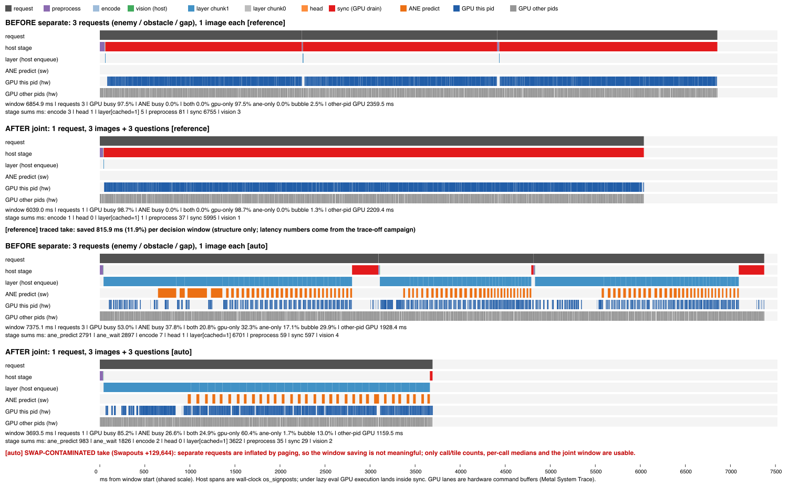

# Clef `joint` 协议 vs `separate` 协议（端到端）

"删工作"型候选：demo 每个决策问 3 个问题（enemy / obstacle / gap，各一张裁图）。

- `separate`（现状）：3 个请求 × 1 图 1 问，demo 端到端 reference 6599 ms/决策
  （[HANDOVER.md](HANDOVER.md)）
- `joint`：1 个请求 × 3 图 3 问（`MARIO_CLEF_PROTOCOL=joint`，bridge
  `examples/mario_demo/clef_local.py` 已有；`apxinf-decide-server` 单请求 ≤4 图）

测量环境：

- 测量机：Apple M1 Pro 16 GB，macOS 27.0.1
- 二进制：`apxinf-decide-server`（`--features mlx,coreml`），构建自
  `origin/showcase/clef-vision` @ `3ad92d69`，sha256 `ee6fc881e400…f26d`
- tier：**reference**（6599 ms 基线所在 tier）；时间线另录 `auto` 以回答
  ANE/GPU 重叠问题
- 证据与脚本：`devlocal/mario-opt/joint-protocol/`（git-ignored）

## 1. 环境确认（阶段 1）

`joint` **开箱可用，未改任何代码**。冒烟（每臂独立 decide-server 进程，
tape 2 决策 + 自然局 2 决策，单锁窗）4 臂全部 exit 0、Swapouts +0；joint
每决策恰好 1 个请求、3 图、3 个 `noul` 答案，bridge 正常解析。

前提修正：Tier-1 前缀缓存（默认 ON）已经让**同一进程内第一个请求之后**的
所有请求跳过 37-token chunk0。冒烟里 separate 的首请求 3308 ms，其后
2160–2436 ms/请求。所以 joint 省下的**不是** "2 × chunk0（1946.8 ms）"，而是
chunk0 之外的每请求固定成本（逐层 launch、head、sync、preprocess/encode、
请求间空隙）——由 §4 时间线量化。

冒烟已见一个决策翻转：frame `0009` 的 obstacle，separate 0.8856 → joint
0.4130。完整 parity 见 §2。

## 2. Parity（阶段 2）

输入：proto14 tape（14 帧 × 3 裁图 = 42 个答案，各帧裁图尺寸固定），经
demo 真实 bridge（`ClefLocalBackend.decide`）逐帧回放；两协议每轮各一个
独立 decide-server 进程。MLX 参考用 **bridge 逐字节相同的 payload**：
joint = `joint-demo-style-42`（既有），separate = 新建
`separate-bridge-42`（`DEFAULT_STATE` + `scene\nquestion`，42 案，补上
"demo 真实 separate payload 从未对 MLX 验过"的缺口）。标签取自
`suite/manifest.json`（`crops.*.label`），判定阈值 p > 0.5。

| 比较 | n | 决策一致 | median\|Δp\| | max\|Δp\|（worst） | >0.035 |
| --- | --- | --- | --- | --- | --- |
| A/A separate（r0 vs r1、r0 vs r2） | 42 | 42/42 | 0 | **0**（f32 逐位一致） | 0 |
| A/A joint（r0 vs r1、r0 vs r2） | 42 | 42/42 | 0 | **0**（f32 逐位一致） | 0 |
| **apxinf joint vs apxinf separate**（3 轮完全相同） | 42 | **38/42** | 0.0246 | **0.736**（0045/obstacle） | 14 |
| apxinf joint vs MLX joint | 42 | 42/42 | 0.0025 | **0.274**（0009/obstacle） | 1 |
| apxinf separate vs MLX separate-bridge | 42 | 41/42 | 0.0027 | 0.053（0012/enemy） | 3 |
| **MLX joint vs MLX separate-bridge** | 42 | **39/42** | 0.0275 | **0.748**（0009/obstacle） | 13 |

apxinf joint vs separate 的 4 个翻转（p_joint / p_separate / 标签）：

| case | joint | separate | 标签 | MLX 复现？ |
| --- | --- | --- | --- | --- |
| 0009/obstacle | 0.413 | 0.886 | True | ✓（MLX 0.139 / 0.887）→ joint **漏判障碍** |
| 0013/obstacle | 0.283 | 0.737 | True | ✓（MLX 0.312 / 0.731）→ joint **漏判障碍** |
| 0045/obstacle | 0.040 | 0.776 | False | ✓（MLX 0.042 / 0.770）→ joint 改对 |
| 0012/enemy | 0.093 | 0.526 | True | 阈值边缘：MLX separate 0.473 本身已在另一侧 |

标签准确率（tape 42 案）：apxinf separate **32/42**、apxinf joint
**30/42**、MLX separate-bridge 31/42、MLX joint 30/42（apxinf joint 与
MLX joint 错的 12 案完全相同）。

解读：

1. **三个 obstacle 翻转是模型级的**：参考实现 MLX 在同一对 payload 上
   翻转同样的 3 案、方向相同。joint 改的是模型输入（3 图同上下文 +
   "This question refers to image N of 3."），不是数值等价变换；其中 2 案
   是把真实障碍判成"无"——demo 里会直接撞管道。这一条 ApxInf 侧修不了。
2. **实现侧还有一处偏离**：apxinf joint vs MLX joint 决策 42/42 一致，但
   0009/obstacle |Δp| = 0.274，超过本线 0.035 的门。未发表的前次研究
   （`signpost-timeline-candidates` worktree，未提交的 `JOINT-PROTOCOL.md`
   §4）在 frame 0000 上逐 stage dump 过：多图模式下 obstacle 裁图的
   `vision_rows` 95.3 % 元素与单图不同（block00 起 0.18 % → 逐块放大），
   enemy ≈ ulp、gap 逐位一致，且与该图在多图中的位置无关。机制推测（未单独
   验证）：`vision.rs` 把多图 patch 行拼成一条序列做 linear（行数 1512 而非
   单图 432–600），注意力才按图分段；GEMM 形状改变带来的 ulp 级舍入差在
   obstacle 裁图的激活链上被病态放大。
3. separate 自身对 bridge-style MLX 的 max|Δp| 是 0.053（0012/enemy，阈值边缘
   翻转）——历史 0.0328 用的是 suite state，不是 demo 真实 payload。这一条
   与 joint 无关，单独记下。

**判定：parity 不过**（行为等价 38/42 = 90.5 %；实现门 0.274 > 0.035）。

## 3. 延迟（阶段 3）

单锁窗（`~/.cache/enginetailor/metal-measure.lock` → `/tmp/enginetailor-metal.lock`，
阻塞等待，持有整个窗口，取锁时无其它持有者），3 轮、奇数轮反序；每轮先
tape、后自然局（`evaluate.py --policy clef --seed 0 --max-decisions 12`，
`MARIO_CLEF_WARM_START=1` 对称暖启）。每臂独立进程、前后 `vm_stat`、每 3 s
扫描外来模型进程。**12/12 臂 exit 0、Swapouts +0、外来进程 0 → 3 轮全干净。**
各臂去掉首决策（Tier-1 填充）后配对；gain = (separate − joint) / separate，
3 轮合并，bootstrap（b = 4000，seed 42）取中位数 CI95。

| 工作负载 | 配对 | separate 中位 | joint 中位 | 省 | gain 中位 | CI95 | joint 更快 |
| --- | --- | --- | --- | --- | --- | --- | --- |
| tape（按帧配对，同输入） | 39 | 6788.1 ms | 5991.6 ms | 789.2 ms | **+11.57 %** | [11.32 %, 12.03 %] | 100 % |
| 自然局（按决策序号配对） | 30 | 6782.6 ms | 5996.2 ms | 783.0 ms | **+11.55 %** | [11.24 %, 11.76 %] | 100 % |

各轮 tape gain：+11.69 / +11.54 / +11.57 %；自然局：+11.55 / +11.75 /
+11.17 %。separate 每请求 server 中位：enemy 2180.7、obstacle 2164.8、gap
2446.1 ms；joint 单请求 5991.3 ms。separate tape 最短请求 2145 ms ⇒ 没有
Tier-2 命中，两臂不对称不成立。

自然局两协议在第 2 决策就分叉（separate 把 gap 误判为 0.63 → 跳；joint
0.04 → 跑）：separate 11 决策、x = 313、撞敌死亡（两次假阳跳反而前进更
远）；joint 跑满 12 决策、x = 213、全程未遇到任何正标签。自然局因此只用于
延迟，不能用来比准确率。

**延迟判定：远超 2 %（+11.6 %，CI 下界 +11.2 %）。**

## 4. before/after 算子时间线（阶段 4）

方法（timeline-method 双轴）：

- 每 take 一个常驻 decide-server，由录制脚本拉起、像 bridge 一样一次喂
  一个请求，共 8 个 bridge 逐字节 payload：1–3 separate（frame 0012）、4
  joint（0013）做 Tier-1 填充与冷启动，**不录**；5–7 = BEFORE（frame 0000
  的一次 separate 决策，含请求间空隙），8 = AFTER（同帧 joint）。8 的
  图像键是 3 图集合，不会从 5–7 命中 Tier-2。
- 软件轴：`APXINF_CLEF_SIGNPOST=1` 的 os_signpost（request / preprocess /
  encode / vision / layer / head / sync，auto 另有 ane_wait / ane_predict）。
  硬件轴：`xctrace record --template 'Metal System Trace' --instrument
  'Points of Interest' --all-processes --time-limit 40s`，在请求 5 前开始；
  导出按 server pid 过滤，再经 timeline-method 的 `xctrace_to_perfetto.py`
  转 Perfetto（两 take 均 `perfetto_invalid = 0`）。
- 同一锁窗里先跑一遍 signpost 关、不录制的 plain run：traced vs plain
  答案两 take 都是 **8/8 逐位一致**（观测不改数值）。traced 的毫秒数只
  用来看结构，延迟结论以 §3 的 trace-off campaign 为准。

take 记录：

| take | 结果 | Swapouts | 用途 |
| --- | --- | --- | --- |
| reference #1（`--launch` + `--target-stdin`） | 目标进程卡在 main 之前（176 KB RSS、0 % CPU），ktrace 溢出涨到 1.69 GB；已杀掉并删除 ktrace / trace。暂存目录本身在 `~/Documents` 下，推测与 [TIMELINE-OPERATOR.md](TIMELINE-OPERATOR.md) §2.2 的 TCC 边界 `open()` 挂死同型（未采栈确认） | — | 不用；改 `--all-processes`，server 由录制脚本而非 xctrace 拉起 |
| **reference #2** | xctrace exit 0，ktrace 1.3 GB 已删 | **+0** | **主结论** |
| auto #1 | xctrace exit 0，ktrace 1.4 GB 已删 | **+129,644** | **swap 污染**：只用调用数、tile 数、逐调用中位数、joint 窗口 |
| auto #2（加了 swap 稳定等待） | plain server 在加载期退出（`server closed stdout`），swap 已用 2.63 / 4 GB、磁盘余 15.6 GiB | +0 | 未录；swap 池饱和，按 skill 停止重试 |

### 4.1 reference（干净，主结论）

| | BEFORE separate（3 请求） | AFTER joint（1 请求） | 省 |
| --- | --- | --- | --- |
| 决策窗口 | **6854.9 ms**（2241.7 + 2169.0 + 2443.6；空隙 0.19 / 0.34 ms） | **6039.0 ms** | **815.9 ms（11.9 %）** |
| 本进程 GPU 忙（硬件 command buffer 并集） | 6686.0 ms（97.5 %） | 5962.1 ms（98.7 %） | **723.9 ms** |
| GPU 空泡（窗口 − GPU 忙） | 168.9 ms | 76.9 ms | 92.0 ms |
| `sync` span（lazy eval 下 GPU 执行落在这里） | 6755.5 ms | 5995.3 ms | 760.1 ms |
| `preprocess` | 80.9 ms（3 次） | 36.8 ms（1 次） | 44.1 ms |
| `layer` 入队（全 cached=1，无 chunk0） | 4.9 ms（96 次） | 1.1 ms（32 次） | 3.8 ms |
| vision / encode / head | 3.3 / 3.0 / 1.4 ms | 1.0 / 0.9 / 0.5 ms | 5.4 ms |
| tokens / vision rows | 306 / 302 / 326；480 / 432 / 600 | 824；1512 | |
| 其它进程 GPU（Ventura、WindowServer） | 2359.5 ms | 2209.4 ms | |

省下的 815.9 ms = **GPU 忙时间少 723.9 ms + GPU 空泡少 92.0 ms**：

- GPU 部分：逐请求 GPU 忙 2154.7 / 2127.2 / 2404.1 / 5962.1 ms 对
  chunk1 token 数 269 / 265 / 289 / 787 做两参数线性拟合，得
  **≈ 227.8 ms/次前向 + 7.29 ms/token**（残差 −34 / −32 / +70 / −3 ms）。
  joint 少 2 次前向 ≈ 456 ms，chunk1 token 总数 823 → 787（少 36）≈
  262 ms，合计 ≈ 718 ms，对上 723.9 ms。截距是 4 点拟合的结果，
  "每次前向固定成本"的具体成分（权重读取、逐层 launch、非线性项）没有
  单独测。
- 空泡部分：preprocess 少 44.1 ms，其余 host stage ≈ 9 ms，请求间空隙
  ≈ 0.5 ms（bridge 往返可忽略），剩余 ≈ 38 ms 未细分（sync 尾部 / 读回）。
- 没有 chunk0 的节省：录制窗内 128 个 layer span 全是 `cached=1`，Tier-1
  已经把它去掉了（§1 的前提修正在时间线上得到确认）。
- 其它进程每窗口占 ≈ 2.2–2.4 s GPU，与本进程重叠；两臂同等受影响，
  但 6599 ms 基线本身可能含有这类争用。

### 4.2 auto（ANE/GPU 重叠，swap 污染 take）

可用的结构事实（调用数、tile 数、逐调用中位数）：

| | separate（请求 5 / 6 / 7） | joint（请求 8） |
| --- | --- | --- |
| `ane_predict` 调用 × tile | 3 × 32 次 × **1 tile**（chunk1 269 / 265 / 289 token） | 32 次 × **2 tile**（787 token） |
| `ane_predict` 中位（host 阻塞 wall-clock） | 28.2 / **21.1** / 24.0 ms | 29.8 ms（≈ 14.9 ms/tile） |
| `ane_wait` 中位（等 GPU 产出 ANE 输入 pack） | 23.8 / 21.2 / 23.7 ms | 53.7 ms |
| `layer` 中位（含 wait + predict） | 53.0 / 44.0 / 45.1 ms | 85.0 ms |
| ANE 被 GPU 覆盖 / 空泡 | 40.2 / **69.9** / 66.6 %；31.1 / **16.2** / 37.5 % | **93.5 %；13.0 %** |

joint 窗口 3693.5 ms：GPU 忙 85.2 %、ANE 忙 26.6 %；both 24.9 %、
gpu-only 60.4 %、ane-only 1.7 %、bubble 13.0 %。

解读与边界：

- joint 把每层 3 次 1-tile ANE 调用合成 1 次 2-tile 调用，逐 tile 的
  predict 开销从 ≥ 21.1 ms 降到 ≈ 14.9 ms；每层的 GPU 段随 token 数变长
  （`ane_wait` 53.7 ms），ANE 几乎全程被 GPU 覆盖（93.5 %，ane-only 仅
  1.7 %）。separate 中最接近 plain 的请求 6（1721 ms，plain 1438 ms）覆盖
  69.9 %、空泡 16.2 %，方向一致。
- 但 separate 三个请求被 paging 拉长（3091 / 1721 / 2561 ms，对 plain
  1468 / 1438 / 1585 ms），窗口级比较（"省 49.9 %"）**没有意义**，不报。
- 同窗 plain run（signpost 关，但同在污染窗口）：separate 5–7 合计
  4490.8 ms（与 auto 基线 4467.5 ms 一致），joint 3817.6 ms，约 −15 %。
  **只作指示**，不是测量结论；auto 的正式数字需要重启后的干净窗口。
- `ane_predict` / `ane_wait` 是 host wall-clock（含排队），不是 ANE 硬件
  执行时间；Metal System Trace 不含 ANE 硬件轨（需要 Core AI 模板）。

## 5. 结论

**NOT-WORTH（作为默认协议）。** `joint` 开箱能跑，延迟收益真实且稳定，
但 parity 不过：

- 延迟：reference tier 3/3 轮干净，tape **+11.57 %**（CI95 [11.32 %,
  12.03 %]，39 对，100 % 更快，省 789 ms/决策），自然局 **+11.55 %**
  （CI95 [11.24 %, 11.76 %]，30 对）。远超 2 % 门。
- 卡点 1（模型级，ApxInf 侧修不了）：joint 改变了模型输入，MLX 参考
  复现同样 3 个 obstacle 翻转，其中 2 个是**漏判真实障碍**；标签准确率
  separate 32/42 → joint 30/42。
- 卡点 2（实现级）：apxinf joint vs MLX joint 在 0009/obstacle 上
  |Δp| = 0.274 > 0.035（多图 vision 漂移，机制未单独验证）。
- 时间线：省下的是**每次前向的 GPU 固定成本 + 少 36 个 token**（≈ 456 +
  262 ms GPU，+ 92 ms 空泡，其中 preprocess 44 ms），不是 chunk0；请求间
  空隙只有 0.5 ms，bridge 不是瓶颈。auto 下 joint 把 ANE 调用合成 2-tile、
  ANE 被 GPU 覆盖 93.5 %，但 separate 对照被 swap 污染，只能定性。

下一步建议：

1. 想要这 ≈ 720 ms 的 GPU 固定成本而不改模型输入：评估"批量 separate"
   ——3 个单图请求在一次前向里以 batch（或块对角注意力）执行，每个问题的
   上下文与 separate 相同。这是假设，需要先确认每次前向成本确实可以跨
   序列摊销，以及 GEMM 形状变化不会像多图 vision 一样放大 obstacle 漂移。
2. 若产品上仍考虑 joint：先在更大的带标签集上评估准确率（42 案里 32 vs
   30 不足以下结论），并修/验证多图 vision 路径（逐图 linear 对照）。
3. auto 的 ANE/GPU 数字需要重启后的干净窗口重录（当前 swap 2.6 / 4 GB）。
4. 与 joint 无关但已记下：demo 真实 separate payload 对 MLX 的 max|Δp| 是
   0.053（0012/enemy），历史 0.0328 基于 suite state。
