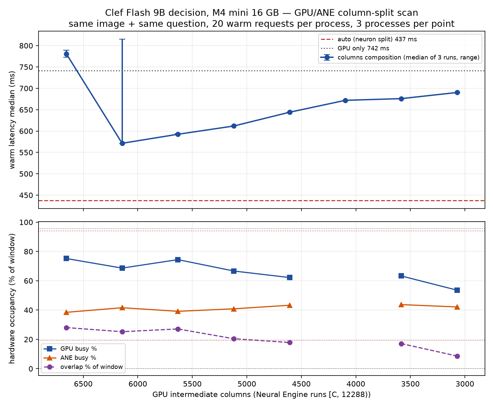
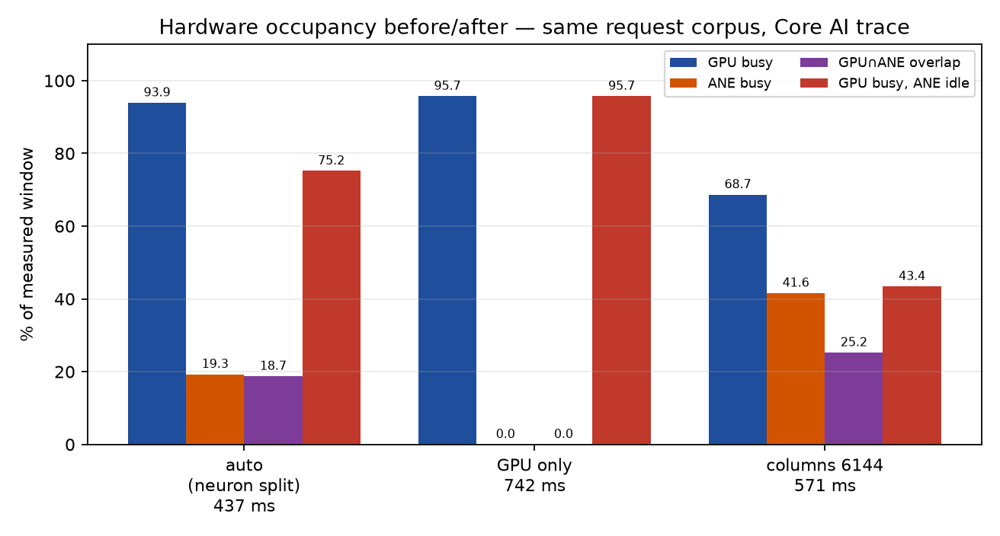
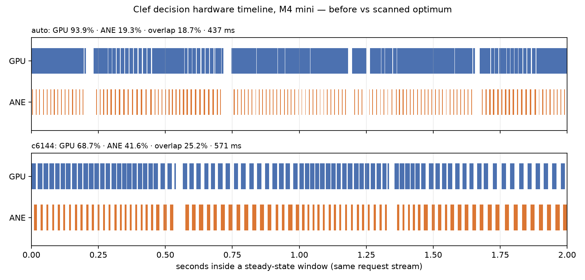

# M4 mini：Clef GPU/ANE 列拆分扫描（第一棒）

Issue #41 第一棒：在 M4 mini 上扫描 Clef GPU/ANE 列拆分，找最优点。授权来自
Issue #41 评论 `6703453938`（本 Issue 只由 M4 mini 实例执行；基线数据与二进制
直接用，不重做）。

- 测量机：Apple M4（Mac mini，16 GB，MLX arch `applegpu_g16g`），macOS 27.0.1
  (26A434)，Xcode 27
- 基线构建：`showcase/clef-vision` @ `882448a1`（owner 的
  `~/work-clef-showcase/target/release/apxinf-decide-server`，sha256
  `033cd909…b480fe`）
- 本棒构建：分支 `agent/clef-column-scan-928c4a3c1597` @
  `<!--FILL:REV-->`（`882448a1` + 诊断门 + 扫描深度），sha256
  `<!--FILL:SHA-->`
- 请求语料：owner 的 `~/test-decide-loop.py`（`test-enemy.png`，320×400，1 个
  `noul` 问句，state 固定）；同图同问，1 图 + 1 个 noul 问句
- 纪律：每配置独立进程；2 warmup + 20 measured；3 个独立进程（轮次反序），
  同配置取轮中位数的中位数；EngineTailor 双测量锁；记录 `vm_stat` Swapouts、
  swap 使用量与 loadavg
- 硬件计数：Core AI instrument，`xctrace record --attach <pid>`，15 s 窗口；
  GPU 按 server pid 过滤；ANE 硬件区间（无 pid 列）在锁内静默窗口记录，并保留
  程序标签直方图以识别外来 ANE 活动；overlap = ANE 区间 ∩ GPU 区间

## 0. 结论

<!--FILL:RESULT-->

## 1. 旋钮确认（关键事实）

- 列拆分旋钮是 `APXINF_CLEF_ANE_COLUMNS`，语义为 **GPU 保留的 intermediate
  列数** `C`：GPU 计算 `[0, C)`，Neural Engine 计算 `[C, 12288)`。未设置时是
  qualified 默认值 `6656`（`GPU_COLUMNS`）。
- **M4 的 `auto` 不选列拆分。** `metal_clef::mod::select` 在
  `applegpu_g16g` 上返回 `GpuAneNeurons`（神经元拆分：5632 个 INT8 + 1248 个
  FP16 神经元在 ANE，其余 5408 个在 GPU）；列拆分只在 `applegpu_g13s`
  （M1 Pro）上自动启用。因此 owner 的 630 ms 基线是**神经元拆分**；
  `APXINF_CLEF_ANE_COLUMNS` 在 M4 的 `auto` 下是 inert 的。
- 本棒新增 `APXINF_CLEF_COMPOSITION` 诊断门（`reference` / `gpu` /
  `gpu-ane-columns` / `gpu-ane-neurons`）：未设置保持 `auto`；显式
  `LoadOptions::model_variant` 优先；强制组合绕过 architecture 资格门，因此
  只用于测量，默认值不变。列深度从 6656/5632/4608 扩到
  6656/6144/5632/5120/4608/4096/3584/3072。
- 几何：down 权重按至多 4096 宽分 part，part 宽必须是 64 的倍数。3584 让 ANE
  拿 8704 列，分成 3×2944，尾部 128 列零填充（零行/零列，不参与求和，数值上
  严格无贡献）。6656 仍是唯一 qualified 默认值。
- 「只 GPU」 = `APXINF_CLEF_COMPOSITION=gpu`（GPU composition，无 ANE）。
  「只 ANE」不可行：attention/GDN/投影/head/vision 仍由 GPU/MLX 执行；把 MLP
  的 12288 列全部给 ANE（`C=0` 的几何虽被支持）是另一个组合，未在本棒验证，
  也仍不是「只 ANE」。

## 2. 方法

- 每次 run：新进程加载 checkpoint（Core ML 程序编译可缓存）→ warmup 2 →
  同一请求连续 20 次；server 自报的 `latency_ms`（覆盖图片解码到概率可用）是
  测量量，另记 wall time。
- 每个配置 3 个独立进程，轮次顺序为正向、反向、正向；同一配置的统计量取 3 个
  进程内中位数的中位数，并给出 pooled p90 与范围。
- Core AI trace：server 完成 warmup 后 `xctrace --attach`，15 s 窗口内连续发
  请求；导出 `ane-hw-intervals` 与 `metal-gpu-intervals` 表。GPU 只保留
  `process.pid == server pid` 的 command buffer 区间；ANE 表无 pid，静默窗口内
  全部区间视为本进程（标签直方图见产物）。
- 决策一致性：同图同问，比较每个配置的 `enemy.noul` 概率与 auto 基线、与默认
  列拆分 `c6656` 的差 `Δp`；`p > 0.5` 视为同一决策。
- 锁：`/tmp/enginetailor-metal.lock` 与
  `~/.cache/enginetailor/metal-measure.lock`；同机另有 EngineTailor 测量
  campaign 时串行执行，锁等待时间记录在 run 日志。

## 3. 扫描结果

<!--FILL:TABLE-->

## 4. 曲线



<!--FILL:CURVE-->

## 5. 最优点与理论下界

<!--FILL:OPTIMUM-->

## 6. 决策一致性

<!--FILL:CONSISTENCY-->

## 7. 硬件占用 before/after





<!--FILL:TRACE-->

## 8. 风险与归因边界

- 请求语料是**同图重复**（owner 基线同款）：Tier-1/Tier-2 image-prefix cache
  命中后的 steady state，vision tower 不在热路径；demo 的真实换帧负载会更重，
  本报告的绝对毫秒不可直接外推到 42 案混合图。列拆分比较本身仍然有效（拆分
  作用在 backbone MLP）。
- M4 上列拆分组合**未通过 qualification**（只在 M1 Pro 的 `applegpu_g13s`
  上 qualified）；本棒的「最优点」是测量结论，不是默认可用的产品路径。启用它
  需要另行通过 parity/质量/内存门，或只作为 env 门控实验配置。
- ANE 硬件区间表没有 pid 列，归属依赖「锁内静默窗口」与程序标签检查；若测量
  窗口内存在其他 ANE 用户，ANE busy/overlap 会被高估。GPU 区间按 pid 过滤。
- 16 GB 机器在 auto tier 上有结构性 swap 压力（历史数据）；每 run 记录
  Swapouts 增量，污染轮次在下表标注。
- 锁等待期间的系统 loadavg 会记录但不可控；延迟数字对桌面 GPU 负载敏感，
  只用于同一批次内的相对比较。

## 9. 复现

```bash
export MLX_ROOT="$HOME/mlx-sdk"
export RUSTFLAGS="-C link-arg=-Wl,-rpath,$MLX_ROOT/lib -C link-arg=-Wl,-headerpad_max_install_names"
export DEVELOPER_DIR=/Applications/Xcode.app/Contents/Developer
cargo build --release --features mlx,coreml --bin apxinf-decide-server

# 每个配置一个独立进程；C 是 GPU 列数
APXINF_CLEF_COMPOSITION=gpu-ane-columns APXINF_CLEF_ANE_COLUMNS=<C> \
  apxinf-decide-server --model ~/Agent4Kernel/models/clef-flash-4bit-b5adbe2 \
  --model-variant auto
# 只 GPU
APXINF_CLEF_COMPOSITION=gpu apxinf-decide-server --model ... --model-variant auto
```

本棒的请求循环、扫描、trace 与绘图脚本在
`devlocal/clef-column-scan/scripts/`（gitignored 的中间产物；本文件所在的
docs 只保留报告与图）。原始 run JSON、trace 与导出表在
`devlocal/clef-column-scan/{results,traces,logs}/`。

## 10. 交接（Direction / Evidence / Next candidates / Cost）

<!--FILL:HANDOFF-->

Opus: 0 次。
