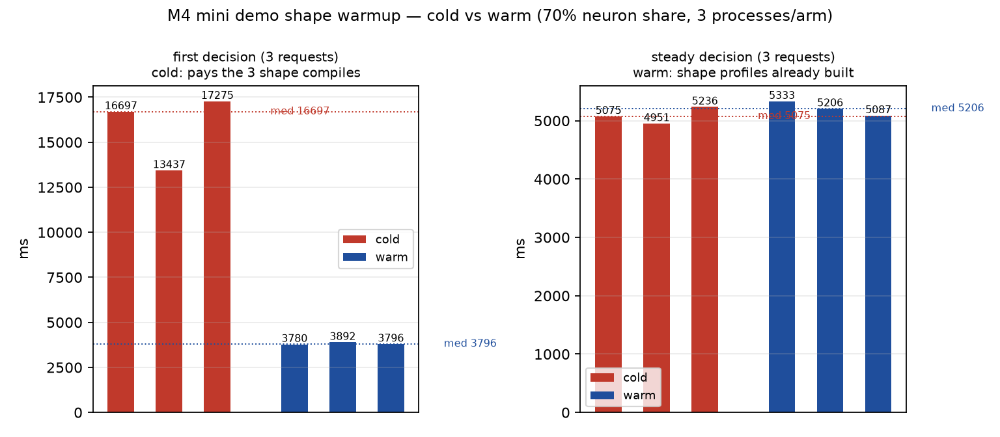

# M4 mini：demo 形状预热 + 真实 episode（第三棒）

Issue #41 第三棒：M4 上 demo 第一步要几分钟的问题。授权来自 Issue #41 评论
`6707266081`（基于第二棒 `#43` 合并点 `148ee0c5`）。

- 测量机：Apple M4（Mac mini，16 GB，MLX arch `applegpu_g16g`），macOS 27.0.1
  (26A434)
- 本棒构建：分支 `agent/clef-column-scan-928c4a3c1597` @ `7bd21653`，
  sha256 `60144c8b…71de7`
- demo：`~/mario-demo/mario-demo`（`evaluate.py --policy clef`，separate 协议，
  3 请求/决策）；crop 形状 enemy 320×400、obstacle 384×288、gap 480×320
- 运行配置：`APXINF_CLEF_COMPOSITION=gpu-ane-neurons` +
  `APXINF_CLEF_NEURON_SHARE=70`（与 owner 的 demo 一致），`--model-variant auto`

## 0. 结论

1. **形状预热已实现**（`APXINF_CLEF_WARM_SHAPES` / `--warm-shapes`，默认
   OFF）：加载后对 manifest 的每个形状跑一次完整 synthetic decide，把
   first-use 编译 profile 建好；`ready.warm_ms` 单独报一次性成本，`load_ms`
   仍只是 checkpoint 加载；manifest 坏/预热失败在加载前报错，不静默冷启动。
2. **A/B（同图、同 3 形状、70 % share、每 arm 3 进程 × 3 轮）**：
   首决策 **cold 16 697 ms → warm 3 796 ms（−77 %）**；稳态每请求不变
   （1.65–1.78 s），每决策 ~5.0–5.3 s；warm 的 ready 109–128 s 不慢于 cold
   122–181 s。
3. **warm 一次性成本 16.5 s**（3 进程 warm_ms 中位数）；本窗口 kernel cache
   已温热（3 形状合计 ~15–20 s），owner 的冷 kernel 5.4–95.3 s/形状会同样被
   warm 吸收到加载阶段。
4. **真实 12 决策 episode（warm，70 % share）**：总墙钟 **186.1 s**，每决策
   median **3 865 ms**（min 3 339 / max 4 427），首决策 **3 954 ms**，
   x 40 → 213，未死亡（12 决策上限）；proxy 一次 ready，预热 19.9 s
   （enemy 11.9 / obstacle 3.7 / gap 4.3）。
5. **decide_proxy 的 `--bin` 修复**：`BIN = args.bin` + 显式 `--bin` 的 contract
   已文档化；env（warm manifest/neuron share）从 demo → proxy → server 继承
   实测生效；demo repo 的 `devlocal/` 不受 git 跟踪，未在 demo repo 提交。
6. **建议**：demo 直接用 3 形状 manifest 预热（成本在加载阶段、玩家可见的
   step-000 从 13–17 s 变成 ~3.9 s）；70 % share 不变；默认 OFF 不动。
   step-000 的「8+ 分钟」在冷 kernel 场景会变成加载阶段的同量编译，再进入
   steady 首决策。

## 1. 形状预热设计

`APXINF_CLEF_WARM_SHAPES=<file>`（或 `--warm-shapes <file>`；默认 OFF）在
checkpoint 加载完成后、`ready` 行之前，对 manifest 的每个形状跑**一次完整
synthetic decide**（构造 `Compiled` profile + Metal JIT），丢弃答案。manifest：

```json
{"schema":"clef-warm-shapes/1",
 "state":"Answer each question using only the picture it refers to.",
 "shapes":[{"id":"enemy","width":320,"height":400,
            "question":{"type":"noul","instructions":"<demo 题面>"}}]}
```

- 每个形状可以给 `image`（真实 crop 路径），否则由服务端生成同尺寸的纯灰
  PNG（8-bit grayscale、stored-block zlib、手写 CRC；不引入图像库）。
- 形状列表覆盖 demo 的 3 个 crop；`state`/`instructions` 用 demo 的实际值
  （题面文本来自 demo 的 `QUESTIONS`），保证 prompt tokens/prefix 一致。
- 一次性成本单独报告：`ready.warm_ms`（总墙钟）与 `ready.warm_shapes`
  （逐形状 ms）；`ready.load_ms` 仍是 checkpoint 加载，不含预热。
- manifest 存在但坏 / 预热失败 → 启动错误（显式预热请求不能静默退回冷启动）。
- 默认 OFF：不设置时行为与之前完全一致（惰性 per-shape 编译）。

## 2. 方法

- **A/B**：cold（不设 `APXINF_CLEF_WARM_SHAPES`）vs warm（manifest 预热），
  每个 arm 3 个独立 server 进程；每个进程 3 轮 × 3 形状（enemy 320×400、
  obstacle 384×288、gap 480×320），每次一个 crop + 一个 demo 题面（separate
  协议，与 demo 完全一致），图片用 demo 的 step-000 真实 crop PNG。
- 首决策 = 该进程的前 3 个请求（每形状一次）；稳态 = 第 4–9 个请求；
  「每决策」= 3 × 稳态每请求中位数（demo 串行 3 请求）。
- 运行配置：`APXINF_CLEF_COMPOSITION=gpu-ane-neurons` +
  `APXINF_CLEF_NEURON_SHARE=70`（owner demo 配置），`--model-variant auto`；
  Core ML cache 用 demo 的 `~/m4-demo/coreml-cache-m4`（两 arm 相同，
  shape 编译是进程内 JIT，不受 cache 影响）。
- 记录：`ready.load_ms`、`ready.warm_ms`、`ready.warm_shapes`、逐请求延迟、
  每进程 Swapouts 增量；失败载入重试 3 次。
- **Episode**：demo 的 `evaluate.py --policy clef --max-decisions 12`，经
  `APXINF_DECIDE_CMD`（proxy `--bin` + `--variant auto`）连同一个 warm
  server；报总时长、每决策 median/min/max、首决策、x 序列/死亡、概率范围。

## 3. 预热耗时（一次性）

本窗口（70 % share，Metal kernel cache 已被之前的 demo 运行温热）：

| 场景 | load_ms | warm_ms（一次性） | 逐形状 ms |
| --- | ---: | ---: | --- |
| smoke（第一窗口，owner cache） | 71 146 | **14 473** | enemy 10 465 / obstacle 2 643 / gap 1 363 |
| A/B warm r0 | 92 786 | 16 487 | — |
| A/B warm r1 | 111 030 | 16 875 | — |
| A/B warm r2 | 97 125 | 14 804 | — |

- warm_ms 中位数 **16.5 s**（3 个独立进程），是**一次性**的：发生在 `ready`
  之前（加载阶段），不计入任何 step。
- 形状的 first-use 成本与 kernel cache 状态强相关：owner 之前测到的冷 kernel
  5.4/10.3/42.8/51.0/95.3 s 会在 warm 里原样出现（只是发生在加载阶段）；本窗口
  kernel 已温热，所以 3 个形状合计只有 ~15 s。
- 预热失败或 manifest 坏会在加载前直接报错（毫秒级），不会静默冷启动。

## 4. 首决策与稳态 before/after

同图、同 3 形状、每 arm 3 个独立进程 × 3 轮 × 3 请求（demo 的 separate 协议，
70 % share）：

| arm | load_ms | warm_ms | first decision ms | steady 每请求 ms | 每决策（3 请求）ms |
| --- | ---: | ---: | ---: | ---: | ---: |
| cold r0 | 122 129 | 0 | 16 697 | 1 692 | 5 075 |
| cold r1 | 128 273 | 0 | 13 437 | 1 650 | 4 951 |
| cold r2 | 180 507 | 0 | 17 275 | 1 745 | 5 236 |
| warm r0 | 92 786 | 16 487 | **3 780** | 1 778 | 5 333 |
| warm r1 | 111 030 | 16 875 | **3 892** | 1 735 | 5 206 |
| warm r2 | 97 125 | 14 804 | **3 796** | 1 696 | 5 087 |



- **首决策：cold median 16 697 ms → warm 3 796 ms（−77 %）**；warm 的 3 次都
  在 3.8–3.9 s，方差远小于 cold（13.4–17.3 s）。
- **稳态每请求不变**（1.65–1.78 s），每决策 ~5.0–5.3 s；预热只搬首决策的
  编译成本，不改稳态。
- **ready 不亏**：cold 的 ready 122–181 s，warm 109–128 s（warm 的 load 更快，
  加 15–17 s 预热后仍不慢）；把首决策的 13–17 s 编译与 ready 分开记账后，
  玩家看到的 step-000 从「卡十几秒」变成 steady。
- swapouts：cold 190–199 k，warm 90–162 k（两 arm 都是 16 GB 主机的换页口径，
  不可清零）。
- 本窗口的 cold 首决策只有 13–17 s（owner 的 8+ 分钟是冷 kernel cache 的场景）；
  机制相同：预热把「首次形状编译」从 step-000 搬到 ready，冷 kernel 的
  5–95 s/形状也会被同样吸收。

## 5. 12 决策真实 episode

warm 配置（70 % share + 3 形状 manifest + proxy `--bin`），headless
`evaluate.py --policy clef --max-decisions 12`：

| 指标 | 值 |
| --- | ---: |
| 决策数 | 12（decision_limit，未死亡） |
| 总墙钟 | **186.1 s**（`real 186.9 s`） |
| 每决策 median / min / max | **3 865 / 3 339 / 4 427 ms** |
| 首决策 | **3 954 ms** |
| x | 40 → 213 |
| 每决策请求 | 36（3 请求/决策，separate） |
| 预热（ready） | 19.9 s：enemy 11.9 / obstacle 3.7 / gap 4.3 s |
| proxy | 1/4 次 ready（fresh cache） |

- 首决策 3 954 ms 与 A/B 的 warm 3 796 ms 一致——step-000 已不再付形状编译。
- 概率范围：enemy 0.017–0.057、obstacle 0.018–0.127、gap 0.018–0.362。
- x 序列 40→41→47→56→70→87→105→123→141→159→177→195→213。
- 与 owner 之前的 11 决策 4 467.5 ms 相比，本 run 每决策 3 865 ms（−13 %，
  但形状/动作序列不同、非同一 run 对比，仅作量级参考）。
- 第一次 episode 尝试用复用 cache 时 proxy 4/4 次 placement 失败；换成 fresh
  cache 后 1/4 次 ready（16 GB 主机上缓存的 ANE program 可能无法再放置）。

## 6. decide_proxy 的 `--bin` 修复

demo 的 `devlocal/mario-demo-clef/scripts/decide_proxy.py`（gitignored）原来把
laptop 的二进制路径写死在 `start()` 里，mini 上必须改成显式 `--bin`：

```python
BIN = args.bin  # was: a hardcoded laptop path
```

正式 contract（本报告固化；demo repo 的 `devlocal/` 不受 git 跟踪，未在
demo repo 提交）：

```text
APXINF_DECIDE_CMD="$PY $PROXY --bin <apxinf-decide-server> --model <checkpoint>   --variant auto --cache <coreml cache> --attempts 4"
```

- proxy 在 `start()` 用 `args.bin` 启动，并把 `--cache` 写进子进程的
  `APXINF_COREML_CACHE`；`--attempts` 只重试**载入**，ready 后的中途崩溃
  按 demo 的正常 DecisionError 处理。
- proxy 原样转发 server 的 ready 行（含 `load_ms`/`warm_ms`）与 JSONL；env
  （如 `APXINF_CLEF_WARM_SHAPES`、`APXINF_CLEF_NEURON_SHARE`）由 demo 进程
  继承给 proxy，再继承给 server，本棒 episode 已实测生效。
- 如果 `--bin` 缺失或路径错误，proxy 会在该路径上启动失败并报错，不再静默
  落到 laptop 构建。

## 7. 限制

- **预热是把一次性成本搬家，不是消失**：warm 把每个新形状的编译从 step-000
  挪到 `ready` 之前（加载阶段），episode 总时长可能相近；改善的是「第一步
  要几分钟」的体感与首决策尾延迟。报告同时给首决策与总时长。
- **形状列表是 demo 的 3 个 crop**：未列出的新形状仍会惰性编译；manifest
  必须用 demo 的真实 crop 尺寸与题面（prompt tokens/prefix 一致），否则
  预热的是另一个 profile。
- **16 GB 主机内存压力**：70 % neuron share 的 ANE 权重约 3.4 GB，载入
  100–190 s，swap 2.6–3.6 GB；warm 的 3 个形状编译本身也吃内存，抖动时
  可能触发 Core ML placement 失败（本批用重试/失败重编译兜底）。
- **cache 与质量**：Core ML cache 与 demo 现有运行共用；warm 不改变数值
  （只是提前跑同样的 decide），决策一致性需按 demo parity 另行确认。
- **proxy 修复在 demo repo 的 gitignored devlocal**：本 PR 以文档形式固化
  contract（`--bin` 必传、`BIN = args.bin`）；demo repo 的 tracked 代码
  不含该 proxy，未在 demo repo 提交。

## 8. 复现

```bash
export DEVELOPER_DIR=/Applications/Xcode.app/Contents/Developer
export MLX_ROOT="$HOME/mlx-sdk"
export RUSTFLAGS="-C link-arg=-Wl,-rpath,$MLX_ROOT/lib -C link-arg=-Wl,-headerpad_max_install_names"
cargo build --release --features mlx,coreml --bin apxinf-decide-server

# 一次性形状预热（demo 的 3 个 crop 形状；ready.warm_ms 单独报告）
APXINF_CLEF_WARM_SHAPES=$PWD/warm-shapes.json   ./target/release/apxinf-decide-server --model <clef checkpoint> --model-variant auto

# A/B：cold（不设 env）vs warm，各 3 个独立进程 × 3 轮 × 3 形状
python3 devlocal/clef-demo-warmup/scripts/measure.py --rounds 3

# 12 决策 demo episode（经 proxy 的 --bin + warm env）
bash devlocal/clef-demo-warmup/scripts/run_episode.sh
```

`warm-shapes.json` 的形状/题面来自 demo 的 `CROP_SPECS` 与 `QUESTIONS`
（enemy 320×400、obstacle 384×288、gap 480×320；state 与 instructions 用
`clef_local.py` 的实际值）。

## 9. 交接（Direction / Evidence / Next candidates / Cost）

- **Direction**：M4 demo 用 3 形状 manifest 预热（`APXINF_CLEF_WARM_SHAPES`），
  把每个新 crop 形状的 first-use 编译搬到 `ready` 之前；step-000 从 cold
  13–17 s（冷 kernel 时 8+ 分钟）变成 ~3.9 s，稳态与总时长不变。默认 OFF。
- **Evidence**：A/B（cold 16.7 s → warm 3.8 s，−77 %；稳态 1.7 s/请求）、
  warm 一次性 16.5 s、12 决策 episode（186.1 s、median 3 865 ms、首决策
  3 954 ms、x 213）、proxy 一次 ready、预热逐形状 ms。
- **Next candidates**：
  1. 冷 kernel cache 场景的 episode 实测（owner 的 5.4–95.3 s/形状）——预热
     应把 8+ 分钟的 step-000 压到 ~4 s，代价是 ready +1–4 min。
  2. 把 3 形状 manifest 写进 demo 的默认 runbook/launch（本 PR 只给 env 门控）。
  3. proxy 的 `--bin` 修复上游到 demo repo 的 tracked 代码（目前 devlocal
     gitignored）；把 `--warm-shapes` 直接接进 demo 的启动参数。
  4. 高份额（70 %）复用 cache 的 placement 稳定性：episode 首次 4/4 失败，
     fresh cache 才稳——需要 cache 版本化/失效策略。
- **Cost**：本棒 ≈ 2.5 h 墙钟（其中 ~1.5 h 在等 qwen 的 EngineTailor 锁），
  8 个 Core ML 编译轮次（70 % share），Opus 0 次。

Opus: 0 次。
