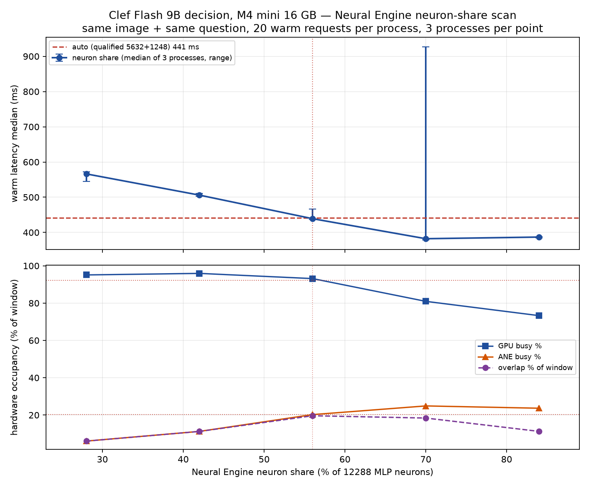
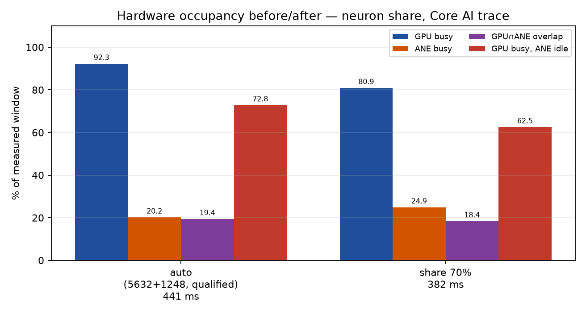
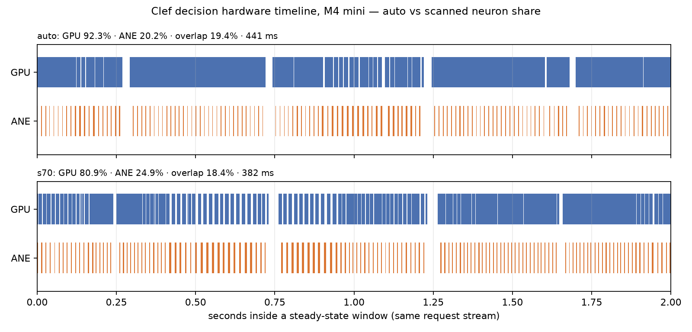

# M4 mini：Clef 神经元拆分调参（第二棒）

Issue #41 第二棒：M4 的神经元拆分（neuron split）调参。授权来自 Issue #41
评论 `6705119162`（第一棒 PR #42 已合并 `61ef08c7`，本棒基于该合并点）。

- 测量机：Apple M4（Mac mini，16 GB，MLX arch `applegpu_g16g`），macOS 27.0.1
  (26A434)
- 本棒构建：分支 `agent/clef-column-scan-928c4a3c1597` @ `fb25a2b9`
  （`61ef08c7` + neuron share 旋钮），sha256 `4056b0c3…7b4016`
- 请求语料：owner 的 `~/test-decide-loop.py`（`test-enemy.png`，1 个 `noul`
  问句）；同图同问
- 纪律：每配置独立进程；2 warmup + 20 measured；3 个独立进程；EngineTailor
  双测量锁；逐 run 记录 Swapouts/loadavg；Core AI trace 每配置 15 s
- 诊断门：`APXINF_CLEF_COMPOSITION=gpu-ane-neurons` +
  `APXINF_CLEF_NEURON_SHARE=<百分比>`

## 0. 结论

1. **几何**：每个 MLP 的 12288 个 neuron 按 int8 误差升序，前 5632 个以 INT8、
   接下来 1248 个以 FP16 跑在 ANE（合计 56.0 %），其余 5408 个留在 GPU。
   `APXINF_CLEF_NEURON_SHARE` 把 ANE 份额做成诊断旋钮（保持 INT8:FP16 比例）；
   未设置时逐位保留默认。几何硬约束：ANE 总数必须是 32 的倍数（GPU 的剩余
   Q4 gate/up 行按 32 行块 decode）、INT8 份额的 down part 必须整且 64 倍数、
   FP16 份额为正。
2. **扫描（6 点 × 3 进程 × 20 warm 请求）**：auto **441.3 ms**；28 % **566.2**；
   42 % **506.0**；56 % **439.0**（A/A 控制，与 auto 几乎逐位一致）；**70 %
   382.2 ms（−13.4 %）**；84 % 386.9 ms。中位数最优点是 **70 %**。
3. **硬件占用**：默认 56 % 时 GPU 92.3 % 忙、ANE 20.2 %——GPU 是瓶颈；70 % 时
   GPU 80.9 %、ANE 24.9 %；84 % 时 GPU 73.3 %、ANE 23.7 %，但 overlap 从
   18.4 % 掉到 11.2 %，延迟不再改善。低份额（42/28 %）把更多 neuron 推回 GPU，
   GPU 占用升到 95.9/95.1 %，延迟回升到 506/566 ms。
4. **引擎工作量（按请求）**：56 % GPU 381.3 / ANE 83.5 ms；70 % GPU 358.6 /
   ANE 110.3；84 % GPU 370.1 / ANE 119.4；42 % GPU 436.8 / ANE 51.2；28 %
   GPU 482.6 / ANE 30.7。GPU 在所有份额上仍是更忙的引擎；线性拟合在
   0–100 % 内没有交点，理论上「全给 ANE」才会反超，但 ANE 权重 residency
   先把高份额卡住了。
5. **可靠性**：70 % 的 ANE program 权重约 3.4 GB（cache 尺寸），载入 103–123 s，
   3 次里 1 次进入换页抖动（975 ms），另两次 379.5/382.3 ms；84 % 约 4.5 GB，
   载入 132–190 s，冒烟那次抖动到 1824 ms，干净运行 384–388 ms。默认 56 %
   约 2 GiB、载入 ~100 s，是稳定的点。**70 % 的中位收益真实，但尾部风险是实质性的。**
6. **决策一致性**：所有份额的 `enemy.noul` 概率在 0.01578–0.01615，max|Δp| =
   **0.00025**（≪ 0.035），决策全部相同；56 % 控制点与 auto 概率逐位一致
   （Δp = 0）。
7. **建议**：把 **70 %** 作为 env 门控实验最优点
   （`APXINF_CLEF_COMPOSITION=gpu-ane-neurons` + `APXINF_CLEF_NEURON_SHARE=70`），
   **默认不动**；在翻默认值之前需要一轮资格门（58–70 % 更细步长 + 重复载入
   稳定性 + parity/质量/内存）。收益 13.4 % 远超 2 %，不是 NOT-WORTH，但被
   ANE residency 的稳定性 gate 住。
8. **437 ms 还能降到多少**：在干净运行里到 **~382 ms**（−13 %）；引擎下界
   估计 ~359 ms（70 % 的 GPU 工作量）+ host 串行边 ~23 ms。想再往下需要削减
   GPU 的非 MLP 工作（attention/GDN/head/vision）或降低 host 边，而不是继续
   调 neuron 份额。

## 1. M4 神经元拆分的几何与旋钮

每个 MLP 有 12288 个 intermediate neuron：gate/up 的一行、down 的一列。神经元
拆分把 neuron 按「int8 编码误差」升序排序：

- 前 `n` 个（误差最小）以 per-channel INT8 跑在 ANE；
- 接下来 `nf` 个以 FP16 跑在 ANE；
- 其余 `12288-n-nf` 个留在 GPU（误差最大，Q4 权重，逐请求 decode）。

qualified 默认是 `n=5632`、`nf=1248`（ANE 56.0%，GPU 5408）。ANE 的 program
是每层一个 Core ML 包：INT8 gate/up 1×1 conv、INT8 down 按至多 4096 宽分
part 再求和、FP16 gate/up/down conv；tile 是 128 token，一次 batch predict。

本棒加的旋钮是 `APXINF_CLEF_NEURON_SHARE`：把 12288 个 neuron 中放到 ANE 的
比例（百分比），保持 qualified 的 INT8:FP16 比例（5632:1248）。未设置时逐位
保留默认值。几何约束（读代码 + 实测得到）：

1. **GPU 侧必须是 32 行整数块**：GPU 的 gate/up Q4 行 decode 要求行数是 32 的
   整数倍，所以 ANE 总数必须是 32 的倍数（默认 6880 = 215×32）。第一次 84%
   冒烟就因 1966 行不是 32 倍数被拒：
   `Q4 decode requires K a multiple of 64 and a row range of whole 32-row blocks`。
2. **INT8 份额的 down 分 part 必须整**：part 数 `ceil(n/4096)`，part 宽必须
   整除且是 64 倍数（默认 5632 = 2×2816）。
3. **FP16 份额必须为正**（program 总会建 FP16 卷积）。
4. ANE 权重预算：默认两档共约 2 GiB；份额越高，编译后的 ANE program 权重越
   大（84% 时本批 coreml cache 约 4.5 GB/份），超出 ANE residency 时会反复
   换入换出。

旋钮值先在几何上取整（总数取最近的 32 倍数，INT8 取最近的 64 倍数），再
`validate_neuron_split` 校验；不能形成几何的百分比直接报错，不静默落到未
验证的 program。

## 2. 方法

- 每 run 新进程：加载 checkpoint（Core ML 程序编译缓存可命中）→ warmup 2 →
  同一请求 20 次；`latency_ms` 是 server 自报的端到端时间。
- 每份额 3 个独立进程，取 3 个进程中位数的中位数。16 GB 主机在重复载入
  （Core ML placement inspection / ANE residency）上不稳定：某 run 载入失败
  时清空 program cache、重新编译后重试（最多 3 次），所以每点严格是 3 个独立
  进程。`.NEURON_SHARE` 的每个点都是强制神经元组合，auto 点不设旋钮（默认）。
- Core AI trace：server warmup 后 `xctrace --attach`，15 s 窗口；GPU 按 pid
  过滤，ANE 硬件区间（无 pid）在锁内静默窗口记录，区间数≈32×请求数用于归属
  自检；overlap = ANE ∩ GPU。
- 决策一致性：同图同问，比较每个份额的 `enemy.noul` 概率与 auto 的差。

## 3. 扫描结果

| arm | ANE share % | rounds | warm median ms | p05–p95 ms | noul p | Δp vs auto | GPU % | ANE % | overlap % | GPU-ANE idle % | GPU ms/req | ANE ms/req | Swapouts |
| --- | ---: | ---: | ---: | ---: | ---: | ---: | ---: | ---: | ---: | ---: | ---: | ---: | --- |
| auto | 55.99 | 3 | 441.3 | 436.4–519.8 | 0.01591 | 0.00000 | 92.3 | 20.2 | 19.4 | 72.8 | 381.3 | 83.5 | 299072,239294,323188 |
| s28 | 28.00 | 3 | 566.2 | 540.7–592.5 | 0.01615 | 0.00025 | 95.1 | 6.0 | 6.0 | 89.1 | 482.6 | 30.7 | 339356,500316,643116 |
| s42 | 42.00 | 3 | 506.0 | 486.3–521.6 | 0.01578 | −0.00012 | 95.9 | 11.2 | 11.2 | 84.7 | 436.8 | 51.2 | 325888,342952,329044 |
| s56 | 56.00 | 3 | 439.0 | 435.4–483.4 | 0.01591 | 0.00000 | 93.1 | 20.2 | 19.6 | 73.5 | 381.4 | 82.9 | 288308,243716,201118 |
| **s70** | 70.00 | 3 | **382.2** | 376.3–1897.0 | 0.01603 | +0.00012 | 80.9 | 24.9 | 18.4 | 62.5 | 358.6 | 110.3 | 392716,118636,162800 |
| s84 | 84.00 | 3 | 386.9 | 381.4–401.8 | 0.01615 | +0.00025 | 73.3 | 23.7 | 11.2 | 62.0 | 370.1 | 119.4 | 124988,162928,154160 |

- 逐进程中位数：auto 445.4/439.0/441.3；s28 544.6/566.7/572.9；s42 506.1/511.4/506.8；
  s56 437.1/439.1/467.3；s70 **975.4/382.3/379.5**；s84 384.4/387.9/388.0。
  s70 的 975 ms 是唯一的高份额抖动点（载入 122.7 s），其余两次干净；
  s84 三次都干净但载入 132–190 s。
- swapouts 列是该 arm 三个进程的 load 窗口增量；请求窗口的 swap 记录在
  run JSON 的 `swapouts_request_delta`。整批 swap 压力大（16 GB，2.6–3.6 GB），
  没有一轮能声称「零换页」。
- 反序轮次纪律的偏离：本批是「每配置 3 个独立进程连续执行、配置间删除
  Core ML cache」，不是 6 配置 × 3 轮交错——16 GB 主机同时保留 6 份
  3.4–4.5 GB 的 ANE 程序会溢出内存/磁盘。跨配置漂移由 s56 A/A 控制
  （与 auto 同几何：Δp = 0、延迟 439.0 vs 441.3）和逐 run 的 loadavg/swap
  记录监控。

## 4. 曲线



- 上：各份额的 warm median（3 个进程中位数；误差条为进程中位数的 min–max），
  红线是默认 auto。
- 下：GPU/ANE 硬件占用与 overlap（auto 与默认份额的虚线参考）。
- 曲线是 U 形：28/42 % 把 neuron 推回 GPU，GPU 已 95 % 忙，延迟回升；
  56 % 到 70 % 是唯一有收益的区间（−13 %）；70 % 以上收益饱和（84 % 反而
  略慢），并且 overlap 随 ANE 份额上升而下降。s70 的误差条很长，是因为
  一次换页抖动（975 ms）；干净运行是 ~380 ms。

## 5. 最优点与理论下界

- 中位数最优点：**ANE 70 %**（`int8=7040`、`fp16=1568`），382.2 ms，
  相对默认 441.3 ms **−13.4 %**；干净运行 379.5–382.3 ms。
- 84 %（`int8=8448`、`fp16=1888`）的中位数 386.9 ms，不比 70 % 好，且
  ANE 权重从 ~3.4 GB 涨到 ~4.5 GB、载入 132–190 s、抖动的冒烟点 1824 ms
  ——收益饱和。
- 引擎下界（70 %）：GPU 358.6 ms、ANE 110.3 ms，`max = 358.6 ms`；实测
  382.2 ms，差 ~23.6 ms 是 host 串行边（preprocess/encode/head/sync）与
  重叠损失。默认的同一算法：`max(381.3, 83.5) = 381.3`，实测 441.3
  （差 60 ms）——70 % 不仅引擎工作量更低，host 边也被 overlap 摊得更好。
- 线性拟合（GPU = 523.1 − 2.165·share；ANE = −15.0 + 1.690·share）在
  0–100 % 内没有交点：即使 100 % 的 neuron 都给 ANE，GPU 仍剩 ~307 ms
  （非 MLP 工作）。所以「全给 ANE」的理论引擎下界约 **307 ms + host 边
  ≈ 330 ms**；70 % 的实测 382 ms 已经接近 ANE residency 允许的范围，
  剩下的 ~50 ms 需要靠削减 GPU 非 MLP 路径或 host 边来拿。
- 「437 ms 还能降到多少」的回答：**到 ~382 ms（−13 %）**，在 70 % 份额、
  干净载入时；再往下需要别的杠杆。

## 6. 决策一致性

- 6 个 arm 的 `enemy.noul` 概率：0.0157846（s42）—0.0161528（s28/s84）；
  auto 0.0159064。
- max|Δp| vs auto = **0.000246**（s28/s84），远小于纪律阈值 0.035；
  所有 arm 决策相同（`p < 0.5`，无敌）。
- s56 控制点（56 %，几何上等于默认 5632+1248）与 auto 概率**逐位一致**
  （Δp = 0），确认旋钮在 56 % 时精确复现 qualified split；延迟 439.0 vs
  441.3 也在批内噪声范围内。
- test-enemy 图的决策余量很大；这不代表 42 案混合图，parity/质量门仍是
  把 70 % 变成默认的前提。

## 7. 硬件占用 before/after





- before/after（本批自己的两条 trace，同请求语料、同 attach-after-warmup 方法）：
  auto（56 %）GPU 92.3 % / ANE 20.2 % / overlap 19.4 % / GPU busy ANE idle
  72.8 %（27 请求）→ s70 GPU 80.9 % / ANE 24.9 % / overlap 18.4 % / GPU busy
  ANE idle 62.5 %（27 请求）。GPU busy 降 11.4 个百分点、ANE 升 4.7 个百分点，
  延迟 441.3 → 382.2 ms（−13.4 %）。
- s84 的 trace 进一步把 GPU 降到 73.3 %、ANE 23.7 %，但 overlap 掉到 11.2 %，
  延迟 386.9 ms 不再改善——从「两引擎重叠」变成「ANE 长板 + GPU 等」。
- ANE 区间数 608–832，≈32×请求数（每请求 32 层 ANE predict），支持归属；
  GPU 按 pid 过滤，ANE 在锁内静默窗口记录。
- 抖动点（s70 r0 975 ms、s84 冒烟 1824 ms）都发生在载入/换页压力大的窗口，
  对应 cache 3.4–4.5 GB 的 ANE 权重 residency；干净运行的硬件占用与上表一致。

## 8. 风险与归因边界

- **同图重复语料**：复用第一棒/owner 的同一张 `test-enemy.png`；Tier-1/Tier-2
  prefix cache 命中后 vision tower 不在热路径。绝对毫秒只用于同批相对比较。
- **16 GB 主机内存压力**：swap 2.6–3.6 GB；高份额的 ANE 权重（~4.5 GB/份）
  会触发 Core ML placement inspection 失败或换页，本批用「失败→清 cache→
  重编译」保 3 进程，代价是编译时间与 swap 污染。
- **ANE 权重预算**：高份额的 program 权重超出 ANE residency 后，每次切层
  都可能重新载入权重；这是「份额越高越慢」的首要候选机制（本批数据支持）。
- **未 qualification**：`APXINF_CLEF_NEURON_SHARE` 是 M4 诊断门；默认值不变，
  最优份额需另行过 parity/质量/内存门才能进默认。
- **决策余量**：test-enemy 图的 `p≈0.016`，余量很大；决策一致性不代表 42 案
  混合图的 parity。

## 9. 复现

```bash
export MLX_ROOT="$HOME/mlx-sdk"
export RUSTFLAGS="-C link-arg=-Wl,-rpath,$MLX_ROOT/lib -C link-arg=-Wl,-headerpad_max_install_names"
export DEVELOPER_DIR=/Applications/Xcode.app/Contents/Developer
cargo build --release --features mlx,coreml --bin apxinf-decide-server

# 每个配置一个独立进程；SHARE 是 ANE neuron 百分比（12288 个 neuron）
APXINF_CLEF_COMPOSITION=gpu-ane-neurons APXINF_CLEF_NEURON_SHARE=<SHARE> \
  apxinf-decide-server --model ~/Agent4Kernel/models/clef-flash-4bit-b5adbe2 \
  --model-variant auto
```

脚本与原始 run/trace 在 `devlocal/clef-neuron-scan/`（gitignored 中间产物）。

## 10. 交接（Direction / Evidence / Next candidates / Cost）

- **Direction**：M4 的 neuron 份额最优点在 **70 %**（median 382.2 ms，−13.4 %）；
  56 % 到 70 % 是有效区间，70 % 以上收益饱和。默认 56 % 仍是稳定性最好、
  residency 最安全的点。建议 70 % 只作为 env 门控实验配置，默认不动。
- **Evidence**：6 份额 × 3 进程 × 20 warm 请求的曲线（U 形）、Core AI 硬件
  占用（auto GPU 92.3/ANE 20.2 → s70 80.9/24.9）、引擎工作量（381/84 →
  359/110 ms/req）、决策 max|Δp| 0.00025、s56 A/A 逐位一致、抖动点与载入
  代价记录。
- **Next candidates**：
  1. **58–70 % 更细步长 + 重复载入稳定性**：70 % 的干净收益 13 %，但 1/3
     运行抖动到 975 ms；先找「稳定且 ≥10 %」的份额（可能是 62–66 %）。
  2. **ANE residency 管理**：2 GiB 默认 vs 3.4 GB@70 %；如果能提前释放/
     预热或按层换入换出，70–84 % 的抖动可能消除，收益更稳。
  3. **削减 GPU 非 MLP 工作**（attention/GDN/head/vision）：线性拟合显示
     即使全给 ANE，GPU 仍剩 ~307 ms，这是下一个结构性的地板。
  4. 高份额的 parity/质量门（更多 neuron 走 INT8/FP16，数值变化需 42 案）。
- **Cost**：本棒 ≈ 2.2 h 墙钟（扫描 72 min，含高份额每次 2–3 min 的载入；
  其余为代码/报告/分析），8 个 Core ML 编译轮次，峰值 cache 4.5 GB；
  Opus 0 次。

Opus: 0 次。
