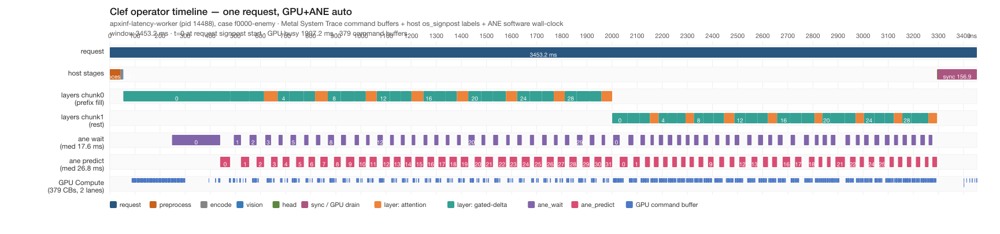

# 算子级 ANE+GPU 时间线（os_signpost 插桩）

Clef Flash 9B × Mario decision demo 的**单请求**算子级时间线：host 算子标签、
ANE 调用区间与 Metal 硬件 command buffer 条对齐到同一时间轴。

- 测量机：Apple M1 Pro 16 GB，macOS 27.0.1 (26A434)，MLX arch `applegpu_g13s`
- 组合：`auto` = GPU composition + MLP columns on ANE（`APXINF_MODEL_VARIANT=auto`）
- 案例：`f0000-enemy`（1 图、1 问、303 tokens = 37 prefix + 266 rest）
- 时间线图：

## 1. 插桩

### 1.1 env 门控

`APXINF_CLEF_SIGNPOST=1` 打开 `os_signpost` 区间；**未设置时零开销**：
每次 `signpost_interval!` 展开后只做一次 relaxed atomic load + 分支，
`$arg` 表达式位于 enabled 分支内才求值 —— 无分配、无字符串格式化、无 FFI。
（`crates/apxinf-model/src/metal_clef/signpost.rs`）

signpost 使用 subsystem `com.apxinf.clef`、category `PointsOfInterest`
（Instruments 的 Points of Interest instrument 默认收录该 category）。

### 1.2 覆盖点与参数

| 标签 | 参数 | 覆盖 |
| --- | --- | --- |
| `request` | images | `decide_schema` 全程（含答案整理） |
| `preprocess` | images | PNG 解码 + patchify |
| `encode` | images, questions | tokenizer 编码（token 数要等编码结束才知道，故带 request shape） |
| `vision` | rows | vision tower + merger（`rows=480` patch 行） |
| `layer` | index, mixer, tokens, cached | 每个 backbone layer；`cached=0` = chunk0 prefix fill，`cached=1` = chunk1 rest |
| `head` | tokens, questions | joint schema head |
| `ane_wait` | layer, tokens | `to_bytes_ready` 等 pack（GPU/ANE overlap 窗口） |
| `ane_predict` | layer, tiles, tokens | Core ML predict 阶段 |
| `sync` | logits | `to_f32_vec` 最终 stream drain |

### 1.3 为什么需要 C shim

`os_signpost_interval_begin/end` 的公开 API 是**宏**，底层是 clang 编译期
`__builtin_os_log_format`（format 与每个参数都必须对编译器可见），Rust 无法展开。
`crates/apxinf-model/native/signpost_shim.c` 按 kind `switch`，对每个算子用
**字面量 format** 调用宏，暴露两个统一入口（`apx_sp_begin` 变参 /
`apx_sp_end`）。每个 span guard 在 drop（含 `?` 提前返回）时发配对的
interval end；**作用域必须与被测阶段一致**（§4 记录了本次踩到的反例）。
`build.rs` 仅在 `mlx` + macOS/aarch64 时编译该 shim，Linux/CUDA 隔离构建不受影响。

机制验证：先用 shim harness 录了一次（非 Clef 请求），导出
`OSSignpostIntervals` 确认 9 类标签全部出现且参数正确，再录 Clef 请求。

## 2. 录制

### 2.1 命令与流程

```bash
xctrace record --template "Metal System Trace" --instrument "Points of Interest" \
  --output <dir>/op.trace --no-prompt \
  --env APXINF_MODEL_VARIANT=auto --env APXINF_COREML_CACHE=<cache> \
  --env APXINF_CLEF_FUSION=0 --env APXINF_CLEF_PREFIX_CACHE=1 \
  --env APXINF_CLEF_PREFIX_CACHE_TIER2=1 --env APXINF_CLEF_SIGNPOST=1 \
  --launch -- <worker> <1-case job>
```

录制窗口内按既定纪律执行（`devlocal/signpost-operator-timeline/scripts/run_recording.py`）：

1. `df` 检查 ≥15 GiB；ANE idle probe（含两把 Metal 锁空闲、2 s Swapouts）
2. 依次取 `~/.cache/enginetailor/metal-measure.lock` → `/tmp/enginetailor-metal.lock`
3. 用**录制同一二进制**预热 content-addressed Core ML cache（未编译约 55 s）
4. A/A：同一 case、关 signpost 再跑一遍 → **max|Δp| = 0.000e+00**（决策与概率逐位一致）
5. `xctrace record` 只录这 1 个请求；失败/超时立刻删 `.trace` 与系统 TMPDIR
   里**本次新增**的 `instruments*.ktrace`

### 2.2 录制环境的 TCC 边界（重要）

第一次 `--launch` 录制挂死：worker 0% CPU 卡在 `open()`（`metal_clef::load`
读 checkpoint）。一个专用 open-probe 在**同一录制命令**下证明：

- worktree 路径、系统路径的 `open()` 正常（100/100、20/20 轮）
- `~/Documents`（TCC 保护区）下 checkpoint 文件的 `open()` **永久阻塞**

挂死期间 kdebug 缓冲写出 **10.87 GiB** 的 `instruments*.ktrace`（已按要求删除，
Data 卷回到 ~37 GiB 可用）。处理：用 APFS clone（`cp -c`，同卷、不占额外空间）
把 checkpoint 与 case image 暂存到 `devlocal/`（TCC 边界外），job 指向暂存路径，
录制随即成功。原 `~/Documents` 路径在录制中不可用，这是**本机录制的硬约束**，
不是 ApxInf 代码问题。

### 2.3 录制次序（take 记录）

| take | 结果 | 处置 |
| --- | --- | --- |
| 1 | worker 卡在 `open(~/Documents/…)`，10.87 GiB ktrace | 按政策删除 |
| 2 | **成功** → 本文件与时间线图的数据来源 | 保留 `results/op.trace` |
| 3 | 修正 guard 作用域后重录：录制完成，但 Instruments **收尾阶段死锁**
（xctrace 等 DTServiceHub，DTServiceHub 等未完成的 NSOperation，0% CPU） | 180 s 超时，删 `.trace` + 0.8 GiB ktrace |

因此**图来自 take 2 的二进制**（encode/sync guard 尚为 function-scoped），
本 PR 代码是修正后的版本；两者除这两处 guard 作用域外走完全相同的
layer/ANE/GPU 路径，不影响图中的 layer、ANE、GPU 数据。encode 的作用域错误
在导出阶段做了机械修正（§3.3），take 3 因 Instruments 收尾死锁无法作为
替代录制。

## 3. 导出与对齐

### 3.1 表与 XPath

```bash
xctrace export --input <dir>/op.trace --xpath \
  '/trace-toc/run/data/table[@schema="OSSignpostIntervals"]'    # 我们的算子标签
xctrace export --input <dir>/op.trace --xpath \
  '/trace-toc/run/data/table[@schema="metal-gpu-intervals"]'    # 硬件 GPU 条
```

另有 `time-info`（mach 时间基）、`process-info`。两表的 start **均为
trace-relative 纳秒**，直接以 `request` signpost 起点 `t0` 对齐，
图上时间 = `(start − t0)`，单位 ms。

### 3.2 窗口与过滤

- 请求窗口 = `request` 区间 `[t0, t0+3453.2 ms]`
- GPU 行按 launched pid 过滤（525 行 / 379 command buffer / 379 encoder，
  全部 `state=Active`，channel `Compute`，device `M1 Pro`）

### 3.3 `encode` 区间的作用域修正（机械、可复现）

take 2 的 `encode` guard 写在 `decide_schema` 函数作用域，直到函数返回才关，
录出 3410.1 ms（几乎等于整个请求）。导出脚本按一条通用规则修正：
**区间内出现“非允许子标签”即判定 guard 未在阶段边界关闭**（`request` 允许
所有子标签；`layer` 允许自己的 `ane_wait`/`ane_predict`；其余不允许），
截断到第一个意外子标签的起点。本次仅 `encode` 命中：

- 记录值 3410.1 ms → 截到 `vision` 起点 51.30 ms → **8.22 ms**
- 该 8.22 ms 仍包含 encode 之后的 embedding dequant + mRoPE positions，
  故图中标为 **上界（≤8.2 ms）**，`summary.json` 的 `corrections` 字段留痕。

代码侧已把 encode/sync guard 改为块作用域（§2.3 take 3 即用修正后二进制录制，
但收尾死锁）。

## 4. 结论

请求窗口 **3453.2 ms**；host stages 212.3 ms + 64 个 layer 区间 3240.6 ms
= 3452.9 ms，**账目闭合到 0.3 ms**。

### C1. ANE predict 是最大单项阻塞，wait 次之

| 分量 | 时长 | 占请求 |
| --- | --- | --- |
| `ane_predict`（64 次 Core ML） | 1599.7 ms（median 26.8 ms） | 46.3 % |
| `ane_wait`（64 次 `to_bytes_ready`） | 1321.6 ms（median 17.6 ms） | 38.3 % |
| layer 内 host 图构建残差 | 319.3 ms | 9.2 % |
| host stages（preprocess/encode/vision/head/sync） | 212.3 ms | 6.1 % |

layer 区间 = 图构建 319.3 + wait 1321.6 + predict 1599.7 = 3240.6 ms。
**下一步优化的主战场是 ANE 往返（predict 服务时延 + 与 GPU 的排队关系），
不是 host 图构建。**

### C2. prefix cache 把 backbone 切成两趟 32 层，且小前缀那一趟更贵

| pass | tokens | 32 层 host | 其中 wait | 其中 predict | predict / 层 |
| --- | --- | --- | --- | --- | --- |
| chunk0 prefix fill（`cached=0`） | 37 | **1946.8 ms** | 759.5 ms | 937.6 ms | 29.3 ms |
| chunk1 rest（`cached=1`） | 266 | 1293.8 ms | 562.2 ms | 662.1 ms | 20.7 ms |

chunk0 少 7× token 却慢 1.5×，来源：(a) **冷启动**——chunk0 `layer0` 单层
425.5 ms（首次 wait 191.8 ms + 首次 predict 39.4 ms），而 chunk1 `layer0`
61.5 ms；(b) chunk0 的 ANE predict 整体慢约 40 %（29.3 vs 20.7 ms/层）；
(c) chunk0 的 wait 窗口内我方 GPU 活动只覆盖 59.5 %（452.2/759.5 ms），
存在无我方命令缓冲的间隙（见 C5 桌面干扰）。layer 中位数：chunk0 47.4 ms
vs chunk1 40.4 ms。

### C3. GPU/ANE overlap 在稳态趟按设计生效（host 窗口口径）

| 窗口 | 窗口总长 | 其中我方 GPU 活动 | 覆盖率 |
| --- | --- | --- | --- |
| chunk1 wait | 562.2 ms | 542.9 ms | **96.6 %** |
| chunk1 predict | 662.1 ms | 489.2 ms | **73.9 %** |
| chunk0 wait | 759.5 ms | 452.2 ms | 59.5 % |
| chunk0 predict | 937.6 ms | 233.7 ms | 24.9 % |

全部 wait 窗口合计覆盖我方 GPU busy 的 995.1/1907.2 ms（52.2 %），
predict 窗口再覆盖 722.9 ms（37.9 %）—— **两者合计包住 90.1 % 的我方 GPU 活动**：
GPU 基本是在 ANE wait/predict 的 host 阻塞窗口里执行的，这正是列切分
“GPU 与 ANE 并行”的预期形态。稳态的 chunk1 趟里，wait 窗口几乎总有 GPU 在跑
（96.6 %），predict 窗口 73.9 % 有 GPU 在跑。

### C4. 末端 `sync` 很小，因为队列已被 64 段 wait 碎片化排干

`sync`（`to_f32_vec` 最终 drain）= **156.9 ms**，其中我方 GPU 活动仅 13.6 ms。
作为**结构对照**（非受控对比）：本分支 Chrome Trace 的 reference 组合首请求
末端 `logits_sync` ≈ 2485 ms（单一大 drain，且 Chrome 会强制 vision eval）；
auto 组合下 drain 被拆成 64 段 wait，末端只剩 156.9 ms。两次录制条件不同，
仅说明**执行结构**变了，不作收益结论。sync 窗口内我方 GPU 活动占比很低，
剩余部分为图求值 host 开销与争用，本录制无法进一步拆分。

### C5. 环境干扰：请求窗口内 GPU 大部分在服务桌面

请求窗口内 `metal-gpu-intervals` 共 **4917 行**：我方 525，**WindowServer +
Ventura（壁纸）4392**。表现：chunk0 的 wait 窗口有 326.5 ms 不含我方 GPU
活动（典型如首个 wait 内一段 ~93 ms 只有 WindowServer/Ventura 行）；本机
`Swapouts` 在整个锁窗口 +63980 页，Data 卷 92 % 满。

因此：**绝对时延与 busy 比例是“本机 + 桌面负载”下的数值，不可外推、
不可用作 latency KEEP 证据**（Swapouts ≠ 0）。结构性结论（顺序、分解、
overlap 机制、归因边界）不受影响。两把 Metal 锁只排除其他 ApxInf 活动，
**不排除 WindowServer/Ventura 的 GPU 争用**——下次需要干净绝对数时，
应在 GPU 安静的主机上重录（并避开 Core AI，见 §5）。

## 5. 归因边界（必须随图一起读）

1. **GPU = 硬件 command buffer 级**。蓝色条来自 Metal System Trace 的
   `metal-gpu-intervals`：M1 Pro 上 command buffer 的执行区间
   （channel `Compute`，depth 0/1）。Metal 模板**不给 kernel 名**，
   MLX 也不给 kernel 命名，故 GPU 条的粒度就是 command buffer/encoder，
   不能读成单个 kernel。
2. **算子标签 = host os_signpost**。`request/preprocess/encode/vision/layer/
   head/ane_wait/ane_predict/sync` 是**请求线程上的 host 壁钟**：包住
   CPU 侧 lazy graph 构建、阻塞等待与 Core ML 调用。它们是**入队序/阻塞点
   证据，不是 GPU kernel span**；它们所代表的 GPU 工作落在其后（或并发）
   的 command buffer 上——vision 的 2.4 ms host 标签与其 GPU 执行分处不同
   条，就是这一点的直接例子。
3. **ANE = 软件轴 wall-clock**。`ane_wait`/`ane_predict` 是
   `to_bytes_ready` 与 `MLModel.predict` 的 host 阻塞时长；本机**禁止使用
   Core AI instrument**（与 Metal 组合会在 `dyld4::__open` 挂死；单独录
   会 0% CPU 卡死并写出 GB 级 ktrace），故 **ANE 硬件利用率/周期未测**。
   §C3 的 “overlap” 是 host 窗口求交，不是硬件计数器证据。

## 6. 产物与复现

维护产物（本 PR）：

- `docs/mario-opt/TIMELINE-OPERATOR.md`（本文）
- `docs/mario-opt/timeline-operator.png`（时间线图）
- `crates/apxinf-model/src/metal_clef/signpost.rs` + `native/signpost_shim.c`
  + `build.rs`（插桩）
- `crates/apxinf-model/src/metal_clef/{mod,model,ane,vision}.rs`（打点）

中间产物（`devlocal/signpost-operator-timeline/`，gitignored）：
`results/op.trace`（录制）、`results/export/{signposts,gpu,...}.{xml,json,csv}`
+ `summary.json`（导出与对齐）、`record_meta.json`（take 2 锁窗口/swap/A/A）、
`results/timeline.svg`、`logs/`（录制与样本栈）、`scripts/`（job 构建、录制、
导出、渲染）。`record_meta-take3-timeout.json` 留存 take 3 的失败元数据。

复现（录制需 §2.2 的暂存 checkpoint + GPU 安静窗口）：

```bash
export MLX_ROOT="$HOME/apxinf-runtime/mlx-sdk"
export RUSTFLAGS="-C link-arg=-Wl,-rpath,$MLX_ROOT/lib -C link-arg=-Wl,-headerpad_max_install_names"
cargo build --release --features mlx,coreml --bin apxinf-latency-worker
python3 devlocal/signpost-operator-timeline/scripts/run_recording.py --run --phase all
bash  devlocal/signpost-operator-timeline/scripts/render_timeline.sh
```
