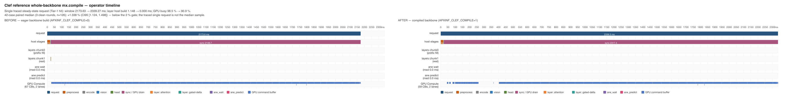

# Clef reference 整骨干 `mx.compile` — +1.34 % < 2 % → NOT-WORTH

参考档（`--model-variant reference`）把 32 层 backbone 编译成一个按 shape
准备好的可重放图，删掉每请求的 host 图构建。环境门控 `APXINF_CLEF_COMPILE`
默认 **OFF**；本记录给出实现、42 案 parity 和 3 轮反序测量，结论是
**NOT-WORTH（median 1.338 %，CI95 [1.124, 1.498]，低于 2 % 门）**。

- 测量机：Apple M1 Pro 16 GB，macOS 27.0.1（`applegpu_g13s`）
- 模型：`clef-flash-4bit-b5adbe2`，reference 组合，42 案 `separate-proto14`
- 服务端/worker：本 worktree `target/release/apxinf-latency-worker`，
  `--features mlx,coreml`，`APXINF_CLEF_FUSION=0`，Tier-1 ON、Tier-2 OFF
- 证据：`devlocal/clef-compile/`（git-ignored）

## 1. 起点（审计的前提）

`doc/notworth-audit.md` §3 #2 把这条列为 Clef 线重开第 2 项：

> reference 档每请求重建 ~230 ms lazy 图且 GPU 全程空闲；按 shape 准备一次
> compile 后，稳态请求跳过整段 host 建图 → 它与 GPU 执行串行的那部分被删掉；
> **~8–9 %**（230 ms / ~2500 ms；即 timeline 的 layer host 9.2 %）。

本棒按此实现并先测 parity，再测收益。结论是前提对 reference 档不成立：
**reference 档的整段 chunk1 host 建图是 ~0.96 ms，不是 ~230 ms**（§4）。
230 ms / 9.2 % 是 **auto 档** timeline 的 `layer` 残差（64 次 ANE
wait/predict 之外的 host 部分），不是 reference 档的 lazy 图构建。

## 2. 实现

`crates/apxinf-model/src/metal_clef/model.rs`：

- 按 `(prompt tokens, prefix tokens)` 准备 shape-specialized `Compiled`
  callable（`Compiled::new`，**不是** shapeless；tape 的 slice/reshape 在
  shapeless replay 下会抛）。
- 编译体接收：chunk1 hidden `[1, rest, width]`、mRoPE positions
  `[3, 1, rest]`，以及每层两个 prefix 状态（attention 的 K/V，或
  gated-delta 的 state/conv）——合计 **66 个输入**；输出是该 chunk 的
  final-norm hidden。
- `forward_layers` 抽出为 eager / compiled 共用的层循环；eager 路径
  （`backbone_forward`）在 profile 命中时走 `Compiled::call`，否则原样
  eager。**任何未准备的 shape（demo 的动态长度、Tier-2 的
  `media_end` prefix、文本请求）都自动 eager fallback**，不会逐请求
  retrace。
- `Network` 由 `Rc<Network>` 持有；编译体捕获 `Weak<Network>`，避免
  图 ↔ 模型的引用环。`install_compiled` 在 load 后对每个 profile 调用
  `Compiled::prepare`（trace + 2 次全量 replay），3 个 profile 的
  load 增量 ~7–9 s。
- 门控与 profile：
  - `APXINF_CLEF_COMPILE=1` 开启；默认 OFF。
  - `APXINF_CLEF_COMPILE_PROFILES=303:37,299:37,323:37`（prompt tokens :
    prefix tokens；42 案的 chunk1 分别为 266/262/286）。

## 3. Parity

同一 42 案、同一 Tier-1 配置，baseline（compile=0）与 candidate
（compile=1）各一次 measured 遍：

| 比较 | n | 决策一致 | max \|Δp\| | 判定 |
| --- | --- | --- | ---: | --- |
| compiled vs baseline（本仓 A/B） | 42 | **42/42** | **0.0**（逐位相同） | ✓ |
| compiled vs 冻结 MLX（`separate-proto14-001`） | 42 | **42/42** | **0.032783**（worst `f0045-enemy/enemy/true`） | ✓（门 0.035） |
| baseline vs 冻结 MLX（历史基线） | 42 | 42/42 | 0.032783 | ✓ |

编译体没有改变任何数值：`Compiled` replay 的是同一张 MLX 图，elementwise
融合顺序未变；42/42 逐位相同，parity 头寸没有被吃掉。**parity 不是这条的
卡点。**

## 4. 测量

协议：3 轮、奇数轮反序、每轮一个 Metal 锁窗口内两臂串行；每臂前后
`vm_stat`；**Swapouts ≠ 0 的轮不进池**。42 案不 warmup、每臂一遍 measured
（42 个唯一图像，Tier-2 OFF）——每个请求都走 chunk1 的 3 个 profile 之一。
每臂独立 worker 进程；compile 臂的 load+prepare 不计入 request latency。

| round | 臂序 | baseline 中位 | compiled 中位 | median gain | Swapouts b/c | compile hit/miss |
| --- | --- | ---: | ---: | ---: | --- | --- |
| 0 | baseline → compiled | 2188.146 ms | 2161.200 ms | **+1.202 %** | 0 / 0 | 42 / 0 |
| 1 | compiled → baseline（反序） | 2190.281 ms | 2168.481 ms | **+1.374 %** | 0 / 0 | 42 / 0 |
| 2 | baseline → compiled | 2197.863 ms | 2159.802 ms | **+1.431 %** | 0 / 0 | 42 / 0 |
| **pooled** | 3 轮、n=126 | — | — | **+1.338 %**，CI95 **[1.124, 1.498]** | 0 | 42/42/轮 |

- **3/3 轮干净**（两臂 Swapouts 均 +0，无外来模型进程）；每臂独立 worker
  进程；compile 臂 load+prepare ~8 s 不计入 request latency。
- compile 臂 **42/42 命中** 3 个 profile，**0 fallback**；两臂 parity
  每轮 42/42 决策、`max|Δp| = 0.0`（逐位）；vs MLX 每轮 42/42、
  `0.032783`（与 baseline 相同）。
- 88.1 % 的 case 更快；三轮回升方向一致（1.20 / 1.37 / 1.43 %），不是单轮
  噪声。**中位数 < 2 %，CI 上界 1.498 % 也 < 2 % → 不 KEEP。**

## 5. 为什么只有 ~1.3 %：host 建图不是 230 ms

同一 recorder（`APXINF_CLEF_CHROME_TRACE`）的单请求 trace（frame 0000
obstacle，reference，Tier-1，无 warmup）：

| span | baseline（compile=0） | compiled（compile=1） |
| --- | ---: | ---: |
| `request` | 2708.55 ms | 2812.09 ms |
| `logits_sync`（GPU drain） | **2482.64 ms** | **2533.51 ms** |
| `vision_gpu` | 210.27 ms | 263.13 ms |
| `preprocess` | 10.04 ms | 10.01 ms |
| `chunk1`（chunk1 的 host 图构建） | **0.96 ms** | **0.49 ms** |
| `chunk0`（首请求 Tier-1 fill） | 1.12 ms | 1.10 ms |
| `layer` 全部 host span（64 个） | **1.87 ms** | 2.23 ms（prepare 的 trace） |
| `head` | 0.33 ms | 0.32 ms |

- chunk1 的整段 32 层 host 图构建 = **0.96 ms**；编译后 call 的 host
  成本 = **0.49 ms**。即使把 host 建图完全删掉，上界也只有
  **0.96 / 2200 ≈ 0.04 %**，不是 6–7 %。
- 请求的 ~97 % 是 `logits_sync`（GPU 执行）；reference 档没有 ANE。
- 230 ms / 9.2 % 的来源是 [TIMELINE-OPERATOR.md](TIMELINE-OPERATOR.md)
  §4 的 auto 档：`layer` 区间 3240.6 ms − ANE wait 1321.6 − ANE predict
  1599.7 = **319.3 ms（9.2 %）**。这 319.3 ms 是 auto 层内 host 残差，
  **不能**外推到 reference；同一行 timeline 的 reference 记录里
  `layer[cached=1]` 只有 **4.9 ms / 96 span**（joint 报告 §4）。


单请求 timeline（上图，同一 signpost recorder + xctrace）：**layer host build
1.148 ms → 0 ms**，GPU busy 98.5 % → 90.9 %，command buffer 67 → 59。该单请求
的 window 是 2173.6 → 2339.3 ms（trace 扰动/单样本）；42 案统计从不在 trace
下跑，权威数字是 §4 的 3 轮中位数 +1.338 %。

- 那 +1.34 % 来自哪里？compile 后 device 侧图的融合/调度有变化（单请求
  trace 的 GPU drain 甚至略慢，42 案 3 轮池化中位数却是 1.338 % 更快），属于
  **设备侧**的小收益，不是 host 建图。它稳定为正但低于 2 % 门。

## 6. 判定

- **NOT-WORTH**：median **+1.338 %**，CI95 **[1.124 %, 1.498 %]**，
  下界 > 0 但 **中位数 < 2 %**；parity 通过、Swapouts 0 不改变结论。
- `APXINF_CLEF_COMPILE` **保持默认 OFF**，不翻默认；实现留在实验分支
  的 OFF 门后，供后续与设备侧候选组合时复用。
- 审计 #2 的 ~8–9 % 预期按本记录 **下调为 ≤0.1 %（host 轴）**；真正
  319.3 ms 的 host 残差在 **auto 档**，而 auto 档在本机 42 案结构性
  Swapouts，暂不可作为 KEEP 测量。

## 7. 下一步候选

1. **auto 档的 319.3 ms 层内 host 残差**：如果 auto 42 案能恢复干净窗
   （或改用 N12/小 suite 的预声明协议），把 ANE wait/predict 之外的
   host 部分移出请求线程/编译化；预期上限 ~9 %，falsifier = auto
   Swapouts 仍不可测或收益 <2 %。
2. **reference 档设备侧**：97 % 时间是 GPU drain；只剩 kernel/GEMM
   级别的设备侧空间（audit §3 的 D3 线与 q4 GEMM 方向），host 侧不再
   有 Clef 候选。
3. **组合**：若未来某个设备侧候选已接近 2 %，可把整骨干 compile 作为
   +1.3 % 的叠加项重新评估（parity 逐位相同，叠加风险低）。

## 8. 证据与复现

- 实现：`crates/apxinf-model/src/metal_clef/model.rs`（`install_compiled`、
  `compiled_inputs`、`forward_compiled`、`run_compiled`、`forward_layers`）
  与 `mod.rs`（`Rc<Network>` + load 时安装）。
- 3 轮 campaign：`devlocal/clef-compile/results/compile-42-final/<stamp>/summary.json`
- 单轮 42 案：`.../compile-42-smoke/20261107-091938/summary.json`
- Chrome trace：`/tmp/trace-base.json`、`/tmp/trace-comp.json`（本次运行的
  recorder 输出；表见 §5）
- xctrace before/after：`devlocal/clef-compile/timeline/`（`runs/{baseline,
  compiled}/export/`、`timeline-compile-before-after.{svg,png}`）
- 运行器：`devlocal/clef-compile/scripts/run_paired_compile.py`

```bash
export MLX_ROOT="$HOME/apxinf-runtime/mlx-sdk"
export RUSTFLAGS="-C link-arg=-Wl,-rpath,$MLX_ROOT/lib -C link-arg=-Wl,-headerpad_max_install_names"
cargo build --release --features mlx,coreml --bin apxinf-latency-worker

python3 devlocal/clef-compile/scripts/run_paired_compile.py \
  --run --rounds 3 --run-root compile-42-final
```
